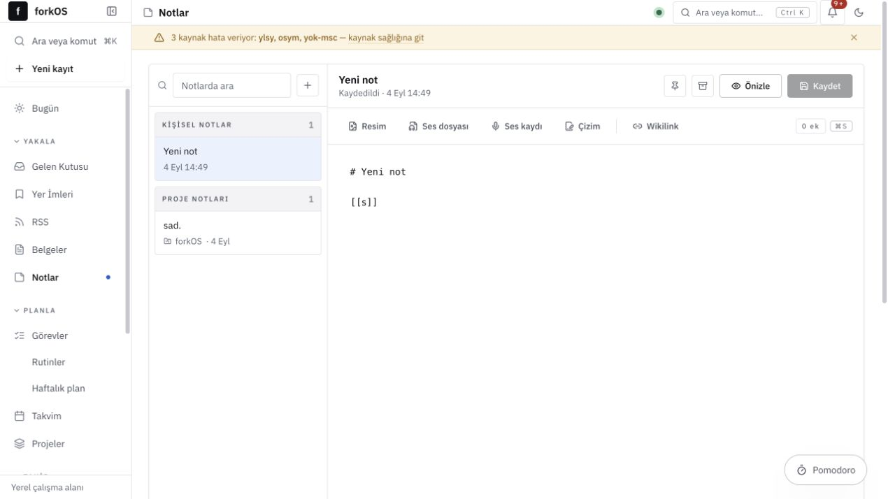
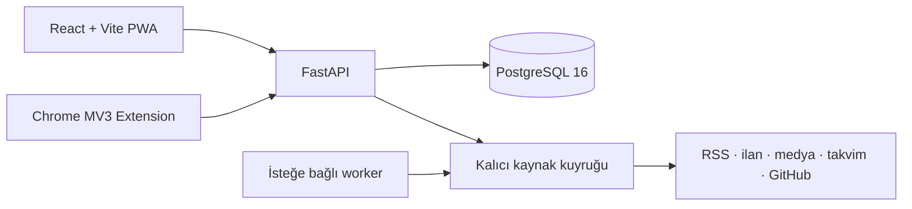

# forkOS

Kişisel verilerini kendi bilgisayarında tutan, tek kullanıcılı ve **local-only** bir kişisel işletim sistemi.

forkOS; yakalama, planlama, odaklanma, öğrenme, medya takibi, iş fırsatları ve kişisel bilgi yönetimini birbirine bağlı tek bir çalışma alanında toplar. Hosted backend, kullanıcı hesabı veya telemetri yoktur; uygulama varsayılan olarak yalnızca `127.0.0.1` üzerinde çalışır.



## Neler sunuyor?

| Alan | Yetenekler |
| --- | --- |
| **Yakala** | Evrensel gelen kutusu, web yer imleri, tam metin RSS okuyucu, yerel belgeler ve hızlı yakalama |
| **Düşün** | Markdown notları, klasörler, wiki bağları, görsel/ses/dosya ekleri, Excalidraw tuvali ve Obsidian tarzı bilgi grafı |
| **Yap** | Görevler, alt görevler, tekrarlayan rutinler, haftalık plan, takvim, Pomodoro ve günlük/haftalık değerlendirme |
| **Takip et** | Öğrenme ağacı ve SRS, medya kütüphanesi, flashcard'lar, projeler, GitHub etkinliği ve finans |
| **Fırsatları izle** | İş ilanı keşfi, CV uyumu, başvuru CRM'i, mülakat hafızası, YLSY/ÖSYM ve kamu duyuruları |
| **Koru** | Append-only aktivite geçmişi, kaynak sağlığı, dışa aktarma, sıkıştırılmış yedek ve felaket kurtarma akışı |

Sistemdeki aranabilir kayıtlar ortak `entity` omurgasını kullanır. Not, görev, proje, fırsat, belge ve medya kayıtları `link` ilişkileriyle birbirine bağlanır; anlamlı değişiklikler append-only `event` günlüğüne yazılır.

## Mimari



- **Frontend:** React 18, TypeScript, Vite, TanStack Query, Tailwind CSS
- **Backend:** FastAPI, SQLAlchemy async, Alembic, Pydantic
- **Veri:** PostgreSQL 16; FTS + unaccent + trigram arama
- **Çalıştırma:** Docker Compose veya Podman Compose
- **Otomasyon:** Varsayılan olarak kapalı APScheduler worker; manuel genel yenileme worker olmadan çalışır

Ayrıntılı sözleşmeler için [mimari rehberine](docs/mimari.md) bak.

## Hızlı başlangıç

### Gereksinimler

- Docker Desktop / OrbStack ve Docker Compose v2, **veya** Podman 4.7+
- Git

### Docker ile

```bash
git clone https://github.com/f0rknturkoglu/forkOS.git
cd forkOS
cp .env.example .env
make up CO="docker compose"
make migrate CO="docker compose"
```

Ardından:

- Web: [http://127.0.0.1:5173](http://127.0.0.1:5173)
- API: [http://127.0.0.1:8787](http://127.0.0.1:8787)
- OpenAPI: [http://127.0.0.1:8787/docs](http://127.0.0.1:8787/docs)
- PostgreSQL: `127.0.0.1:5433`

`Makefile` varsayılan olarak `podman compose` kullanır. Podman kullanıyorsan `CO` parametresini yazmana gerek yoktur.

## Günlük kullanım

```bash
# Servisleri aç / kapat
make up CO="docker compose"
make down CO="docker compose"

# Loglar ve servis durumu
make logs CO="docker compose"
make ps CO="docker compose"

# Şemayı güncelle
make migrate CO="docker compose"

# Yerel PostgreSQL dump'ı
make backup CO="docker compose"
```

Worker normal kullanımda kapalı kalabilir. Header'daki genel yenileme düğmesi RSS, fırsat/duyuru, medya, takvim, GitHub ve son tarih kaynaklarını tek turda günceller.

```bash
# Sürekli otomasyonla aç
make up-auto CO="docker compose"

# Worker'ı sonradan aç / kapat
make worker-up CO="docker compose"
make worker-down CO="docker compose"
```

LinkedIn doğrudan taraması otomatik turlara dahil edilmez; yalnızca açık bir manuel seçimle çalışır.

## İsteğe bağlı entegrasyonlar

Temel yerel özellikler hiçbir credential olmadan çalışır. Harici sağlayıcılar gerektiğinde Ayarlar ekranından veya `.env` üzerinden bağlanır.

```dotenv
GOOGLE_CLIENT_ID=
GOOGLE_CLIENT_SECRET=
GOOGLE_REDIRECT_URI=http://127.0.0.1:8787/api/auth/google/callback
EXTENSION_ID=
```

- Google OAuth: Drive belge metadatası ve Calendar aynası
- GitHub: proje commit/contribution bilgileri
- TMDB, AniList, OpenLibrary, MusicBrainz ve benzeri sağlayıcılar: medya kataloğu
- Kaynak adaptörleri: iş ilanları, YLSY, ÖSYM ve kamu duyuruları

Secret değerler export ve uygulama yedeklerine bilinçli olarak alınmaz.

## Tarayıcı eklentisi

1. `chrome://extensions` sayfasında **Developer mode** seçeneğini aç.
2. **Load unpacked** ile `extension/` klasörünü seç.
3. Eklenti seçeneklerinden API adresini `http://127.0.0.1:8787/api` olarak ayarla.
4. Oluşan extension ID'yi `.env` içindeki `EXTENSION_ID` alanına yaz ve servisleri yeniden başlat.

Backend kapalıyken yakalanan kayıtlar eklentinin yerel outbox'ında bekler. `client_uuid` tekrar denemelerin çift kayıt üretmesini engeller.

## Test ve doğrulama

```bash
# İzole, geçici PostgreSQL üzerinde backend testleri
make test CO="docker compose"

# Backend + frontend + extension + API sözleşmesi + production build
make verify CO="docker compose"
```

Testler kişisel `lifeos` veritabanına bağlanmayı reddeder ve yalnızca adı `_test` ile biten geçici veritabanında çalışır. Test projesi iş bitince container, network ve volume'ünü kaldırır.

Backend şeması değiştiğinde API sözleşmesini eşleştir:

```bash
cd backend
python scripts/export_openapi.py
cd ../frontend
npm run api:generate
```

## Yedekleme ve geri yükleme

- `make backup`: PostgreSQL custom-format dump üretir.
- Uygulamadaki yedekleme: taşınabilir, gzip sıkıştırılmış JSON üretir.
- `/backup/restore`: mevcut veriyi silmeden, çakışmasız birleştirerek içe aktarır.
- `make disaster-restore`: açık onay isteyen, safety dump alan gerçek felaket kurtarma akışıdır.

Veri klasörleri, kişisel ayarlar, OAuth token'ları ve üretilmiş cache dosyaları Git'e alınmaz.

## Dizin yapısı

```text
backend/       FastAPI, SQLAlchemy modelleri, migration'lar ve kaynak adaptörleri
frontend/      React/Vite uygulaması, modül registry'si ve ortak UI sistemi
extension/     Chrome MV3 yakalama eklentisi
docs/          Yaşayan mimari ve ürün görselleri
.agents/       Projeye özel agent becerileri ve guardrail'ler
compose.yaml   Yerel çalışma ortamı
```

Geliştirme kuralları için [AGENTS.md](AGENTS.md), migration zinciri için [backend/alembic/README.md](backend/alembic/README.md) dosyasını oku.

## Güvenlik ve gizlilik sınırı

forkOS tek kullanıcı içindir ve auth içermez. `BIND_ADDR=127.0.0.1` değerini native Linux/Docker ortamında değiştirme; `0.0.0.0` uygulamayı yerel ağa açabilir. Harici kaynaklar yalnızca içerik çekmek veya kullanıcının açıkça yapılandırdığı entegrasyonu çalıştırmak için çağrılır; kişisel veritabanı bir bulut servisine senkronlanmaz.
