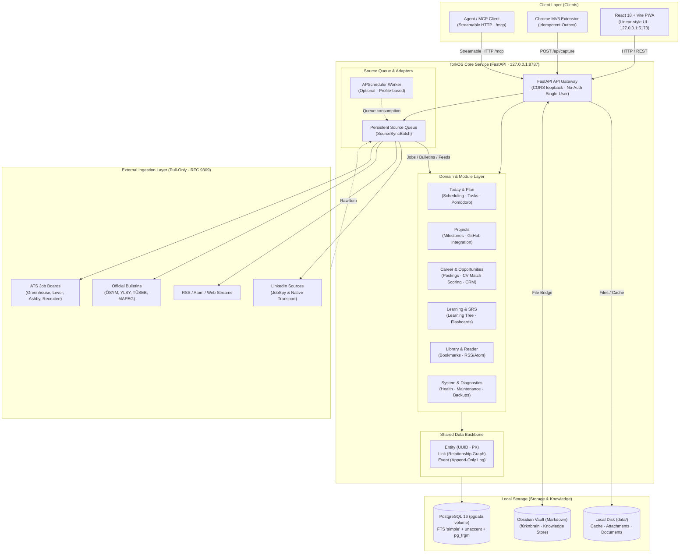

# forkOS (v1.0)

**[🇬🇧 English](README.md) | [🇹🇷 Türkçe](README.tr.md)**

[](docs/mimari.md)
[](.agents/skills/local-privacy-audit/SKILL.md)
[](backend/alembic/README.md)
[](backend/)
[](frontend/)
[](LICENSE)

> [!NOTE]
> **Hobby Project & Personal Backstory:**<br>
> forkOS is purely an **individual hobby project**. It was started during my internship to cope with depression and mental exhaustion, rediscover the excitement and vitality of building things, and create a fun playground for development. Its core motivation is fun, personal learning, and organizing my own daily workflow.
>
> *(Türkçe açıklama için [README.tr.md](README.tr.md) dosyasına bakabilirsiniz.)*

A single-user, **local-only** personal operating system that keeps all your personal data strictly on your own hardware.

forkOS brings task execution, weekly planning, deep focus (Pomodoro), spaced repetition learning (SRS/Flashcards), career opportunity tracking (ATS/Public Portals/LinkedIn), full-text RSS reading, and bookmark archiving together into a single interconnected workspace. There is no hosted backend, no user account system, and no telemetry; all services run strictly bound to `127.0.0.1` by default.

---

## 1. Core Philosophy & Dual-Ownership Architecture

* **forkOS owns execution:** Tasks, weekly time blocks, calendar, Pomodoro sessions, learning progress/SRS cards, job & academic opportunities, RSS streams, and an append-only event log live inside the forkOS PostgreSQL database.
* **Obsidian owns knowledge:** Notes, daily journals, project briefs, learning summaries, and literature reviews reside in your local Obsidian Vault as Markdown files. forkOS communicates with these files solely through bridge endpoints (`/api/obsidian/*`). There is no dual-ownership or mirroring complexity.
* **Zero Telemetry & Egress-Free Boundary:** Data leakage to the outside world (external CDNs, font trackers, analytics SDKs, cloud APIs) is strictly blocked. The only outbound network requests permitted are **pull-only content retrievals** from user-configured sources (RSS feeds, job postings, official announcements).

---

## 2. System Architecture



### Layer Responsibilities

1. **Client (Web / PWA & Extension):**
   * Dense, fast, and tranquil Linear-inspired UI built with `@/core/ui` design tokens and primitives.
   * Chrome MV3 extension: One-click bookmark, job posting, or quote capture. Keeps items in a local `chrome.storage` outbox when offline; drains idempotently using `client_uuid` once the backend is reachable.
   * Model Context Protocol (MCP) Streamable HTTP interface (`/mcp`): Provides local AI assistants with 37 bounded, auditable tools.
2. **Core Data Backbone (`entity`, `link`, `event`):**
   * **Entity:** Primary keys of all domain records foreign-key to `entity.id` (UUID). Unified search, tagging, and navigation originate here.
   * **Link:** Bi-directional relationships between entities (e.g. Task ↔ Project, Job ↔ Resume/Doc).
   * **Event:** Append-only log. Events are never updated or deleted; streaks, activity heatmaps, and audit trails derive from this stream.
3. **Source Engine (Resilient Scraping & RFC 9309):**
   * Modular architecture based on the `SourceAdapter` contract.
   * Full RFC 9309 robots.txt compliance (graceful fallback on 4xx responses, polite rate limiting, circuit breaker backoff).
   * Alerting on 3 consecutive empty runs to prevent silent scrapers failures.

---

## 3. V1 Product Scope & Modules

| Area | Module | Capabilities |
| :--- | :--- | :--- |
| **Home** | **Today** | Daily plan, single **Attention** surface (upcoming deadlines, pending follow-ups, notifications), now/next cards, and focus sessions. |
| **Plan** | **Tasks & Routines** | Subtasks, priorities, tags, recurring routines, and weekly time blocks. |
| | **Calendar & Pomodoro** | Daily/weekly calendar view, Pomodoro timer with retroactive session logging and adjustment. |
| **Projects** | **Project Management** | Phases, milestones, GitHub commit/activity tracking, and project log bridging. |
| **Career** | **Opportunities & Postings** | 100+ ATS portals, public official bulletins (TÜSEB, MAPEG, ÖSYM, YLSY, EURES), and native LinkedIn guest crawler. |
| | **Match & CV Scoring** | Posting quality assessment, skill profile match (%0-%100), and two-stage recommendation score against master CV. |
| | **Application CRM** | Stage-by-stage pipeline tracking, interview prep notes, contact/company linking, and bulk cleanup/archiving. |
| **Learning** | **Learning Tree** | Topic taxonomy hierarchy, resource/document associations, and mastery percentage tracking. |
| | **Flashcards (SRS)** | SuperMemo/SM-2 based spaced repetition, decks, and daily review loop. |
| **Library** | **Bookmarks** | Pocket-style reader mode, highlights, estimated read times, and archiving. |
| | **RSS & Feeds** | Category-based RSS/Atom reader, Hacker News, GitHub Trending, and article discovery. |
| **System** | **System & Diagnostics** | Source health dashboard, circuit breaker states, disk/cache management, and JSON/PostgreSQL backup routines. |

---

## 4. Quick Start

### 🤖 One-Shot Agentic Setup

If you prefer having an AI coding agent (Claude Code, Cursor, Codex, Antigravity, or ChatGPT) set up forkOS automatically, simply pass the prompt from [**AGENTIC_SETUP.md**](AGENTIC_SETUP.md) to your agent. It will configure the `.env` file, Obsidian Vault bridge, Hermes MCP connection, and launcher aliases (`forkos`, `forkos stop`, `forkos doctor`) in a single pass.

To run the interactive CLI setup wizard directly from your terminal:
```bash
make setup
```

---

### Manual Step-by-Step Setup

### Prerequisites

* **Container Runtime:** Docker Desktop, OrbStack, or Podman (Compose v2 supported)
* **CLI Tools:** Git, Make, Python 3.11+

### Steps

1. **Clone the Repository:**
   ```bash
   git clone https://github.com/f0rknturkoglu/forkOS.git
   cd forkOS
   ```

2. **Prepare Environment Variables:**
   ```bash
   cp .env.example .env
   ```
   *(Default configuration is pre-configured to run on `127.0.0.1`; no credentials required.)*

3. **Start forkOS:**
   ```bash
   # Using Docker / OrbStack:
   make up CO="docker compose"

   # Using Podman:
   make up
   ```

   > **Automated Migration Gateway:** The one-shot `migrate` service in `compose.yaml` automatically applies Alembic migrations (`alembic upgrade head`) and prepares the database schema before the API and Web UI initialize.

4. **Access the System:**
   * **Web UI:** [http://127.0.0.1:5173](http://127.0.0.1:5173) (Dev) or [http://127.0.0.1:8788](http://127.0.0.1:8788) (Stable)
   * **API Swagger / OpenAPI:** [http://127.0.0.1:8787/docs](http://127.0.0.1:8787/docs)
   * **PostgreSQL:** `127.0.0.1:5433` (`lifeos` / `lifeos`)

---

## 5. Runtime Modes

| Target | Command | Description |
| :--- | :--- | :--- |
| **Daily (Stable)** | `make up CO="docker compose"` | Pre-built frontend + production uvicorn. No HMR or file watcher; friendly to SSD wear. |
| **Development (Dev)** | `make up-dev CO="docker compose"` | Vite dev server with HMR, `uvicorn --reload`, and directory bind mounts enabled. |
| **Obsidian Hybrid** | `make up-obsidian CO="docker compose"` | Stable runtime + binds `OBSIDIAN_VAULT_HOST_PATH` from `.env` directly to the API. |
| **Full Automation** | `make up-auto CO="docker compose"` | Stable runtime + enables the background APScheduler worker service. |
| **Shutdown** | `make down CO="docker compose"` | Stops all containers safely; preserves personal PostgreSQL volumes. |

### Desktop Launcher (macOS & Linux)

To control forkOS with simple terminal commands:
```bash
make install-launcher
source ~/.zshrc    # or ~/.bashrc
forkos            # Starts system with health verification and opens browser
forkos stop       # Shuts down services gracefully
forkos doctor     # Runs 11-point system diagnostics
```

---

## 6. Browser Extension (Chrome MV3)

1. Navigate to `chrome://extensions` in your browser and enable **Developer mode**.
2. Click **Load unpacked** and select the `extension/` directory from the repository.
3. In the extension settings, confirm that the API endpoint is set to `http://127.0.0.1:8787/api`.
4. Optionally paste the extension ID into the `EXTENSION_ID` key in your `.env` file.

*The extension safely stores captures in its local offline outbox and drains them idempotently when forkOS is online.*

---

## 7. Backups & Data Integrity

* **PostgreSQL Dump (Full Safety):**
  ```bash
  make backup CO="docker compose"
  ```
  Generates a timestamped custom-format PostgreSQL dump under `backend/backups/`.
* **Portable JSON Backup:**
  Export a single-click gzip JSON archive directly from the Web UI (`Settings → System & Backup`).
* **Selective Backup Policy:**
  Backups selectively target meaningful user data. Transient source run logs (`source_run`) and OAuth credentials are excluded to guarantee clean, unbloated restorations.
* **Disaster Recovery:**
  ```bash
  make disaster-restore CO="docker compose"
  ```

---

## 8. Testing & Quality Verification

forkOS enforces strict architectural invariants (Entity PK/FK constraints, single-statement migrations, simple FTS config) verified via automated test suites:

```bash
# Run isolated backend test suite (operates in an ephemeral DB, never touches personal data)
make test CO="docker compose"

# Run full project verification (Backend + Frontend Lint/TypeCheck + API Contract Sync)
make verify CO="docker compose"
```

---

## 9. Directory Structure

```text
forkOS/
├── backend/            # FastAPI, SQLAlchemy 2.0 models, Alembic migrations
│   ├── app/
│   │   ├── core/       # Entity, Link, Event, Runs, UI, and shared infrastructure
│   │   ├── modules/    # Module routers, models, and domain business logic
│   │   └── sources/    # SourceAdapters: ATS boards, RSS feeds, LinkedIn
│   ├── tests/          # Contract, integration, and isolation tests
│   └── alembic/        # Database schema migrations
├── frontend/           # React 18, TypeScript, Vite, TanStack Query, Tailwind CSS
│   ├── src/
│   │   ├── core/       # Design tokens, @/core/ui primitives, typed API client
│   │   └── modules/    # UI modules (Today, Todo, Career, Learning, Library...)
├── extension/          # Manifest V3 Chrome capture extension
├── docs/               # Architecture decision records and development specs
├── .agents/skills/     # Autonomous agent skills and guardrail rules
├── compose.yaml        # Standard stable container stack
├── compose.dev.yaml    # Live development (hot-reload) stack
└── Makefile            # Standard developer commands
```

---

## 10. Disclaimer & Limitation of Liability

> [!CAUTION]
> **Limitation of Liability (AS-IS):**<br>
> This software is provided *"as is"*, without warranty of any kind, express or implied, including but not limited to the warranties of merchantability, fitness for a particular purpose, and non-infringement.
>
> In no event shall the author or copyright holder be liable for any claim, damages, data loss, third-party Terms of Service changes, or other liability, whether in an action of contract, tort, or otherwise, arising from, out of, or in connection with the software or the use or other dealings in the software. The operator who configures and runs forkOS assumes all responsibility for its local execution and usage.

---

## 11. License

This project is licensed under the [MIT License](LICENSE). forkOS is open-source, transparent, and local-first.
