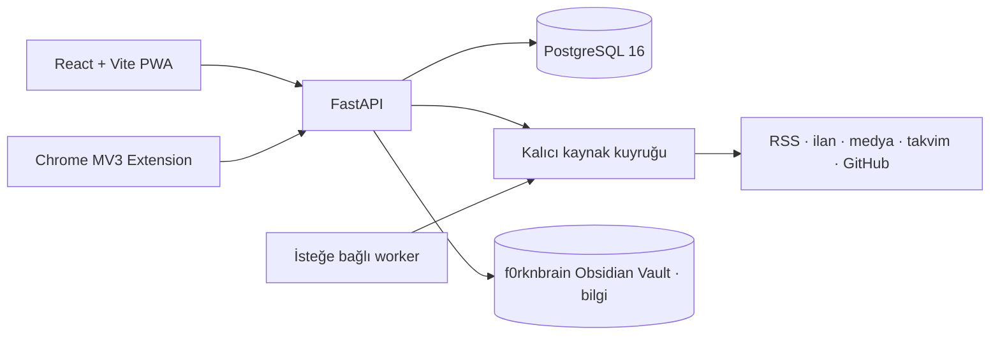

# forkOS

Kişisel verilerini kendi bilgisayarında tutan, tek kullanıcılı ve **local-only** bir kişisel işletim sistemi.

forkOS; yakalama, planlama, odaklanma, öğrenme, medya takibi, iş fırsatları ve operasyonel takibi birbirine bağlı tek bir çalışma alanında toplar. Hosted backend, kullanıcı hesabı veya telemetri yoktur; uygulama varsayılan olarak yalnızca `127.0.0.1` üzerinde çalışır.

**İki sahipli çalışma modeli.** forkOS **yürütmenin** sahibidir: görevler, plan, takvim, Pomodoro, öğrenme ilerlemesi/SRS, fırsatlar, RSS, medya ve olay geçmişi. Bilgi ise ayrı ve private `f0rknbrain` Obsidian Vault'unda yaşar: notlar, günlükler, proje bilgi notları ve günlükleri, öğrenme bilgi notları, kaynak notları. Aynalı Not sistemi yoktur. Ayrıntı: [PHASE 3 — bilgi sahipliği devri](docs/obsidian-hybrid/phase3-cutover.md).

## Neler sunuyor?

Navigasyon ürün alanlarına göre kurulur (tek kaynak: `docs/product-navigation.md`):

| Ürün alanı | Yetenekler |
| --- | --- |
| **Home** | Günün planı, tek **Dikkat** yüzeyi (son tarihler, takipler, bildirimler), şimdi/sırada, bekleyen kararlar |
| **Plan** | Görevler, alt görevler, tekrarlayan rutinler, haftalık plan, takvim, Pomodoro |
| **Projeler** | Proje aşamaları, ilerleme, GitHub etkinliği, proje günlüğü |
| **Kariyer** | İş ilanı keşfi, CV uyumu, başvuru CRM'i, mülakat hafızası, YLSY/ÖSYM ve kamu duyuruları |
| **Öğrenme** | Öğrenme ağacı ve SRS, flashcard'lar |
| **Kütüphane** | Yer imleri, evrensel gelen kutusu, tam metin RSS okuyucu, yerel belgeler, medya kütüphanesi, bilgi köprüsü |
| **Sistem** | Aktivite/ritim, finans, değerlendirme, kaynak sağlığı, yedekleme, ayarlar |

### Fırsatlardaki üç skor

Fırsatlar ekranında aynı ilan için üç ayrı ölçü vardır ve karıştırılmazlar:

| Skor | Aralık | Ne söyler | Nerede görünür |
| --- | --- | --- | --- |
| **Kalite skoru** | `-1..100` (`-1` = elendi) | Kaynak/kural tabanlı ilan kalitesi: beceri eşleşmesi, kıdem, konum, tazelik | Satırdaki TEK ana sayı |
| **Profil uyumu** | `%0..%100`, boş = hesaplanmadı | Becerilerinin ilan metniyle örtüşme oranı | Satırdaki ikincil "Uyum" chip'i ve ilan detayı |
| **Tavsiye skoru** | `0..100` | CV ile iki aşamalı değerlendirmenin önerisi (başvur / düşün / geç) | İkincil "Tavsiye" chip'i ve "Uyum" sekmesi |

"Skor hesaplanmadı" ile "0 puan" aynı şey değildir: hesaplanmamış kayıtlar ayrı filtrelenebilir. İlan metni veya profil değiştiğinde kayıtlı değerlendirme **bayat** işaretlenir ve yeniden hesaplanana kadar güncel gibi sunulmaz.

Sistemdeki aranabilir kayıtlar ortak `entity` omurgasını kullanır. Görev, proje, fırsat, belge ve medya kayıtları `link` ilişkileriyle birbirine bağlanır; anlamlı değişiklikler append-only `event` günlüğüne yazılır. Legacy Notlar bu omurgada arşivdir: `searchable=False` / `linkable=False` olduğu için arama ve ilişki panellerinde görünmez.

## Mimari



- **Frontend:** React 18, TypeScript, Vite, TanStack Query, Tailwind CSS
- **Backend:** FastAPI, SQLAlchemy async, Alembic, Pydantic
- **Veri:** PostgreSQL 16; FTS + unaccent + trigram arama
- **Bilgi:** private f0rknbrain Obsidian Vault; forkOS yalnızca `/api/obsidian/*` köprüsü ve modül köprüleriyle okur/yazar
- **Çalıştırma:** Docker Compose veya Podman Compose; günlük (stable) runtime ve geliştirme runtime'ı ayrıdır
- **Otomasyon:** Varsayılan olarak kapalı APScheduler worker; manuel genel yenileme worker olmadan çalışır

### Bilgi sahipliği ve Vault köprüsü

Notlar, günlükler, proje bilgi notları ve günlükleri, öğrenme bilgi notları ile kaynak notları Vault'ta Markdown olarak yaşar; forkOS bunları yalnızca köprü uçlarıyla (`/api/obsidian/capture`, `/ensure`, `/items/{id}`, `uri/search`, `/index/refresh`, proje günlüğü ve kaynak notu köprüleri) açar ve yazar.

- Navigasyondaki **Bilgi** sayfası (`/notes`) hafif bir köprü yüzeyidir: kasa adı, `Obsidian'ı Aç` / `Inbox` / `Bugünün Notu` / `Vault'ta Ara` ve `İndeksi yenile`. Not listesi, editör, klasör, ek, tuval ve bilgi grafı yoktur.
- `/notes?focus=<uuid>` eski Aktivite/yer imi bağlantıları için çalışmaya devam eder; not Vault'ta çözülür, legacy DB'ye düşen bir okuma yoktur.
- `/api/notes*`, `/api/note-folders*` ve `/api/graph` rota kaydı **yoktur**; legacy Notlar tabloları, ek deposu ve `note.*` olayları dondurulmuş arşiv olarak yerinde kalır (hiçbir migration tablo DROP etmez).
- Vault erişilemezse uygulama normal çalışır, yalnızca bilgi işlemleri açık hata verir (`503`/`403`); legacy Notlar'a düşen bir yedek yazma yolu yoktur.
- Domain grafiği (Entity/Link/Event, ilişki panelleri) korunur; forkOS artık hiçbir bilgi grafı görselleştirmesi render etmez.

### Ajan Entegrasyonu ve Hermes

forkOS canlı operasyonel durumunu ve f0rknbrain bilgi kasasını yerel yapay zeka ajanlarına (Hermes vb.) açmak için Model Context Protocol (MCP) tabanlı `/mcp` Streamable HTTP arayüzü sunar. Yüzey toplam **32 sınırlı araçtır**:

| Katman | Araç | Kapsam |
| --- | --- | --- |
| **H0** | 8 | operasyonel durum + f0rknbrain bilgi kasası **okuma** |
| **H1** | 11 | açıkça onaylanan güvenli **yazmalar** |
| **H2** | 5 | `90 Agent/Memory` altında küratörlü **sıcak hafıza** |
| **H3** | 1 | kökenli, sınırlı **kanıt getirme** (`forkos_evidence`) |
| **H4** | 1 | **yerel biliş** router'ı: sınıflandırma, sözleşmeli çıkarım, sorgu yeniden yazımı (`forkos_local_cognition`) |
| **H5** | 3 | **gözden geçirme zekâsı** ve anlamsal hafıza adayları (`forkos_review_intelligence`, `semantic_memory_candidates`, `semantic_memory_promote`) |
| **H6** | 1 | **proaktif dikkat kontrolü**: kapalı kural kümesi, koşu durumu, konfigürasyon ve kullanıcı override'ı (`forkos_proactivity`) |
| **H7** | 1 | **kalıcı karar ve sınırlı yürütme**: kanıta dayanan plan revizyonu, sunucu tarafı onay, adım başına durable makbuz ve kesintiye dayanıklı, H1 üzerinden yürütme (`forkos_execution`) |
| **A5** | 1 | H3 kanıtının isteğe bağlı yerel anlamsal önceliklendirmesi; varsayılan kapalı (`forkos_context_judge`) |

Yazma araçları `readOnlyHint=false` taşır; önerilen istemci güveni `untrusted`dır ve kullanıcı onayı istemci/harness tarafından yönetilir.

Backend ajan araçları için dış model/API'ye veri göndermez. H4 ve açıkça etkinleştirilmiş A5.1 yalnızca yapılandırılmış **loopback** yerel model süreçlerine gider. MCP araç sonuçlarını yapılandırılmış ajan harness'i tüketir: harness uzak bir model sağlayıcısı kullanıyorsa seçilen bağlam o sağlayıcıya model girdisi olarak gidebilir.

Ayrıntılı mimari, araç sözleşmeleri ve kurulum için [Hermes Brain Interface Rehberi](docs/hermes/README.md) dokümanına bak.

Ayrıntılı sözleşmeler için [mimari rehberine](docs/mimari.md) bak.

## Hızlı başlangıç

### Gereksinimler

- Docker Desktop / OrbStack ve Docker Compose v2, **veya** Podman 4.7+
- Git

### Docker ile

```bash
git clone https://github.com/f0rknturkoglu/forkOS.git
cd forkOS
cp .env.example .env
make up CO="docker compose"
make migrate CO="docker compose"
```

Ardından:

- Web: [http://127.0.0.1:5173](http://127.0.0.1:5173)
- API: [http://127.0.0.1:8787](http://127.0.0.1:8787)
- OpenAPI: [http://127.0.0.1:8787/docs](http://127.0.0.1:8787/docs)
- PostgreSQL: `127.0.0.1:5433`

```text
make up            → yalnız çekirdek forkOS (Vault bağlı DEĞİL)
make up-obsidian   → forkOS + f0rknbrain Obsidian Vault   ← günlük önerilen runtime
```

Bilgi köprüsü (Notlar, günlükler, proje günlükleri) Vault mount'u gerektirir:
`.env` içine `OBSIDIAN_VAULT_HOST_PATH` (host yolu) ve `OBSIDIAN_VAULT_NAME`
değerlerini yaz, sonra `make up-obsidian CO="docker compose"` ile başlat. Vault
mount'u yalnızca `api` servisine verilir; `web` container'ı Vault'u görmez ve
Vault dosyaları forkOS yedeğine girmez. `make up` sessizce farklı davranmaz:
hangi runtime'ı istediğini komut söyler.

`Makefile` varsayılan olarak `podman compose` kullanır. Podman kullanıyorsan `CO` parametresini yazmana gerek yoktur.

## Günlük kullanım

```bash
# Günlük (stable) runtime — Vite, HMR ve `uvicorn --reload` YOKTUR.
make up CO="docker compose"
make down CO="docker compose"

# Loglar ve servis durumu
make logs CO="docker compose"
make ps CO="docker compose"

# Şemayı güncelle
make migrate CO="docker compose"

# Yerel PostgreSQL dump'ı
make backup CO="docker compose"
```

### Runtime modları

forkOS'un iki çalışma biçimi vardır; ikisi de aynı portları kullanır
(web `127.0.0.1:5173`, API `127.0.0.1:8787`, PostgreSQL `127.0.0.1:5433`).

| Komut | Ne çalışır | Ne zaman |
| --- | --- | --- |
| `make up` | **Günlük (stable) runtime.** PostgreSQL + üretim modunda FastAPI + önceden derlenmiş frontend'i servis eden nginx. `compose.yaml` | Normal kullanım |
| `make up-dev` | **Geliştirme runtime'ı.** Yukarıdakine ek olarak Vite dev server, HMR, dosya izleyici (polling) ve `uvicorn --reload`; `backend/` ve `frontend/` bind mount edilir. `compose.yaml` + `compose.dev.yaml` | Kod yazarken |
| `make up-auto` | Günlük runtime + APScheduler worker (`--profile auto`) | Günlük kullanım, otomasyon açık |
| `make up-auto-dev` | Geliştirme runtime'ı + worker | Kod yazarken, otomasyon açık |
| `make up-obsidian` | Günlük runtime + Obsidian Vault mount (`compose.obsidian.yaml`) | Normal kullanım, bilgi köprüsü açık |
| `make up-obsidian-dev` | Geliştirme runtime'ı + Vault mount | Kod yazarken, bilgi köprüsü açık |
| `make up-auto-obsidian` | Günlük runtime + worker + Vault mount | Otomasyon açık, bilgi köprüsü açık |

Günlük runtime'da hiçbir dosya izleyici çalışmaz: SSD'ye sürekli yazan Vite
polling'i, HMR ve `--reload` yalnızca `compose.dev.yaml` içindedir. Backend
veya frontend kaynağını değiştirdikten sonra günlük runtime'ı yenilemek için
`make build CO="docker compose"` çalıştır ve servisleri yeniden başlat.

Compose dosyalarını doğrulamak için:

```bash
make config CO="docker compose"        # günlük runtime
make config-dev CO="docker compose"    # geliştirme runtime'ı
```

### Container logları

Tüm servislerde log rotasyonu açıktır (`max-size: 10m`, `max-file: 3`).
Varsayılan sürücü `json-file`'dır çünkü hem Docker hem Podman'da geçerlidir
(Podman'da `k8s-file`'a eşlenir). Docker'da daha verimli olan `local`
sürücüsünü tercih edersen:

```bash
LOG_DRIVER=local make up CO="docker compose"
```

Not: `podman compose` bazı sürümlerde `logging` bloğunu podman'a aktarmaz.
O durumda rotasyonu `~/.config/containers/containers.conf` içindeki
`log_size_max` ile sistem genelinde ayarla.

### Veri konumları

Günlük runtime'da uygulamanın **kodu** imajdan gelir, ama **yazdığı veri**
host'a bağlanır. Bu dizinler `compose.yaml` içinde hem `api` hem `worker`
servisine bağlanır; bağlanmasalardı container yeniden oluşturulunca kaybolurlardı.

| Yol (host) | İçerik |
| --- | --- |
| `backend/data/documents/` | yerel belge dosyaları |
| `backend/data/attachments/` | legacy not ekleri (binary, sha256 adıyla; dondurulmuş arşiv) |
| `backend/data/media/` | medya görsel önbelleği (yeniden üretilebilir) |
| `backend/data/cache/` | scraper önbelleği (yeniden üretilebilir) |
| `backend/data/config.yaml` | jobhunter uyum profili |
| `backend/backups/` | JSON yedekleri ve felaket kurtarma dump'ları |
| `backend/app/sources/forkjob_core/data/*.user` | jobhunter akışları ve LinkedIn profilleri |
| `forkos_pgdata` (volume) | PostgreSQL verisi |
| `OBSIDIAN_VAULT_HOST_PATH` (host) | f0rknbrain Obsidian Vault kökü — **bilgi burada yaşar**, forkOS yedeğine girmez |

Eski konumdaki `backend/config.yaml` ilk kullanımda `backend/data/config.yaml`
altına **kopyalanır** (silinmez).

### Göster ve arka planda güncelleme ayrıdır

Bir modülü gizlemek (Ayarlar → Modüller) yalnızca **arayüzü** kapatır: rota,
Home bileşenleri ve komutlar gizlenir; verisi silinmez. Arka planda dış
kaynağa çıkıp çıkmamak **ayrı** bir karardır ve Ayarlar → Modüller ekranındaki
"Arka plan güncellemesi" bölümünden yönetilir.

- `automation.opportunity.enabled`, `automation.media.enabled`,
  `automation.calendar.enabled`, `automation.github.enabled` — kapatıldığında
  worker o kaynağa **hiç çıkmaz**.
- RSS'in arka plan anahtarı kendi aralığıdır (`rss.interval_minutes = 0` →
  yalnız manuel). Aynı davranışı iki ayara bağlamamak için ikinci bir anahtar
  yoktur.
- **Elle aksiyonlar otomasyondan bağımsızdır:** header'daki yenileme, "Tümünü
  tazele" ve POST uçları otomasyon kapalıyken de çalışır.

Hazır çalışma profilleri teknik scheduler değerleri yerine tek seçim sunar:

| Profil | Ne yapar |
| --- | --- |
| **Elle** | Arka plan güncellemesi tamamen kapalı; yalnız manuel yenileme + yerel bakım |
| **Dengeli** (önerilen) | RSS 60 dk, fırsatlar 30 dk, takvim 60 dk, GitHub 3 sa, medya kendi 24 saati |
| **Aktif** | Daha sık turlar (RSS 30 dk, fırsatlar 15 dk, takvim 30 dk) |

Profil değişikliği worker'ı yeniden başlatmayı gerektirmez: işler aralıklarını
her turda ayardan okur.

### Açılış telafisi

forkOS çevrimdışı geçen süreyi telafi eder ama **worker'ı yeniden başlatmak tek
başına ağ patlaması yaratmaz**: açılış görevleri tazelik kapılıdır.

- RSS: yalnız süresi geçmiş feed'ler (aralık ayarına göre) çekilir.
- Takvim / GitHub: son tur yeterince yeniyse atlanır.
- Medya: kendi 24 saatlik aralığına uyar.
- Kritik kaynaklar: son 2 saat içinde koşmuşsa kuyruğa tekrar alınmaz.
- Yedek: taze ya da değişiklik yoksa atlanır.

Worker normal kullanımda kapalı kalabilir. Header'daki yenileme düğmesi RSS, fırsat/duyuru, medya, takvim, GitHub ve son tarih kaynaklarını tek turda günceller; yanındaki menüden kapsam seçilir:

- **Kritik kaynaklar** — yalnız resmî/hızlı kaynaklar (ÖSYM, YLSY, YÖK, ATS panoları)
- **Standart yenileme** (varsayılan) — opt-in kaynaklar hariç tümü + medya
- **Tam yenileme** — katalogun tamamı; EURES ve LinkedIn gibi yavaş/opt-in kaynaklar dahil

Worker kapalıyken de aynı kalıcı kaynak kuyruğu API arka planında işlenir; menüde çalışan yenilemenin kuyruk kimliği, ilerlemesi ve son sonucu görünür.

```bash
# Sürekli otomasyonla aç
make up-auto CO="docker compose"

# Worker'ı sonradan aç / kapat
make worker-up CO="docker compose"
make worker-down CO="docker compose"
```

LinkedIn doğrudan taraması otomatik turlara dahil edilmez; yalnızca açık bir manuel seçimle çalışır.

## İsteğe bağlı entegrasyonlar

Temel yerel özellikler hiçbir credential olmadan çalışır. Harici sağlayıcılar gerektiğinde Ayarlar ekranından veya `.env` üzerinden bağlanır.

```dotenv
GOOGLE_CLIENT_ID=
GOOGLE_CLIENT_SECRET=
GOOGLE_REDIRECT_URI=http://127.0.0.1:8787/api/auth/google/callback
EXTENSION_ID=
```

- Google OAuth: Drive belge metadatası ve Calendar aynası
- GitHub: proje commit/contribution bilgileri
- TMDB, AniList, OpenLibrary, MusicBrainz ve benzeri sağlayıcılar: medya kataloğu
- Kaynak adaptörleri: iş ilanları, YLSY, ÖSYM ve kamu duyuruları

Secret değerler export ve uygulama yedeklerine bilinçli olarak alınmaz.

## Tarayıcı eklentisi

1. `chrome://extensions` sayfasında **Developer mode** seçeneğini aç.
2. **Load unpacked** ile `extension/` klasörünü seç.
3. Eklenti seçeneklerinden API adresini `http://127.0.0.1:8787/api` olarak ayarla.
4. Oluşan extension ID'yi `.env` içindeki `EXTENSION_ID` alanına yaz ve servisleri yeniden başlat.

Backend kapalıyken yakalanan kayıtlar eklentinin yerel outbox'ında bekler. `client_uuid` tekrar denemelerin çift kayıt üretmesini engeller.

## Test ve doğrulama

```bash
# İzole, geçici PostgreSQL üzerinde backend testleri
make test CO="docker compose"

# Backend + frontend + extension + API sözleşmesi + production build
make verify CO="docker compose"
```

Testler kişisel `lifeos` veritabanına bağlanmayı reddeder ve yalnızca adı `_test` ile biten geçici veritabanında çalışır. Test projesi iş bitince container, network ve volume'ünü kaldırır.

Backend şeması değiştiğinde API sözleşmesini eşleştir:

```bash
cd backend
python scripts/export_openapi.py
cd ../frontend
npm run api:generate
```

## Yedekleme ve geri yükleme

- `make backup`: PostgreSQL custom-format dump üretir.
- Uygulamadaki yedekleme: taşınabilir, gzip sıkıştırılmış JSON üretir.
- `/backup/restore`: mevcut veriyi silmeden, çakışmasız birleştirerek içe aktarır.
- `make disaster-restore`: açık onay isteyen, safety dump alan gerçek felaket kurtarma akışıdır.

Yedek kapsamı **kullanıcı anlamlı** veridir: entity omurgası, bağlantılar, olay
geçmişi ve tüm modül tabloları (legacy not arşivi, görev, proje, öğrenme, medya,
finans, fırsat, yer imi, değerlendirme, belge, etiket, ayarlar…).

Kapsam dışı bırakılanlar:

- `oauth_token` — erişim/yenileme token'ları hiçbir zaman dışa çıkmaz.
- `source_run`, `source_sync_batch` — kaynak sağlığı ve kuyruk ilerlemesi;
  kullanıcı verisi değil, bir sonraki çekim turu yeniden üretir. Geri
  yüklendiklerinde eski sağlık geçmişi yeni veriyle karışıp devre kesici
  kararlarını yanıltırlardı.

Eski yedekler geriye dönük uyumludur: payload'da bulunan ama artık kapsam
dışı olan tablolar restore sırasında sessizce atlanır.

Bilgi tarafı bu kapsamın dışındadır: PHASE 3'ten sonra yazılan notlar, günlükler
ve kaynak notları f0rknbrain Vault'unda yaşar ve kendi Git/senkron stratejisiyle
yedeklenir — forkOS yedeğine **kopyalanmaz** (çift sahiplik yaratmamak için).
Legacy Notlar tabloları ve kullanılan ekler arşiv olarak yedekte kalmaya devam
eder; bu, Notlar ürününü geri getirmez ve DB → Vault otomatik yeniden göçü
yoktur ([PHASE 3](docs/obsidian-hybrid/phase3-cutover.md) §3).

### Zamanlanmış yedek ne zaman atlanır

Gece yedeği **anlamlı veri değişmediyse atlanır**: aynı veriyi her gece yeniden
yazmanın anlamı yok. Değişiklik sinyali `event` geçmişinden türetilir
(`backend/app/modules/system/dirty.py`) — uygulamada anlamlı her mutasyon zaten
olay yazar. Şunlar "değişiklik" **sayılmaz**:

- worker kalp atışı ve diğer makine durumu,
- kaynak koşuları / kaynak kuyruğu ilerlemesi,
- kaynak sağlığı bildirimleri,
- cache bakımı (RSS budama, görsel önbelleği temizliği).

Ayar değişiklikleri, görev/proje/medya/finans/fırsat düzenlemeleri ve bunun gibi
tüm kullanıcı aksiyonları bir sonraki turda yedeği **tetikler**. Vault'a yazılan
bilgi forkOS yedeğine girmediği için bu kapıyı tetiklemez.

Elle **"Backup now"** bu kapıyı kullanmaz; her zaman yedek üretir.

Veri klasörleri, kişisel ayarlar, OAuth token'ları ve üretilmiş cache dosyaları Git'e alınmaz.

## Saklama ve bakım

forkOS yalnızca **yeniden üretilebilir operasyonel** kayıtları budar. Kişisel
verin (legacy not arşivi, görev, proje, fırsat, medya, finans, belge, etiket,
bağlantı, anlamlı `event` kayıtları) hiçbir saklama kuralına tabi değildir.
PHASE 3'ten sonra yazılan bilgi zaten forkOS veritabanında değildir.

| Veri | Saklama |
| --- | --- |
| `source_run` — sorunsuz koşular (`ok`/`empty`) | 30 gün |
| `source_run` — sorunlu koşular (`partial`/`error`/`abandoned`) | 90 gün |
| `source_run` — kaynak başına **son 20 koşu** | her durumda kalır |
| `source_sync_batch` — terminal batch'ler | 60 gün |
| `source_sync_batch` — aktif batch'ler | **asla silinmez** |
| `notification` — okunmuş/kapatılmış | 90 gün |
| `notification` — okunmuş/kapatılmış ve `importance >= 3` | 180 gün |
| `notification` — okunmamış ve kapatılmamış | **asla silinmez** |
| `event` | **asla budanmaz** (kişisel aktivite hafızası) |

Kaynak sağlığı kararları (devre kesici, sessiz ölüm alarmı, kapsam küçülmesi
tespiti) bu geçmişten türetildiği için "son 20 koşu" kuralı eşiklerden
bağımsızdır. Ayrıntılı politika: `backend/app/core/retention.py`.

Budama, hafif bakım mekanizmasıyla günde en fazla bir kez çalışır ve hiçbir
ağ çağrısı yapmaz.

- Bakım worker'dan **bağımsızdır**: worker açıkken gecelik zamanlanır, kapalıyken
  API açılışında arka planda (açılışı bloklamadan) bir kez denenir.
- Gün talebi tek bir atomik `INSERT ... ON CONFLICT ... WHERE day <> :day` ile
  alınır; API ve worker aynı anda denese bile yalnızca biri koşar.
- Adımlar birbirinden bağımsızdır: biri hata verirse diğerleri devam eder ve
  hata kayda geçer (`maintenance.last_run`, `system.maintenance` event'i).
- Kapsam: operasyonel saklama, RSS öğeleri ve medya görsel önbelleği. Ayrıntı:
  `backend/app/modules/system/maintenance.py`.

## Not ekleri (dondurulmuş arşiv)

Legacy Notlar eklerinin **binary içeriği veritabanında tutulmaz**:
`data/attachments/` altında, içeriğin `sha256` özetiyle adlandırılmış tek bir
dosyada durur. Veritabanındaki `note_attachment` satırı yalnızca metadata taşır
(id, not, ad, mime, boyut, sha256, tarih).

- **Yeni ek yazılmaz.** PHASE 3'ten sonra hiçbir ürün akışı not veya ek
  oluşturmaz; satırlar ve blob'lar **dondurulmuş arşiv**dir — günlük bakım
  budamasına girmez, global aramada görünmez ve kaynak parmak izi sabit kalır.
- **Ad güvenliği:** dosya adı hiçbir zaman istemciden gelmez, yalnızca
  özetten türetilir; `data/attachments` dışına yol üretilemez.
- **Dönüşüm:** eski `note.attachments` (base64 JSONB) içerikleri PHASE 2 göçünde
  Vault'a kopyalandı; not bazlı dönüşüm adımı (`convert_legacy_attachments`)
  PHASE 3'te bakımdan kaldırıldı, çünkü arşivi değiştirecek zamanlanmış iş
  kalmadı.
- **Yedek:** kullanılan ek blob'ları soğuk güvenlik arşivi olarak yedeğe girer
  (yetimler girmez) ve restore'da geri yazılır. Geri yüklemede içeriğin özeti
  anahtarla uyuşmazsa dosya **yazılmaz**. Bu, Notlar ürününü yeniden
  etkinleştirmez; PHASE 3'ten sonra yazılan bilgi f0rknbrain Vault'unda yaşar ve
  forkOS yedeğine girmez.

## Offline ve PWA cache'i

Offline mod **salt okunurdur**: mutation'lar hiçbir koşulda cache'lenmez.

Service worker yalnızca okunması anlamlı, küçük JSON yanıtlarını saklar. Beyaz
liste yanıt sözleşmesi üzerinden kurulur (`frontend/vite.config.ts`):

| Koşul | Değer |
| --- | --- |
| Origin | aynı origin |
| Metot | yalnızca `GET` |
| İçerik tipi | `application/json` |
| Gövde boyutu | en fazla 256 KB |
| Cache adı / girdi | `lifeos-api-v2`, en fazla 120 girdi, 7 gün |

Binary ve büyük yanıtlar cache dışıdır: `/api/export/*`, `/api/backup/*`,
`/api/documents/*/file`, `/api/media/assets/*`
ve JSON olmayan her yanıt. Boyut ölçümü **gövdeden** yapılır: `Content-Length`
gzip'li yanıtlarda hiç gelmez ve "yok"u sıfır saymak tavanı işlevsiz bırakır.

`localStorage` gibi Cache Storage de göç ettirilir: eski `lifeos-api` cache'i
yeni service worker activate olduğunda silinir
(`frontend/public/sw-cleanup.js`). Aksi halde Workbox'un expirasyon eklentisi
onu yönetemez ve binary'lerle dolu halde diskte kalırdı.

## Dizin yapısı

```text
backend/       FastAPI, SQLAlchemy modelleri, migration'lar ve kaynak adaptörleri
frontend/      React/Vite uygulaması, modül registry'si ve ortak UI sistemi
extension/     Chrome MV3 yakalama eklentisi
docs/          Yaşayan mimari ve ürün görselleri
.agents/       Projeye özel agent becerileri ve guardrail'ler
compose.yaml   Günlük (stable) çalışma ortamı
compose.dev.yaml  Geliştirme overlay'i (Vite + HMR + --reload)
compose.obsidian.yaml  Obsidian Vault mount overlay'i (yalnızca `api` servisi)
```

Geliştirme kuralları için [AGENTS.md](AGENTS.md), migration zinciri için [backend/alembic/README.md](backend/alembic/README.md) dosyasını oku.

## Güvenlik ve gizlilik sınırı

forkOS tek kullanıcı içindir ve auth içermez. `BIND_ADDR=127.0.0.1` değerini native Linux/Docker ortamında değiştirme; `0.0.0.0` uygulamayı yerel ağa açabilir. Harici kaynaklar yalnızca içerik çekmek veya kullanıcının açıkça yapılandırdığı entegrasyonu çalıştırmak için çağrılır; kişisel veritabanı bir bulut servisine senkronlanmaz.
