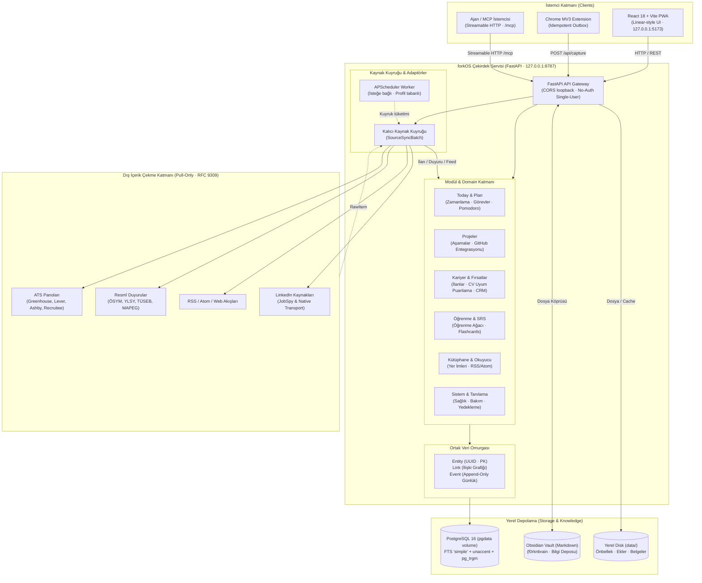

# forkOS (v1.0)

**[🇬🇧 English](README.md) | [🇹🇷 Türkçe](README.tr.md)**

[](docs/mimari.md)
[](.agents/skills/local-privacy-audit/SKILL.md)
[](backend/alembic/README.md)
[](backend/)
[](frontend/)
[](LICENSE)

> [!NOTE]
> **Hobi Projesi & Kişisel Hikâye (TR):**<br>
> forkOS tamamen **bireysel bir hobi projesidir**. Staj dönemimde yaşadığım depresyonu ve zihinsel yorgunluğu aşmak, bir şeyler üretmenin getirdiği heyecanı ve canlılığı yeniden hissetmek ve kendime eğlenceli bir geliştirme alanı yaratmak amacıyla başlatılmıştır. Temel motivasyonu eğlence, kişisel öğrenme ve kendi günlük iş akışımı organize etmektir.
>
> **Hobby Project & Personal Backstory (EN):**<br>
> forkOS is purely an **individual hobby project**. It was started during my internship to cope with depression and mental exhaustion, rediscover the excitement and vitality of building things, and create a fun playground for development. Its core motivation is fun, personal learning, and organizing my own daily workflow.

Kişisel verilerini kendi donanımında tutan, tek kullanıcılı ve **local-only** kişisel işletim sistemi.

forkOS; görev yürütme, haftalık planlama, derin odaklanma (Pomodoro), aralıklı tekrarla öğrenme (SRS/Flashcards), iş ve kamu duyurusu takibi (ATS/YLSY/ÖSYM/TÜSEB/MAPEG), tam metin RSS okuma ve yer imi arşivini birbirine bağlı tek bir çalışma alanında toplar. Barındırılan (hosted) backend, kullanıcı hesabı veya telemetri yoktur; servisler varsayılan olarak yalnızca `127.0.0.1` üzerinde çalışır.

---

## 1. Temel Felsefe ve İki Sahipli Mimari

* **forkOS yürütmenin sahibidir:** Görevler, haftalık zaman blokları, takvim, Pomodoro seansları, öğrenme ilerlemesi/SRS kartları, iş ve akademik fırsatlar, RSS akışları ve append-only olay geçmişi forkOS PostgreSQL veritabanında yaşar.
* **Obsidian bilginin sahibidir:** Notlar, günlükler, proje bilgi notları, öğrenme özetleri ve kaynak incelemeleri yerel bir Obsidian Vault'unda Markdown dosyaları olarak saklanır. forkOS bu dosyalara yalnızca köprü uçlarıyla (`/api/obsidian/*`) erişir. Çift sahiplik veya aynalama (mirroring) karmaşası yoktur.
* **Sıfır Telemetri & Dışarıya Kapalı Sınır:** Dış dünyaya veri sızıntısı (harici CDN, font izleyicileri, analitik SDK'ları, bulut API'leri) kesinlikle engellenmiştir. Dış ağa yapılan tek çağrı, kullanıcının yapılandırdığı kaynaklardan (RSS, iş ilanları, resmî duyurular) **yalnızca içerik indirmek (pull-only)** içindir.

---

## 2. Sistem Mimarisi



### Katman Sorumlulukları

1. **İstemci (Web / PWA & Extension):**
   * Modern, yoğun ve sakin Linear-tarzı arayüz (`@/core/ui` tasarım tokenları ve primitive'leri).
   * Chrome MV3 eklentisi: Tek tıkla yer imi, iş ilanı veya metin yakalama. Backend kapalıyken istekleri `chrome.storage` outbox'ında saklar; backend açıldığında `client_uuid` ile idempotent biçimde boşaltır.
   * Model Context Protocol (MCP) Streamable HTTP arayüzü (`/mcp`): Yerel yapay zekâ asistanlarına 37 adet sınırlı ve denetimli araç sunar.
2. **Çekirdek Veri Omurgası (`entity`, `link`, `event`):**
   * **Entity:** Tüm modül ana kayıtlarının PK'si `entity.id` (UUID) alanına foreign key'dir. Ortak arama ve navigasyon buradan yürür.
   * **Link:** Entity'ler arasında çift yönlü ilişki kurar (ör. Görev ↔ Proje, İlan ↔ Belge/CV).
   * **Event:** Append-only günlük. Hiçbir event güncellenmez veya silinmez; ritim, aktivite haritası ve denetim bu akıştan türetilir.
3. **Kaynak Motoru (Resilient Scraping & RFC 9309):**
   * `SourceAdapter` sözleşmesine dayalı modüler yapı.
   * RFC 9309 robots.txt uyumu (4xx yanıtlarda kısıtlamasız geçiş, API alt alan adlarında nezaket, devre kesici / backoff mekanizması).
   * 3 ardışık boş çekim alarmı ile sessiz ölümlerin engellenmesi.

---

## 3. V1 Ürün Kapsamı ve Modüller

| Alan | Modül | Yetenekler |
| :--- | :--- | :--- |
| **Home** | **Bugün (Today)** | Günün planı, tek **Dikkat** yüzeyi (yaklaşan son tarihler, takipler, bildirimler), şimdi/sırada kartları ve odak seansları. |
| **Plan** | **Görevler & Rutinler** | Alt görevler, öncelikler, etiketler, tekrarlayan rutinler, haftalık zaman blokları. |
| | **Takvim & Pomodoro** | Günlük/haftalık takvim entegrasyonu, geçmiş seans düzenleme/ekleme imkânına sahip Pomodoro sayacı. |
| **Projeler** | **Proje Yönetimi** | Proje aşamaları, kilometre taşları, GitHub commit/etkinlik izleme, proje günlüğü köprüsü. |
| **Kariyer** | **Fırsatlar & İlanlar** | 100+ ATS panosu, TÜSEB, MAPEG, ÖSYM, YLSY, EURES ve yerel LinkedIn tarayıcısı. |
| | **Uyum & CV Puanlama** | İlan kalitesi, beceri profili uyumu (%0-%100) ve CV ile iki aşamalı tavsiye skoru. |
| | **Başvuru CRM** | Aşamalı başvuru takibi, mülakat hazırlığı, kontak ve şirket eşleştirmesi, toplu arşiv/temizlik. |
| **Öğrenme** | **Öğrenme Ağacı** | Konu hiyerarşisi, kaynak ve döküman bağlantıları, ustalık yüzdesi takibi. |
| | **Flashcards (SRS)** | SuperMemo/SM-2 tabanlı aralıklı tekrar, desteler ve günlük gözden geçirme döngüsü. |
| **Kütüphane** | **Yer İmleri** | Pocket-benzeri tam metin okuma modu, vurgulama (highlights), okuma süresi tahmini ve arşivleme. |
| | **RSS & Akışlar** | Kategori bazlı RSS/Atom takibi, Hacker News, GitHub Trending ve makale keşfi. |
| **Sistem** | **Sistem & Tanılama** | Kaynak sağlığı göstergesi, devre kesici durumu, disk/cache yönetimi, JSON ve PostgreSQL yedekleme. |

---

## 4. Hızlı Başlangıç

### 🤖 Ajan ile Tek Adımda Kurulum (Agentic Setup)

forkOS'u Claude Code, Cursor, Codex, Antigravity veya ChatGPT gibi bir AI kodlama ajanına kurdurmak isterseniz, [**AGENTIC_SETUP.md**](AGENTIC_SETUP.md) dosyasındaki hazır promptu ajanınıza vermeniz yeterlidir. Ajan; `.env` dosyasını, Obsidian Vault köprüsünü, Hermes MCP bağlantısını ve terminal kısayollarını (`forkos`, `forkos stop`, `forkos doctor`) tek seferde kurup test eder.

Doğrudan terminalden tek komutla sihirbazı çalıştırmak isterseniz:
```bash
make setup
```

---

### Manuel Adım Adım Kurulum

### Önkoşullar

* **Container Runtime:** Docker Desktop, OrbStack veya Podman (Compose v2 destekli)
* **Araçlar:** Git, Make, Python 3.11+

### Adımlar

1. **Depoyu Klonlayın:**
   ```bash
   git clone https://github.com/f0rknturkoglu/forkOS.git
   cd forkOS
   ```

2. **Ortam Değişkenlerini Hazırlayın:**
   ```bash
   cp .env.example .env
   ```
   *(Varsayılan ayarlar `127.0.0.1` üzerinde çalışmak için hazırdır; herhangi bir credential girmeniz zorunlu değildir.)*

3. **forkOS'u Başlatın:**
   ```bash
   # Docker / OrbStack ile:
   make up CO="docker compose"

   # Podman ile:
   make up
   ```

   > **Otomatik Migration Geçidi:** `compose.yaml` içerisindeki one-shot `migrate` servisi, API ve arayüz başlamadan önce Alembic migration'larını (`alembic upgrade head`) otomatik olarak uygular ve veritabanı şemasını hazırlar.

4. **Uygulamaya Erişin:**
   * **Web Arayüzü:** [http://127.0.0.1:5173](http://127.0.0.1:5173)
   * **API Swagger / OpenAPI:** [http://127.0.0.1:8787/docs](http://127.0.0.1:8787/docs)
   * **PostgreSQL:** `127.0.0.1:5433` (`lifeos` / `lifeos`)

---

## 5. Çalışma Biçimleri (Runtime Modları)

| Hedef | Komut | Açıklama |
| :--- | :--- | :--- |
| **Günlük (Stable)** | `make up CO="docker compose"` | Önceden derlenmiş frontend + üretim uvicorn. HMR ve dosya izleyici çalışmaz; SSD dostudur. |
| **Geliştirme (Dev)** | `make up-dev CO="docker compose"` | Vite dev server, HMR, `uvicorn --reload` ve dizin bind mount'ları aktiftir. |
| **Obsidian Hibrit** | `make up-obsidian CO="docker compose"` | Günlük runtime + `.env` içindeki `OBSIDIAN_VAULT_HOST_PATH` yolunu API'ye bağlar. |
| **Tam Otomasyon** | `make up-auto CO="docker compose"` | Günlük runtime + APScheduler arka plan worker servisini devreye sokar. |
| **Durdurma** | `make down CO="docker compose"` | Tüm container'ları durdurur; kişisel PostgreSQL volume'ü korunur. |

### Masaüstü Başlatıcı (macOS & OrbStack)

Terminalden tek bir `forkos` komutuyla sistemi başlatmak için:
```bash
make install-launcher
source ~/.zshrc
forkos            # Sistemi sağlık kontrolleriyle ayağa kaldırır
forkos stop       # Güvenli biçimde kapatır
forkos doctor     # Sistem sağlığını raporlar
```

---

## 6. Tarayıcı Eklentisi (Chrome MV3)

1. Tarayıcınızda `chrome://extensions` adresine gidin ve **Geliştirici modu**nu (Developer mode) açın.
2. **Paketlenmemiş öğe yükle** (Load unpacked) düğmesine basarak repo içindeki `extension/` klasörünü seçin.
3. Eklenti seçeneklerinde API adresinin `http://127.0.0.1:8787/api` olduğunu doğrulayın.
4. Eklentinin ürettiği ID'yi `.env` dosyasındaki `EXTENSION_ID` değişkenine yazabilirsiniz.

*Eklenti, çevrimdışıyken yakalanan içerikleri kendi yerel hafızasında tutar ve sistem açıldığında güvenle iletir.*

---

## 7. Yedekleme ve Veri Güvenliği

* **PostgreSQL Dump (Tam Güvenlik):**
  ```bash
  make backup CO="docker compose"
  ```
  `backend/backups/` altında zaman damgalı PostgreSQL custom-format dump üretir.
* **Taşınabilir JSON Yedekleme:**
  Web arayüzünden (`Ayarlar → Sistem & Yedekleme`) tek tıkla indirilebilir gzip JSON yedeği alınabilir.
* **Seçici ve Temiz Yedek Politikası:**
  Yedekler yalnızca anlamlı kullanıcı verilerini kapsar. OAuth token'ları (`oauth_token`) ve geçici kaynak koşu günlükleri (`source_run`) güvenlik ve kararlılık gerekçesiyle yedeğe dahil edilmez.
* **Felaket Kurtarma:**
  ```bash
  make disaster-restore CO="docker compose"
  ```

---

## 8. Test ve Doğrulama

forkOS'un katı sözleşmeleri (Kural 1: entity.id FK, Kural 10: asyncpg tek SQL per op.execute, Kural 12: Turkish simple FTS vb.) otomatik testlerle korunur:

```bash
# Hızlı backend testleri (Geçici izole test veritabanında çalışır, ana veriye dokunmaz)
make test CO="docker compose"

# Tam doğrulama (Backend + Frontend Lint/TypeCheck + API Sözleşme Senkronu)
make verify CO="docker compose"
```

---

## 9. Dizin Yapısı

```text
forkOS/
├── backend/            # FastAPI, SQLAlchemy 2.0 modelleri, Alembic migration'ları
│   ├── app/
│   │   ├── core/       # Entity, Link, Event, Runs, UI ve ortak altyapı
│   │   ├── modules/    # Modül router, model ve iş mantığı servisleri
│   │   └── sources/    # SourceAdapter'lar: ATS, Kamu Duyuruları, RSS, LinkedIn
│   ├── tests/          # Sözleşme ve izolasyon testleri
│   └── alembic/        # Veritabanı şema versiyonları
├── frontend/           # React 18, TypeScript, Vite, TanStack Query, Tailwind CSS
│   ├── src/
│   │   ├── core/       # Tasarım tokenları, @/core/ui primitive'leri, API istemcisi
│   │   └── modules/    # UI modülleri (Today, Todo, Career, Learning, Bookmarks...)
├── extension/          # Manifest V3 Chrome yakalama eklentisi
├── docs/               # Mimari kararlar, yaşam döngüsü dokümantasyonu ve sözleşmeler
├── .agents/skills/     # Geliştirme agent becerileri ve değişmez kurallar
├── compose.yaml        # Standart ve kararlı çalışma ortamı
├── compose.dev.yaml    # Canlı geliştirme (hot-reload) ortamı
└── Makefile            # Standart operasyonel komutlar
```

---

## 10. Sorumluluk Reddi (Disclaimer)

> [!CAUTION]
> **Sorumluluk Reddi / Limitation of Liability:**<br>
> Bu yazılım *"olduğu gibi"* (AS-IS) ve hiçbir garanti (zımni, ticari, belirli bir amaca uygunluk vb.) olmaksızın sunulmaktadır. forkOS'un veya içerisindeki herhangi bir modülün (veri toplama, üçüncü taraf sitelerden/beslemelerden bilgi çekme, otomasyonlar vb.) kullanımından, veri kayıplarından, üçüncü taraf platformların hizmet koşulları (ToS) değişikliklerinden veya sisteminizde doğabilecek doğrudan/dolaylı hiçbir teknik veya hukuki sonuçtan **geliştirici hiçbir sorumluluk kabul etmez**. Sistemi kuran ve çalıştıran kullanıcı, tüm kullanımın ve yerel yapılandırmanın tek sorumlusudur.
>
> *This software is provided "as is", without warranty of any kind, express or implied. In no event shall the author or copyright holders be liable for any claim, damages, or other liability arising from, out of, or in connection with the software or the use or other dealings in the software.*

---

## 11. Lisans

Bu proje [MIT Lisansı](LICENSE) kapsamında sunulmaktadır. forkOS açık kaynaklı, şeffaf ve yerel-öncelikli bir kişisel projedir.
