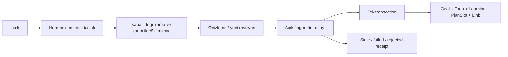

# Goals 2.0 — Yaşayan hedefler

## Ürün akışı

`/goals` tek Hedefler alanıdır. Kullanıcı amacını ve ayırabileceği zamanı yazar;
`Uzun vadeli` aynı ürünün dönemli hedef tercihidir. Hermes içerik önerir, sunucu
tipli bir pakete dönüştürür, kullanıcı önizlemeyi düzenleyip onaylar. Başarılı
onay hedefin yol haritasını açar. Manuel hedef oluşturma bağımsız çalışır.

Ana görünüm çalışma ilerlemesini, sıradaki işleri, öğrenmeyi ve takvim planını
gösterir. Ölçümler, model bağlantı ayrıntıları, tarihsel planlar ve V1 düzenleyicileri
isteğe bağlı açılır. Bir sınav puanının ölçülmemesi, hazırlık işlerinin tamamlanmasıyla
giderilmez: gerçek sonuç ve çalışma ilerlemesi ayrı kalır.

## Kanonik sahiplik

| Kayıt | Sahibi | Yol haritasında saklanan |
| --- | --- | --- |
| Hedef ve alt hedef | Goal | hedef referansı, dönem/aşama bağlantısı |
| Görev ve tamamlanması | Todo | kanonik görev referansı |
| Öğrenme alanı/konu/kaynak | Learning | kanonik konu/kaynak referansı |
| Proje ve milestone | Project | kanonik proje referansı |
| Çalışma günü/süresi | Todo PlanSlot | önizlemede öneri; uygulamada gerçek PlanSlot |
| Sonuç ölçümü | V1 KeyResult sağlayıcısı | ayrı sonuç read model'i |
| Düğüm | GoalRoadmapNode + Entity | ad, açıklama, sıra, ağırlık, üst düğüm, tür, kapı, çıkarılma |
| Bağlantı | Link | `targets`, `advances_goal`, `prepares_for`, `roadmap_requires` |

`GoalRoadmapNode.id` entity FK'sidir. Durum ve yüzde sütunları içermez. Tüm durumlar
okuma sırasında asıl modüllerden alınır. Entity helper'ları ve append-only event
defteri kullanılır. `roadmap_requires` normal Link yazma uçlarında değiştirilemez;
tipli paket revizyonu döngü kontrolünü uygular.

## Paket ve onay sözleşmesi

Hermes `PackageDraft` semantik içerik üretir: başlık, ölçülebilir hedef tanımı,
aşamalar, milestone'lar, konular, görevler, dönemli alt hedefler, aday token'ları,
plan niyeti ve açıklamalar. UUID, SQL, araç çağrısı, tamamlanma veya ölçülmüş güncel
puan kabul edilmez. Mevcut kayıtlar en fazla 30 doğrulanmış yerel aday ile önerilir.

`compile_draft()` token'ları yeniden doğrular; çalışma tarihlerini, sahipliği,
bağımlılıkları, mevcut adım indekslerini ve tam eşleşmeleri çözerek kararlı anahtarlarla
`StudioProposal(schema_version=2)` üretir. Tam eşleşme dahi önizleme/onay gerektirir.
Mevcut alan/konu/görev kullanımı kopya oluşturmaz. Benzer başlık tek başına birleşme
kanıtı değildir. Yeni kaynak URL'si üretmek yerine kaynak ihtiyacı kaydı açılır.
Bookmark kullanımı Learning'in kanonik `attach_bookmark` köprüsünden geçer; kurs ve
kart destesi bağları konu Kaynaklar bölümünde görünür. Otomatik Anki ithali yoktur.

Kapalı operasyonlar: Goal create/update, KR save, milestone create/update,
roadmap create/update, Learning area/topic/resource, Todo create/update,
PlanSlot schedule/explicit replacement, doğrulanmış Record Link. Görev düzenleme
tamamlanma alanı içermez. Aşama değişimi ve çıkarılması asıl kayıtları silmez.

Paket en fazla 160 operasyon / 120 KB, ilk taslak en fazla 20 görev ve 28 çalışma
bloğu içerir. V1'in 20 operasyon sınırı ve tarihsel proposal okumaları korunur.
Önizleme değişince eski fingerprint onaylanamaz; sunucuda yeni revizyon gerekir.

V1 Studio session/revision tabloları, TTL, sağlayıcı kökeni, consent kilitleri,
idempotent tur teslimi, SSE ve kayıp cevap uzlaştırması yeniden kullanılır.
Yeni altyapı veya ikinci bir agent motoru yoktur. Önizleme dry-run'ı nested transaction
içinde geri alınır. Onay en güncel revizyonu, süresini, fingerprint'i, referans
kayıtların önceki durumlarını ve plan uygunluğunu kontrol eder. Domain helper'ları
`commit=False` ile aynı transaction'a katılır. Hata sonrası tüm domain yazmaları
geri alınır; hata receipt'i kalır. İkinci onay aynı gerçek ID'leri ve PlanSlot ID'sini
döndürür. Başarılı yeni paket görüşmesi yaratılan ana hedefe bağlanır.

## Hiyerarşi ve görünüm

Normal hedefin aşama → milestone → Todo/konu ağacı vardır. Uzun vadeli hedef dönem
→ alt Goal → aşama şeklindedir. Kanonik `parent_goal_id` ve graph referansları birlikte
döngü kontrolüne girer. Gelecek dönemler görevle doldurulmaz; boş milestone henüz
tamamlanmamış bir kapsam birimidir. İlk dönemin bitmesi tüm stratejiyi bitirmez.

React/SVG, mevcut bundle'a yeni graph paketi eklemeden deterministik yerleşim,
pan, yakınlaştırma, ekrana sığdırma, dal daraltma ve yön tuşları sağlar. Küçük ekranda
ağaç/liste vardır. Düğüm ayrıntısı asıl modüle gider; düzenleme de inceleme/onay
üzerinden çalışır. Hareket azaltma tercihi gözetilir. Görsel düzen operasyonel veri
değildir; yeni tarayıcı veri deposu eklenmez.

## İlerleme formülü

1. Todo `done` ve Topic `done` gerçek tamamlanma kanıtıdır. Tekrarlı şablon bilinmez;
   belirli occurrence ID'si kanıttır. Eksik/arşivli hedef kayıt `null` olur.
2. Kanonik ID aynı kabul edilmiş kapsamda yalnız bir kez sayılır. Parent Todo,
   aynı kapsamdaki alt görevlerinin yanında ikinci bir iş birimi değildir.
3. Bir konuya hazırlayan görevler ve konunun kendisi tek öğrenme gereksiniminde
   birleşir; kanıtlarının ortalaması görev bittiğinde de ilerleme sağlar. Sonra
   konunun bitmesi aynı gereksinimi tamamlar. Bilinmeyen kanıt bilinmez kalır.
4. Milestone alt işlerinin ortalamasıdır. Kullanıcının açık milestone tamamlaması
   kendi kabul kriterini karşılar. `completion_gate` milestone ise alt işler ve
   ayrıca sonuç onayı gerekir.
5. Aşama/dönem ağırlıklı birimdir. Hedef yüzdesi `sum(fraction * weight)/sum(weight)`;
   aynı iş ikinci aşama/proje/alt hedef yolundan tekrar payda oluşturmaz. Tekrar
   görünen iş ilk deterministik aşamaya aittir; yalnız tekrardan oluşan grup hariçtir.
6. Bilinmeyen gerekli birim veya kapsam kesilmesi toplamı `null` yapar. Bilinen ve
   toplam gereksinim sayıları ayrıca taşınır. Ara düğümler seçili hedef kapsamını,
   alt hedefin kendi sayfası kendi kapsamını gösterir.

Project aynı kanonik evidence helper'ını kullanır. Her proje milestone'u birimdir;
Goal içinde de bu milestone ağırlıkları korunur; yalnız görevlerin düz ortalaması
alınarak farklı bir proje yüzdesi üretilmez. Arşivli kriter belirsiz kalır.
atamasız görevler birer birimdir. Proje yüzdesi bu proje kapsamının ortalaması,
Goal yüzdesi aşama/dönem kapsamının ortalamasıdır. Çalışma veya link değişince merkezi
`invalidateAfter()` Goal/graph/workspace/Project/Planning/Learning okumalarını yeniler.
Gerçek dünya sonucu V1 KR sağlayıcılarında kalır; çalışma yüzdesi ölçüm yazmaz.

## Planlama ve takvim

İlk pencere İstanbul gününe göre 14 gündür. Kullanıcının açık kapasitesi korunur;
bilinmeyen kapasite günlük 30 dakika etiketli başlangıç varsayımıdır. Uzun iş
kapasiteye sığacak birden fazla gün bloğuna bölünür; kalan iş uyarısı gizlenmez.
Mevcut bloklar kapasiteden düşülür; süresi bilinmeyen blok olan gün atlanır.
Yeni paket mevcut slotu sessizce değiştiremez. Taşıma açık eski slot ID'siyle
onaylanır; gerçek teslim tarihi ayrı kalır.

Yeni kesin saat yalnız kullanıcıca onaylanmış çalışma aralığı varsa kabul edilir.
Mevcut manuel blok açıkça başka güne taşınırken kullanıcının saati, süresi ve notu
korunur; değiştirilecek eski blok da önizlemenin takvim snapshot'ına dahildir.
PlanSlot ve local ExternalEvent çakışması, günlük kapasite, uygun günler ve pencere
sunucuda kontrol edilir. Saat bilinmiyorsa all-day çalışma planıdır. Plan/Calendar
değişikliği önizlemeden sonra olursa revizyon stale olur. Aynı transaction kilidi
kanonik PlanSlot yazıcılarında da kullanılır. Google'a otomatik gönderim yapılmaz;
Google bağlantılı slot normal Planner üzerinden düzenlenir.

## Hermes bağlamı ve sınırı

Her yeni soruda `GoalContextSnapshot` yeniden hazırlanır: Goal/hiyerarşi, graph,
güncel Todo/konu/kaynaklar, gerçek slotlar, Project ilerlemesi, mevcut sonuç ölçümleri,
7/30/90 günlük anlamlı event pencereleri, ilgili kabul edilmiş Review snapshot'ları,
son paket kararları ve kayıtlı kapasite. İç içe alt hedeflerin kanonik işleri bu
kapsama dahildir; ayrılmış işler legacy bağlantılardan geri getirilmez. Kaynak
ihtiyacı ve kırılmış kaynak bağlantısı gerçek URL'den ayrı gösterilir.
Global notlar/Vault veya başka hedeflerin
anlatısı bağlama gönderilmez. Sağlayıcıya giden görünüm 20 KB ile sınırlı ve kesilme
işaretlidir. Kısa sorularda da seçili hedefin gerçek görevleri token'larla çözülebilir.

Hermes yalnız yorum veya tipli revizyon önerebilir. Yüzde, tarih, mevcut puan veya
etkinlik nedenini tahmin etmesi istenmez. Bozuk yapısal cevap bir kez aynı doğrulanmış
sağlayıcıyla düzeltilebilir; yine geçersizse hiçbir domain kaydı yazılmaz. Yerel profil
araçsızdır. Mevcut açık cloud consent, iptal ve sağlayıcı/model doğrulaması korunur.

## Migration ve V1

`0081_goal_roadmap` tek head'dir, `0080_goal_studio_capture` sonrasına eklenir.
Yalnız yeni tablo/index ekler; Goal/Entity/Event/Link çekirdeğini yeniden yazmaz.
V1 Goal, milestone, Plan, Pillar, KR, Studio ve Review geçmişi aynen kalır. Eski
Goal'ların graph'ı okuma adaptörüyle gösterilir; toplu dönüştürme yapılmaz.

0081→0080 boş graph'ta tabloyu düşürebilir. Kabul edilmiş graph satırları varsa
tablo/history korunur; tekrar upgrade idempotent'tir. Verili graph ile daha eski
Goal tablosunu düşüren derin downgrade FK tarafından engellenir; sessiz veri silme
yapılmaz. Üretim upgrade öncesi doğrulanmış safety dump saklanır.

## Sınırlar

500 Goal, toplam 10.000 graph satırı / Goal başına 1.000 düğüm, hiyerarşi 12 ve
düğüm derinliği 32 ile sınırlıdır. Graph okumaları batch hazırlanır; recursive
çocuk başına yeniden DB taraması yoktur. Agent snapshot'ında en fazla 60 düğüm,
100 görev/konu, 50 kaynak, 100 slot, 5 revision/Review bulunur; inference görünümü
daha küçüktür. Büyük kapsamda belirsizlik ve kesilme gösterilir.

Canlı modelin her istekte geçerli ve içerik olarak doğru taslak üretmesi garanti
edilmez. Bu durum onay/dry-run sınırında reddedilir. Kaynak araştırması yerel aday
keşfidir; internet taraması veya otomatik deste indirme yoktur. Doğal dilde tüm
müsaitlik ifadelerini çözme kapsamı sınırlıdır; typed preview bilinen kısıtları taşır.
Güncel doğrulama ve açık kalan sınırlar [kapanış kaydındadır](goals-2.0-closure.md).
