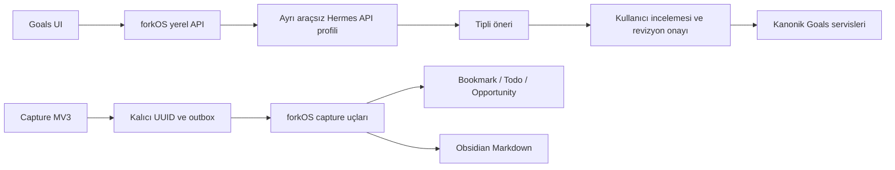

# Hermes Goal Studio ve Capture V1

Doğrulama tarihi: 11 Ekim 2026. Çalışma başlangıcı `05cb22c`; `b8124a9` sonrasındaki değişiklikler korunmuştur.

## 1. Doğrulanan mimari

Goal Studio `/goals` içinde bağlamsal bir çalışma alanıdır. Goals mevcut operasyonel Goal/Plan/Pillar/KR/Milestone servislerinin sahibidir. Yeni tablolar domain kopyası değil, oturum/revizyon ve teslim makbuzudur. Entity FK'leri ve append-only Event kullanılır. Capture Goals'tan ve Hermes'ten bağımsızdır.



H1'in 11 eylemi genişletilmedi. H2 hafızası otomatik okunmaz/yazılmaz; H3 bağlam, H4 yerel sınırlı extraction, H5 review, H6 dikkat ve H7 execution sözleşmeleri korunur. H4 stratejik akıl yürütme yerine kullanılmaz; H7'ye Goal yazma yetkisi eklenmez.

## 2. Hermes API taşıması

[Resmî API server belgesi](https://hermes-agent.nousresearch.com/docs/user-guide/features/api-server) ve kurulu `44fc5f629` kaynak ağacı incelendi. GET health/capabilities/toolsets, POST runs, GET run/status/events ve POST stop kullanılır. Oturum kimliği kararlıdır; tur UUID'si resmî `Idempotency-Key` olur. İlk turda seçilen bağlam gönderilir; sonraki turlarda tüm geçmiş tekrar gönderilmez. Kaybolan yanıt aynı kimlik ve aynı kaydedilmiş istekle uzlaştırılır. 23 saatten eski belirsiz tur otomatik tekrarlanmaz.

Hermes sürümü; profil kimliği, Bearer auth, run status/events/stop ve runs idempotency özelliklerini doğrulamadan hazır sayılmaz. Genel proxy, çağıran URL/model/provider/key alanı yoktur.

## 3. Güvenlik ve profil kurulumu

Örnek: `config/hermes-goal-studio/config.yaml`. Kullanıcının mevcut Hermes profiline uygulanmaz. Ayrı `forkos-goal-studio` profili ve ayrı daemon gerekir. API server platform araç kümesi **açıkça boş**, MCP/plugin/fallback kapalı; hafıza, background review ve curator kapalıdır. Profilde hook veya dolu cron jobs dosyası reddedilir. Yeni profil oluştururken global config, `.env`, auth, skills, hooks veya cron dosyalarını kopyalamayın.

Operatör, kendi Hermes kurulumunda ayrı profili oluşturur; yalnız örnek YAML'i yerleştirir. Bu profilin `.env` dosyasında ayrı `API_SERVER_KEY` ve yerel custom sağlayıcının gerekli ayarları tutulur. Dosya izinleri 0600 olmalıdır. Ollama örneği `qwen3.5:9b`, `http://127.0.0.1:11434/v1` kullanır. Model indirilmez veya Hermes otomatik açılmaz. Profil daemon'u kendi resmî Hermes CLI sürümünün `--profile forkos-goal-studio gateway run` komutuyla başlatılabilir. Lazy yüklemeleri engellemek için `HERMES_DISABLE_LAZY_INSTALLS=1` kullanın. Profilin curator kapalı ve cron listesi boş olduğunu ayrıca doğrulayın.

forkOS backend ortamı:

```dotenv
HERMES_GOAL_BASE_URL=http://127.0.0.1:8643/p/forkos-goal-studio
HERMES_GOAL_API_KEY=<yalnız-sunucuda-ayrı-profil-anahtarı>
HERMES_GOAL_PROFILE_CONFIG=<aynı-profilin-salt-okunur-config.yaml-yolu>
```

Anahtar browser, URL, frontend bundle, extension veya localStorage'a verilmez. Config dosyası ve yanındaki profil dizinleri güvenilen operatöre ait olmalıdır. Profil/anahtar değişirse daemon yeniden başlatılır. Browser Origin yalnız `http://127.0.0.1:5173` veya `http://localhost:5173`; Host yalnız loopback/localhost; mutation JSON + `X-ForkOS-Goal-Studio: 1` gerektirir. Extension ve MCP onay yolu yoktur. Hermes yalnız sayısal loopback HTTP adresine bağlanır; proxy ortamı ve redirect kapalıdır. İki eşzamanlı upstream bağlantı, 8 sn HTTP/25 sn stream, 64 KB istek/128 KB upstream/6000 karakter mesaj/20 tur sınırı vardır. SSE yalnız kamuya açık message.delta ve lifecycle olaylarını taşır; reasoning/raw tool payload'ları taşınmaz.

**Ağ yerleşimi:** API ve Hermes aynı loopback ağ alanında olmalıdır. macOS host Hermes'i normal OrbStack API container'ının `127.0.0.1` adresinde değildir. Bu değişiklik host.docker.internal veya LAN erişimini otomatik açmaz. Native forkOS API + native Hermes ya da aynı ağ alanındaki izole daemon kullanılmalıdır. Varsayılan Compose kurulumunda profil ayarlanmadan manuel Goals çalışır, Studio yapılandırılmamış/erişilemiyor gösterir. Container için profil dizinini salt okunur bağlayın ve env değerlerini ayrıca API'ye geçirin; örnek `.env` tek başına mount yaratmaz.

Hermes genel olarak bulut inference sağlayıcısı kullanabilir; UI bunu açıklar. Bu geçit yerel `custom` sağlayıcı ve loopback model adresini zorunlu kılar. Yerel sağlayıcı operatör tarafından değiştirilmiş bir bulut relay ise güvenilen ortam sınırı aşılmış olur; bu kod inference sunucusunun iç ağ davranışını kanıtlamaz.

## 4. Kullanıcı akışı ve onay yaşam döngüsü

“Hermes ile Hedef Hazırla” → yeni/seçili hedef → konuşma → yapılandırılmış taslak → düzenleme → yeni revizyon doğrulaması → **Bu revizyonu onayla ve uygula**. “Hermes ile Geliştir” seçili hedefi bağlam yapar. Manuel form ve mevcut overview korunur.

Oturum drafting/running/unknown_delivery/approval_pending/applied/rejected/stale/failed durumlarını gösterir. Revizyon ready_for_review → approved → applied veya failed olur; reject/stale ayrı terminal kararlardır. Approved durumu atomik transaction içinde kaydedilir; kalıcı approval Event ile nihai sonuç birlikte commit edilir. Chat “onayladım” metni yetki değildir. Red kanonik kayıt yazmaz. Durdurma isteği, gerçek koşu durumu uzlaştırılana kadar tamamlandı sayılmaz.

## 5. Yapılandırılmış şema ve revizyon

Pydantic `StudioProposal` version 1, generated TS üzerinden UI'ye gelir. En fazla 20 kapalı işlem: plan.create, pillar.create, goal.create/update, key_result.save, milestone.create/update. Her işlem canonical input contract'ını sarar; shell/SQL/file/tool/approval veya bilinmeyen alan kabul edilmez. İşlem anahtarları ve hedefler tektir; referanslar canonical UUID veya önceki işlem anahtarıdır.

Kanonik servisler tarih/plan/pillar/parent cycle/KR sağlayıcı/hedef/yol kurallarını savepoint dry-run içinde doğrular. Önizleme domain Event veya çocuk kayıt bırakmaz. Rationale, assumptions, evidence, missing ve warnings sınırlıdır. Her revizyon SHA256(proposal+before), öncesi snapshot ve 24 saat TTL taşır. İstemci revizyonu değiştirdiğinde onay kapanır; raw JSON editörü de bu kontrole dahildir. Yeni doğrulama yeni revizyon oluşturur. Hatalı model çıktısı discussion olarak kalır.

## 6. Kanonik Goals entegrasyonu

Onaydan önce Entity kayıtları kilitlenip güncel snapshot karşılaştırılır. Aynı oturumun kararları satır kilidi, materialization ise transaction advisory lock ile seri olur. Mevcut servisler `commit=False` destekleyerek tek transaction'a katılır; bağımlılık sırası korunur. Çocuklardan biri hata verirse hepsi savepoint ile geri alınır ve durable failed sonucu kaydedilir. Aynı applied revizyon tekrar onaylanırsa ilk sonuç kimlikleri döner.

Yeni manuel KR'lerin güncel ölçümü null'dır. Model manual_value veya milestone completion yazamaz. Mevcut KR güncel değeri/tarihi ve ölçüm Event sayısı korunur; yalnız tanım değişir. PATCH içindeki gönderilmeyen alanlar JSON/HTTP/revizyon roundtrip boyunca gönderilmemiş kalır; başlık değişikliği plan/ebeveyn/açıklama/tarih alanlarını temizlemez. H2 source-memory otomatik bağlanmaz; başlık benzerliğiyle kayıt eşleştirilmez. Sonuç bağlantıları EntityTypeSpec rotalarından türetilir; mutation `invalidateAfter('goal.write')` kullanır.

## 7. Extension sahipliği ve paket

`forkOS Capture` 0.2.0, Chromium Manifest V3. Gerçek 16/48/128 PNG ikonlar ve manifest kaynakları doğrulanır. Persistent content script yoktur; activeTab/scripting yalnız kullanıcı talebiyle sınırlı extraction yapar. İlk açılışta seçili metin alınır; büyük HTML veya tüm sayfa gövdesi gönderilmez. Metadata incelemesi kullanıcı tetiklemesiyle bounded DOM/JSON-LD okur; sayfanın scriptleri çalıştırılmaz.

Inbox/Bookmark, Quick Todo, Obsidian Note/Quote, job ve announcement yakalama korunur. Hermes sohbeti/planning veya yeni knowledge store eklenmez. Kısayol ve context menu korunur; non-sensitive tab/collection tercihleri hatırlanır. Popup gerçek seçili teslim sonucunu gösterir, otomatik kapanıp sonucu saklamaz. CSS display kuralları hidden niteliğini ezmez; yalnız etkin capture formu görünür.

## 8. Capture idempotency sözleşmesi

| Hedef | Yetkili sınır | Aynı kimlik / aynı içerik | Farklı içerik |
|---|---|---|---|
| Bookmark/Inbox | `/api/capture`, durable receipt + Bookmark client_uuid | aynı kayıt, replay | 409 |
| Todo | `/api/todos`, canonical create + durable receipt | orijinal TodoOut | 409 |
| Job/Announcement | `/api/opportunities`, canonical create + durable receipt | orijinal OpportunityOut | 409 |
| Obsidian | `/api/obsidian/capture`, mevcut UUID/fingerprint/atomik Markdown yazma | aynı forkos_id/dosya | mevcut conflict sözleşmesi |

DB receipt `client_uuid UNIQUE` + advisory lock ile canonical yazıyla aynı transaction'da commit edilir. Kayıp HTTP yanıtı veya service worker yeniden başlaması ikinci kayıt oluşturmaz. Receipt içerik SHA256 ve ilk response'u korur; sonraki kullanıcı düzenlemelerini eski response ile ezmez. Eski receiptless Bookmark kimliği yalnız mevcut kayıtla eşleşirse receipt'e alınır; alanlar sonradan değişmişse 409 ile inceleme ister. Bu durumda queued/failed payload silinmez.

## 9. Kuyruk ve yeniden deneme

UUID HTTP'den önce `chrome.storage.local` outbox'a kaydedilir. Popup mutation'ları yalnız background RPC'ye gider; service worker storage serializer/active flush kullanır. Eşzamanlı enqueue sırasında snapshot sonrası yeni öğeler korunur. Eski outbox/failedCaptures/lastResult anahtarları okunur; upgrade purge yoktur.

Her capture'ın saved/already_present/queued_offline/retry_pending/rejected/invalid_input/permanent_conflict/vault_unavailable/unknown_delivery sonucu vardır. 2xx response kimlik içermiyorsa başarı sayılmaz. Timeout/ağ/5xx belirsiz sonucu korur; 503 Vault notu kuyrukta tutar. 4xx reddi inspection panelinde payload ve HTTP koduyla kalır. Değişmeyen payload aynı UUID ile retry; düzeltilen permanent failure yeni UUID ve replace lineage kullanır, önceki payload history'de korunur. Kuyruk temizleme açık kullanıcı confirmation ister. Aggregate flush sayısı tek öğenin başarısı değildir.

API ve Web base ayrıdır: default `127.0.0.1:8787/api` ve `127.0.0.1:5173`. Eski API tercihi korunur. Custom hedefler yalnız loopback veya RFC1918 özel adres, credentialsiz URL, explicit exact-origin permission ile kaydedilir. Optional host declarations geniştir ama gerçek kalıcı host erişimi yalnız seçilen izinlerdir; reddedilen permission eski config'i korur. Hermes anahtarı yoktur.

## 10. Akademik fırsat ve yaşam döngüsü

Kullanıcı İş veya Akademik/Genel Duyuru türünü açıkça seçer. State seçenekleri canonical lifecycle endpoint'inden gelir; iş capture discovery akışıyla sınırlıdır. Gerçek job application CRM durumu extension'dan oluşturulmaz. Announcement kendi canonical lifecycle'ını kullanır.

Başlık/kurum/kaynak, Article publication date veya PDF bağlantısı yalnız görünür kaynak kanıtı olarak gösterilir. Bilinmeyen deadline/pubdate boş kalır; manuel tarih saat dilimli ISO gerektirir. Belge URL'si raw.capture_evidence içinde saklanır; PDF bulunması resmîliği/eligibility kanıtlamaz. Exam score/kota/uygunluk uydurulmaz. ATS parser her sayfayı announcement diye sınıflandırmaz.

## 11. Browser uyumluluğu

Gerçek Google Chrome'da temiz unpacked yükleme, worker/popup/options, Todo teslimi, Vault unavailable + daha sonra geçici Vault'a restart/retry teslimi doğrulandı. Test extension'ı test bitiminde devre dışı bırakıldı; bekleyen/başarısız kuyruk sıfırdı. Kullanıcının önceki extension'larına dokunulmadı. Firefox ve Safari package/çalışma davranışı doğrulanmadı; Safari desteği ilan edilmez.

## 12. Migration ve upgrade

Tek yeni head `0080_goal_studio_capture`, parent `0079_retire_media_batches`. Üç Entity-backed tablo: goal_studio_session, goal_studio_revision, capture_receipt. Her SQL ayrı execute'dur. Eski Goals, Event, Vault, archived Media/Finance/Notes ve application history değişmez.

Normal deployment upgrade'i operatör kontrollü mevcut yedekleme akışından sonra çalıştırılır:

```bash
make migrate CO="docker compose"
docker compose exec api alembic heads
docker compose exec api alembic current
```

Kişisel DB bu geliştirme testinde migrate edilmedi. Downgrade yalnız revision pointer'ını geri alır; receipt/taslak tabloları kasıtlı olarak korunur. Re-upgrade var olan tabloları tekrar yaratmaz. İzole PostgreSQL'de upgrade/downgrade/re-upgrade sonrasında Goal=1, revision=3, receipt=1 değişmedi. Tam rollback geçmiş kaybı üretmez.

## 13. Doğrulama matrisi

- Backend: tam pytest + yeni concurrent approval/capture, reject, stale, exact revision, atomic failure, unknown measurement, malformed/malicious proposal, real HTTP Host/Origin/CSRF, session continuity/stop, expired approval ve measurement preservation testleri.
- Frontend: tüm Vitest, unavailable/manual Goals, dirty revision, unknown-delivery same-ID recovery; TypeScript/production build, design tokens/registry/invalidation ve endpoint coverage.
- Extension: Node package/icons/origin/lifecycle/academic evidence/outbox destination/unknown response/restart/concurrent enqueue/permanent failure/replacement/confirmation testleri.
- Gerçek IAB: manuel mode, chat fixture → edit → new revision → approve → canonical KR navigation, reject, 390px dar ekran (scrollWidth 380 ≤ viewport 390), normal geniş görünüm, açık/koyu tema ve klavye Tab.
- Gerçek Hermes: ayrı geçici profilde resmî APIServerAdapter, gerçek AIAgent araçları `[]`; platform tool list `[]`; authentication yokken capabilities 401; geçit status ready ve etkin toolset `[]`. Model `custom/qwen3.5:9b`, gerçek agent base_url `http://127.0.0.1:11434/v1`, fallback kapalı. Gerçek inference çalıştırılmadı: Ollama 11434 kapalıydı. Tarayıcı conversation cevabı fixture'dı; bu sonuç gerçek model kalitesi doğrulaması değildir.

### Nihai teslim sonuçları

| Kontrol | Gerçek sonuç |
|---|---|
| Tam backend pytest, izole PostgreSQL | **2640 passed, 36 skipped**, 229.79 sn |
| Tam frontend Vitest | **150 dosya, 1019 test passed** |
| Extension Node | **27 passed** |
| TypeScript + production build/bundle | geçti; 67 asset, giriş chunk sınır içinde |
| OpenAPI runtime / generated TS sync | geçti |
| Ruff check tüm backend | geçti |
| Ruff format değişen 22 Python dosyası | geçti |
| Frontend Prettier format | geçti |
| Endpoint coverage | eşik geçti; mevcut 2 referanssız uç: execution recover ve career-ops doctor |
| Dead exports | mevcut 10, eşik 10; geçti |
| Registry / migration / scope guards | tam suite içinde geçti |
| git diff --check | geçti |

Tam backend Ruff **format** kontrolü önceden kalan biçim farkları nedeniyle yeşil değildir: aynı HEAD arşivinde 373, çalışma ağacında 367 dosya yeniden format ister. Bu görevde bütün depoyu yeniden formatlamak yerine değişen 22 dosya doğrulandı. Bu sonuç Ruff lint başarısıyla karıştırılmamalıdır. Canlı model/haricî ortam gerektiren koşullu testler tam suite içindeki atlanan testler arasında kalır; bu teslim bunların çalıştığını iddia etmez.

## 14. Sınırlar ve işletim

Kullanıcının global Hermes config/credentials değiştirilmedi; model indirilmedi. Ürün kullanımı için ayrı profil, API env ve aynı loopback ağ yerleşimi gerekir. Varsayılan OrbStack host/container ayrımı otomatik çözülmez. Profil yanlışsa sistem güvenli biçimde Studio'yu kapatır; manuel Goals/Capture çalışır. Canlı LLM strateji kalitesi ve gerçek production Compose yerleşimi sınanmadı. Browser stream-loss ve stale failure detayları otomatik contract testleriyle kapsanır; tüm bu fault senaryoları ayrı manuel browser oturumlarında tekrarlanmadı.

Kısa vadeli takip: operator-controlled same-network Hermes deployment ve canlı modelle disposable dogfooding. Bu sürüm bir modelin önerisini gerçek ölçüm/onay/başvuruya dönüştürmez.
