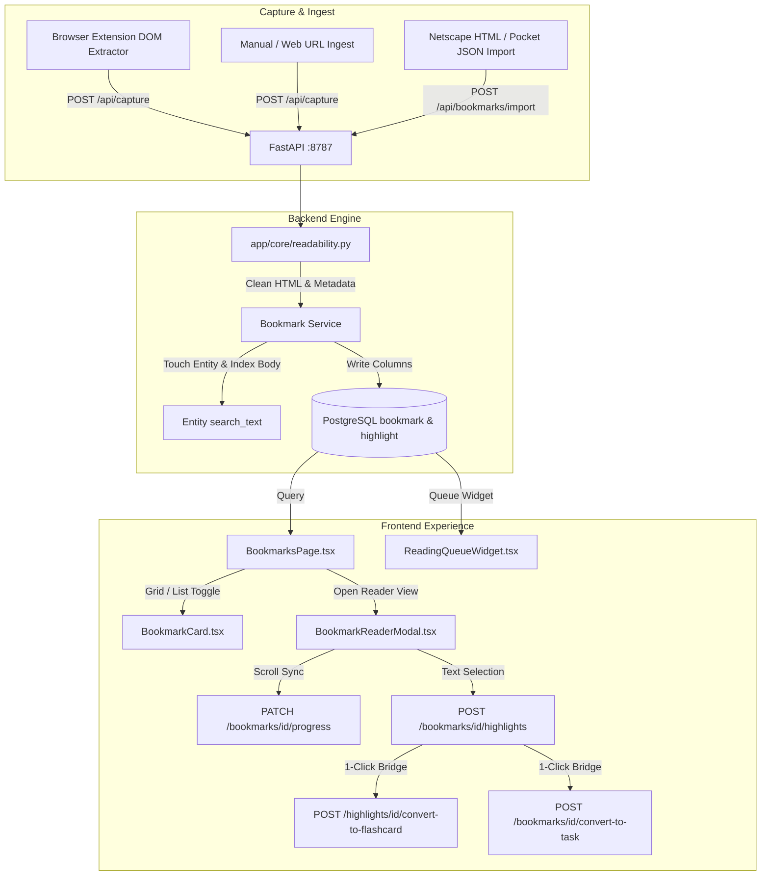

# Mozilla Pocket Tarzi Yer Imleri ve Okuma Motoru (Pocket Engine) Implementation Plan

> **For agentic workers:** REQUIRED SUB-SKILL: Use superpowers:subagent-driven-development to implement this plan task-by-task. Steps use checkbox (`- [ ]`) syntax for tracking.

**Goal:** Transform the forkOS Bookmarks module into a local-only, distraction-free Mozilla Pocket style reading and bookmark engine with Reader View, selectolax content extraction, in-text highlights, flashcard bridges, magazine grid layout, and import/export capabilities.

**Architecture:**
The engine stores extracted clean HTML, text, hero images, reading times, and scroll progress directly in the `bookmark` table via Alembic migration `0053_bookmark_pocket_engine.py`. A dedicated support table `bookmark_highlight` stores user highlights with color and notes. Content is fetched and sanitized using a shared `app/core/readability.py` utility (`selectolax`). The frontend introduces a distraction-free `BookmarkReaderModal` with `@fontsource-variable/newsreader` serif/sans toggle, floating highlight toolbar, and card grid layout (`BookmarkCard`).

**Architecture Diagram:**



**Tech Stack:**
- Backend: Python 3.12, FastAPI, SQLAlchemy 2.0 (asyncpg), Alembic, Selectolax (ultra-fast Lexbor HTML parser), HTTPX
- Frontend: React 18, TypeScript, Tailwind CSS, `@tanstack/react-query`, `@fontsource-variable/newsreader`, Lucide React
- Browser Extension: Manifest V3, Chrome Scripting & DOM Extraction, IndexedDB / Chrome Storage local outbox

**Spec:** [2026-09-11-bookmark-pocket-engine-design.md](file:///Users/furkanturkoglu/Desktop/Projeler/forkOS/docs/superpowers/specs/2026-09-11-bookmark-pocket-engine-design.md)

## Global Constraints

- STRICTLY ZERO EMOJIS in all code, comments, UI strings, logs, and artifacts.
- Local-only application: 127.0.0.1 bind, no external telemetry or cloud tracking.
- Rule 1: Every searchable/linkable module object PK -> `entity.id` FK. Support tables (`bookmark_highlight`) documented in `tests/test_migrations.py`.
- Rule 2: Entity creation and updates MUST use `app/core/entity.py` helpers.
- Rule 3: `event` table is append-only; call `log_event()` for meaningful mutations.
- Rule 7: Universal Inbox and Bookmark Library share the same `bookmark` table separated by `collection`.
- Rule 10: Every DDL statement in Alembic migration MUST be a separate `op.execute()` call (asyncpg prepared statement rule).
- Rule 11: `@/` path alias in `tsconfig.json` and `vite.config.ts`.
- Rule 12: Turkish search standard: `'simple'` config + `immutable_unaccent()` + `pg_trgm`. No `to_tsvector('turkish', ...)`.
- Rule 15: Design tokens and `@/core/ui` controls only (`src/index.css` + `tailwind.config.js`). No raw form inputs or arbitrary text sizes.

---

### Task 1: Backend Data Model and Alembic Migration

**Files:**
- Modify: `backend/app/modules/bookmark/models.py`
- Create: `backend/alembic/versions/0053_bookmark_pocket_engine.py`
- Modify: `backend/tests/test_migrations.py:96-115`
- Test: `backend/tests/test_migrations.py`

**Interfaces:**
- Consumes: `Base`, `EntityBacked`, `app.db`
- Produces: `Bookmark` expanded model with `content_html`, `content_text`, `hero_image_url`, `favicon_url`, `author`, `published_at`, `reading_time_min`, `word_count`, `scroll_progress`; `BookmarkHighlight` model with `id`, `bookmark_id`, `text`, `note`, `color`, `anchor_index`, `created_at`.

- [ ] **Step 1: Write the failing test in `test_migrations.py` or inspect existing schema drift**
Run: `pytest backend/tests/test_migrations.py` to confirm baseline passes.

- [ ] **Step 2: Update `backend/app/modules/bookmark/models.py` with expanded fields and `BookmarkHighlight`**

```python
# Add to backend/app/modules/bookmark/models.py
from sqlalchemy import Boolean, DateTime, ForeignKey, Integer, String, Text, func
from sqlalchemy.orm import relationship

# In Bookmark:
    content_html: Mapped[str | None] = mapped_column(Text)
    content_text: Mapped[str | None] = mapped_column(Text)
    hero_image_url: Mapped[str | None] = mapped_column(Text)
    favicon_url: Mapped[str | None] = mapped_column(Text)
    author: Mapped[str | None] = mapped_column(String(128))
    published_at: Mapped[datetime | None] = mapped_column(DateTime(timezone=True))
    reading_time_min: Mapped[int] = mapped_column(Integer, nullable=False, default=1)
    word_count: Mapped[int] = mapped_column(Integer, nullable=False, default=0)
    scroll_progress: Mapped[int] = mapped_column(Integer, nullable=False, default=0)

    highlights: Mapped[list[BookmarkHighlight]] = relationship(
        "BookmarkHighlight", back_populates="bookmark", cascade="all, delete-orphan"
    )

class BookmarkHighlight(Base):
    __tablename__ = "bookmark_highlight"

    id: Mapped[uuid.UUID] = mapped_column(
        PgUUID(as_uuid=True), primary_key=True, default=uuid.uuid4
    )
    bookmark_id: Mapped[uuid.UUID] = mapped_column(
        PgUUID(as_uuid=True),
        ForeignKey("bookmark.id", ondelete="CASCADE"),
        nullable=False,
        index=True,
    )
    text: Mapped[str] = mapped_column(Text, nullable=False)
    note: Mapped[str | None] = mapped_column(Text)
    color: Mapped[str] = mapped_column(String(16), nullable=False, default="yellow")
    anchor_index: Mapped[int] = mapped_column(Integer, nullable=False, default=0)
    created_at: Mapped[datetime] = mapped_column(
        DateTime(timezone=True), nullable=False, server_default=func.now()
    )

    bookmark: Mapped[Bookmark] = relationship("Bookmark", back_populates="highlights")
```

- [ ] **Step 3: Create migration `backend/alembic/versions/0053_bookmark_pocket_engine.py`**
Ensure each command is an isolated `op.execute()` call (Rule 10).

```python
"""bookmark pocket engine columns and highlight table.

Revision ID: 0053_bookmark_pocket_engine
Revises: 0052_source_run_error_kind
"""
from alembic import op

revision = "0053_bookmark_pocket_engine"
down_revision = "0052_source_run_error_kind"
branch_labels = None
depends_on = None

def upgrade() -> None:
    op.execute("alter table bookmark add column if not exists content_html text")
    op.execute("alter table bookmark add column if not exists content_text text")
    op.execute("alter table bookmark add column if not exists hero_image_url text")
    op.execute("alter table bookmark add column if not exists favicon_url text")
    op.execute("alter table bookmark add column if not exists author varchar(128)")
    op.execute("alter table bookmark add column if not exists published_at timestamptz")
    op.execute("alter table bookmark add column if not exists reading_time_min integer not null default 1")
    op.execute("alter table bookmark add column if not exists word_count integer not null default 0")
    op.execute("alter table bookmark add column if not exists scroll_progress integer not null default 0")
    op.execute("""
        create table bookmark_highlight (
            id uuid primary key,
            bookmark_id uuid not null references bookmark(id) on delete cascade,
            text text not null,
            note text,
            color varchar(16) not null default 'yellow',
            anchor_index integer not null default 0,
            created_at timestamptz not null default now()
        )
    """)
    op.execute("create index ix_bookmark_highlight_bookmark_id on bookmark_highlight(bookmark_id)")

def downgrade() -> None:
    op.execute("drop index if exists ix_bookmark_highlight_bookmark_id")
    op.execute("drop table if exists bookmark_highlight")
    op.execute("alter table bookmark drop column if exists scroll_progress")
    op.execute("alter table bookmark drop column if exists word_count")
    op.execute("alter table bookmark drop column if exists reading_time_min")
    op.execute("alter table bookmark drop column if exists published_at")
    op.execute("alter table bookmark drop column if exists author")
    op.execute("alter table bookmark drop column if exists favicon_url")
    op.execute("alter table bookmark drop column if exists hero_image_url")
    op.execute("alter table bookmark drop column if exists content_text")
    op.execute("alter table bookmark drop column if exists content_html")
```

- [ ] **Step 4: Update `tests/test_migrations.py` support_tables**
Add `"bookmark_highlight"` to `support_tables` set in `tests/test_migrations.py`.

- [ ] **Step 5: Run tests and verify**
Run: `pytest backend/tests/test_migrations.py`
Expected: ALL PASS.

- [ ] **Step 6: Commit**
Run: `git add backend/app/modules/bookmark/models.py backend/alembic/versions/0053_bookmark_pocket_engine.py backend/tests/test_migrations.py && git commit -m "feat(bookmark): add pocket engine schema and highlight model"`

---

### Task 2: Readability Core Module (`app/core/readability.py`)

**Files:**
- Create: `backend/app/core/readability.py`
- Create: `backend/tests/test_readability.py`

**Interfaces:**
- Consumes: `selectolax.parser.HTMLParser`, `re`, `math`
- Produces: `extract_article(html: str | bytes, base_url: str = "") -> ArticleContent` dataclass with fields:
  `title`, `content_html`, `content_text`, `hero_image_url`, `favicon_url`, `author`, `published_at`, `word_count`, `reading_time_min`.

- [ ] **Step 1: Write the test in `backend/tests/test_readability.py`**
Include tests for noise stripping, hero image detection, word count, reading time calculation, and HTML safety.

- [ ] **Step 2: Run test to verify it fails**
Run: `pytest backend/tests/test_readability.py`
Expected: FAIL (module not found).

- [ ] **Step 3: Implement `backend/app/core/readability.py`**
Use `selectolax` to clean noise tags, extract og:image, author, article body, calculate word count and reading time.

- [ ] **Step 4: Run test to verify it passes**
Run: `pytest backend/tests/test_readability.py`
Expected: PASS.

- [ ] **Step 5: Commit**
Run: `git add backend/app/core/readability.py backend/tests/test_readability.py && git commit -m "feat(core): implement selectolax readability module"`

---

### Task 3: Bookmark Service, Highlights and Full-Text Search

**Files:**
- Modify: `backend/app/modules/bookmark/schemas.py`
- Modify: `backend/app/modules/bookmark/service.py`
- Modify: `backend/app/modules/bookmark/router.py`
- Modify: `backend/app/modules/bookmark/__init__.py`
- Create: `backend/tests/test_bookmark_pocket_engine.py`

**Interfaces:**
- Consumes: `Bookmark`, `BookmarkHighlight`, `app/core/readability.py`, `app/core/entity.py`
- Produces:
  - `GET /bookmarks/{id}/fulltext` -> `BookmarkFullTextOut`
  - `PATCH /bookmarks/{id}/progress` -> `BookmarkProgressUpdate`
  - `POST /bookmarks/{id}/highlights` -> `HighlightCreateIn`, `BookmarkHighlightOut`
  - `DELETE /bookmarks/{id}/highlights/{highlight_id}` -> 204
  - `entity.search_text` updated with first 5000 characters of `content_text`.

- [ ] **Step 1: Write failing tests in `backend/tests/test_bookmark_pocket_engine.py`**
Test highlight creation, retrieval, deletion, scroll progress update, and search text indexing.

- [ ] **Step 2: Run tests to verify failure**
Run: `pytest backend/tests/test_bookmark_pocket_engine.py`
Expected: FAIL.

- [ ] **Step 3: Implement schemas, service functions, and router endpoints**
Update `CaptureIn`, `BookmarkOut`, `BookmarkUpdate`, and implement `get_full_text`, `update_progress`, `add_highlight`, `delete_highlight`.

- [ ] **Step 4: Run tests to verify pass**
Run: `pytest backend/tests/test_bookmark_pocket_engine.py`
Expected: PASS.

- [ ] **Step 5: Commit**
Run: `git add backend/app/modules/bookmark/ backend/tests/test_bookmark_pocket_engine.py && git commit -m "feat(bookmark): add fulltext, progress, and highlights endpoints"`

---

### Task 4: Flashcard & Note Conversion Bridges for Highlights

**Files:**
- Modify: `backend/app/modules/bookmark/service.py`
- Modify: `backend/app/modules/bookmark/router.py`
- Modify: `backend/tests/test_bookmark_pocket_engine.py`

**Interfaces:**
- Consumes: `BookmarkHighlight`, `app/modules/flashcard/service.py`, `app/modules/note/service.py`
- Produces:
  - `POST /bookmarks/{id}/highlights/{highlight_id}/convert-to-flashcard` -> `{"card_id": UUID}`
  - `POST /bookmarks/{id}/highlights/{highlight_id}/create-note` -> `{"note_id": UUID}`

- [ ] **Step 1: Add conversion tests to `backend/tests/test_bookmark_pocket_engine.py`**
- [ ] **Step 2: Run test to verify failure**
- [ ] **Step 3: Implement conversion service and routes**
- [ ] **Step 4: Run test to verify pass**
- [ ] **Step 5: Commit**
Run: `git add backend/app/modules/bookmark/ backend/tests/test_bookmark_pocket_engine.py && git commit -m "feat(bookmark): add highlight to flashcard and note bridge"`

---

### Task 5: API Schema Generation and TypeScript Contracts

**Files:**
- Generate: `frontend/src/core/api-schema.ts`
- Modify: `frontend/src/core/types.ts`
- Test: `frontend/src/core/mediaRouting.test.ts` or contract tests

- [ ] **Step 1: Generate api-schema.ts from FastAPI OpenAPI**
Run: `npm --prefix frontend run api:generate` (or curl backend openapi.json and run openapi-typescript).
- [ ] **Step 2: Update `frontend/src/core/types.ts` with `BookmarkHighlight` and expanded `Bookmark` fields**
- [ ] **Step 3: Run TypeScript typecheck**
Run: `npm --prefix frontend run build` or `npx tsc --noEmit`
Expected: PASS.
- [ ] **Step 4: Commit**
Run: `git add frontend/src/core/types.ts frontend/src/core/api-schema.ts && git commit -m "feat(frontend): sync api schema and bookmark highlight types"`

---

### Task 6: Distraction-Free Reader View Modal (`BookmarkReaderModal.tsx`)

**Files:**
- Create: `frontend/src/modules/bookmarks/BookmarkReaderModal.tsx`
- Create: `frontend/src/modules/bookmarks/BookmarkReaderModal.test.tsx`

**Interfaces:**
- Props: `bookmarkId: string; onClose: () => void; onNext?: () => void; onPrev?: () => void;`
- Features:
  - Header: Close (ESC), Typography toggle (Serif `@fontsource-variable/newsreader` vs Sans), Font Size (sm/md/lg), Column width (`max-w-2xl` vs `max-w-3xl`), Mark Read/Unread, Collection Move, Open External.
  - Floating Highlight Toolbar: Color choices (yellow, green, blue, pink), Note prompt, Convert to Flashcard button, Convert to Task button.
  - Scroll progress bar synced via debounced `PATCH /bookmarks/{id}/progress`.
  - Auto-mark `read` when reaching 90% scroll progress.

- [ ] **Step 1: Write test `frontend/src/modules/bookmarks/BookmarkReaderModal.test.tsx`**
- [ ] **Step 2: Run test to verify failure**
- [ ] **Step 3: Implement `BookmarkReaderModal.tsx` with `@/core/ui` tokens and zero emojis**
- [ ] **Step 4: Run test to verify pass**
Run: `npm --prefix frontend test BookmarkReaderModal.test.tsx`
- [ ] **Step 5: Commit**
Run: `git add frontend/src/modules/bookmarks/BookmarkReaderModal* && git commit -m "feat(bookmarks): implement distraction-free BookmarkReaderModal"`

---

### Task 7: Magazine Card Grid (`BookmarkCard.tsx`) & BookmarksPage Layout

**Files:**
- Create: `frontend/src/modules/bookmarks/BookmarkCard.tsx`
- Modify: `frontend/src/modules/bookmarks/BookmarksPage.tsx`
- Modify: `frontend/src/modules/bookmarks/ReadingQueueWidget.tsx`
- Modify: `frontend/src/modules/bookmarks/BookmarksPage.test.tsx`

**Interfaces:**
- Features:
  - Grid / List view toggle button in `WorkspacePaneHeader`.
  - `BookmarkCard`: Aspect ratio cover image (with clean fallback), favicon, title, snippet, reading time badge ("5 dk"), scroll progress bar, favorite, checkbox for bulk select.
  - Clicking a card opens `BookmarkReaderModal`.
  - `ReadingQueueWidget`: Displays reading time and opens Reader Modal directly.

- [ ] **Step 1: Write test for Grid/List view toggle and Reader Modal trigger in `BookmarksPage.test.tsx`**
- [ ] **Step 2: Implement `BookmarkCard.tsx` and integrate into `BookmarksPage.tsx` and `ReadingQueueWidget.tsx`**
- [ ] **Step 3: Run frontend vitest tests**
Run: `npm --prefix frontend test BookmarksPage.test.tsx`
- [ ] **Step 4: Commit**
Run: `git add frontend/src/modules/bookmarks/ && git commit -m "feat(bookmarks): implement magazine grid view and reader trigger"`

---

### Task 8: Browser Extension Metadata Pipeline

**Files:**
- Modify: `extension/extractor.js`
- Modify: `extension/popup/popup.js`
- Modify: `extension/outbox.js`
- Modify: `extension/tests/outbox.test.mjs`

**Interfaces:**
- Passes `hero_image_url` (from og:image), `reading_time_min`, `favicon_url`, `author` to `CaptureIn` payload so backend captures them instantly without re-requesting.

- [ ] **Step 1: Write test in `extension/tests/outbox.test.mjs`**
- [ ] **Step 2: Update `popup.js` and `outbox.js`**
- [ ] **Step 3: Run extension tests**
Run: `npm --prefix extension test`
Expected: 17/17 PASS.
- [ ] **Step 4: Commit**
Run: `git add extension/ && git commit -m "feat(extension): transmit page image, reading time, and favicon on capture"`

---

### Task 9: Netscape HTML and Pocket JSON Import / Export

**Files:**
- Modify: `backend/app/modules/bookmark/service.py`
- Modify: `backend/app/modules/bookmark/router.py`
- Modify: `frontend/src/modules/bookmarks/BookmarksPage.tsx`
- Modify: `backend/tests/test_bookmark_pocket_engine.py`

**Interfaces:**
- `POST /bookmarks/import`: Accepts file upload (HTML or JSON) or text content, parses Netscape Bookmark DT/A format or Pocket JSON export, imports bookmarks idempotently.
- `GET /bookmarks/export`: Generates standard Netscape Bookmark HTML.
- UI button in Bookmarks sidebar/header: "İçe Aktar (Import)" and "Dışa Aktar (Export)".

- [ ] **Step 1: Write tests for HTML/JSON import and HTML export in `test_bookmark_pocket_engine.py`**
- [ ] **Step 2: Implement parser and serializer in `service.py` and endpoints in `router.py`**
- [ ] **Step 3: Add import modal and export trigger to `BookmarksPage.tsx`**
- [ ] **Step 4: Run backend tests and verify pass**
Run: `pytest backend/tests/test_bookmark_pocket_engine.py`
- [ ] **Step 5: Commit**
Run: `git add backend/app/modules/bookmark/ frontend/src/modules/bookmarks/ && git commit -m "feat(bookmark): add netscape html and pocket json import/export"`

---

### Task 10: End-to-End Verification and Compliance Gate

**Files:**
- System-wide verification across backend, frontend, extension, design system, endpoint coverage, and emoji-free rule.

- [ ] **Step 1: Run endpoint coverage check**
Run: `node frontend/scripts/check-endpoint-coverage.mjs`
Expected: Threshold passed (no dead endpoints).
- [ ] **Step 2: Run design system and invalidation tests**
Run: `npm --prefix frontend test designSystem.test.ts invalidation.test.ts`
Expected: ALL PASS.
- [ ] **Step 3: Run all frontend tests**
Run: `npm --prefix frontend test`
Expected: ALL PASS.
- [ ] **Step 4: Run all backend tests**
Run: `docker exec forkos-api-1 pytest -q`
Expected: ALL PASS.
- [ ] **Step 5: Verify ZERO EMOJIS across all modified files**
Run: `grep -rn '[^\x00-\x7F]' backend/app/modules/bookmark/ frontend/src/modules/bookmarks/ | grep -v 'ç\|ğ\|ı\|ö\|ş\|ü\|Ç\|Ğ\|İ\|Ö\|Ş\|Ü\|’\|–\|…\|·\|‹\|›'`
Expected: No emojis found.
- [ ] **Step 6: Build frontend production bundle**
Run: `npm --prefix frontend run build`
Expected: SUCCESS.
