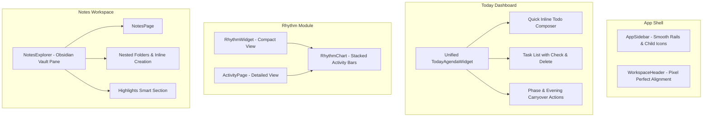

# Bugun Dashboardi, Ritim Grafigi, Sidebar/Header ve Obsidianvari Notlar Implementation Plan

> **For agentic workers:** REQUIRED SUB-SKILL: Use superpowers:subagent-driven-development to implement this plan task-by-task. Steps use checkbox (`- [ ]`) syntax for tracking.

**Goal:** Unify Today dashboard planning and day summary, modernize the monthly rhythm activity chart into a stacked interactive chart, polish sidebar/header alignment and smooth transitions with missing SVG icons, and build a dedicated Obsidian-style Vault Explorer in NotesPage.

**Architecture:**
- Frontend shell: Enhance `AppSidebar.tsx` with smooth CSS width/opacity transitions and child route SVG icons; remove clunky tree injection from the main sidebar.
- Activity & Rhythm: Create `RhythmChart.tsx` with stacked activity bars (Pomodoro, Todos, Reading/Notes, Applications) and hover breakdown tooltip, shared by `RhythmWidget.tsx` and `ActivityPage.tsx`.
- Today Dashboard: Merge `DailyRhythmWidget` and `TodayAgendaWidget` into a single, cohesive `TodayAgendaWidget`, remove clumsy multi-select form, add 1-line quick todo composer with instant list reflection, complete/delete actions, and phase/carryover banner.
- Notes Module: Build an Obsidian-style `NotesExplorer.tsx` pane within `NotesPage.tsx` with nested tree, inline creation, hover actions, smart highlights section, and collapsible pane.

**Architecture Diagram:**



**Tech Stack:** React 18, TypeScript, Tailwind CSS, TanStack React Query, Lucide Icons, Vitest.

**Spec:** `docs/superpowers/specs/2026-09-11-today-rhythm-sidebar-notes-design.md`

## Global Constraints

- STRICTLY ZERO EMOJIS in code, comments, test names, commit messages, and UI text.
- Local-only (127.0.0.1); no external CDNs or analytics.
- Design tokens only (Rule 15: no raw inputs/selects, use `@/core/ui` components and tokens).
- Invalidation via `invalidateAfter` only (Rule 14).
- Dead exports under threshold of 10.
- Referenceless endpoints under threshold of 3.

---

### Task 1: Sidebar & Header Alignment, Child Route SVG Icons, and Smooth Transitions

**Files:**
- Modify: `frontend/src/core/types.ts` (add `icon?: LucideIcon` to `ModuleRoute`)
- Modify: `frontend/src/core/shell/AppSidebar.tsx` (smooth width/opacity transitions, child route icons, clean notes nav)
- Modify: `frontend/src/modules/health/index.ts` (add icon for `/sources`)
- Modify: `frontend/src/modules/todo/index.ts` (add icons for `/habits`, `/planner`)
- Modify: `frontend/src/modules/notes/index.ts` (add icon for `/graph`, remove sidebar injection)
- Test: `frontend/src/core/shell/AppSidebar.test.tsx`

**Interfaces:**
- Consumes: `ModuleSpec`, `ModuleRoute`, `navigationGroups`
- Produces: Smooth collapsible `AppSidebar` with icons on every child link and pixel-perfect header alignment.

- [ ] **Step 1: Write test for child route icons and smooth transition classes**

```typescript
it("renders icons for child navigation links and supports smooth collapsible rails", () => {
  // test that child links have SVG icons and sidebar has smooth classes
});
```

- [ ] **Step 2: Run test to verify it fails**

Run: `npm --prefix frontend test src/core/shell/AppSidebar.test.tsx`
Expected: FAIL

- [ ] **Step 3: Update `ModuleRoute` type and assign icons to child routes**

Add `icon?: LucideIcon` to `ModuleRoute` in `frontend/src/core/types.ts`.
Assign:
- `health`: `/sources` -> `Activity` (or `Radio`)
- `todo`: `/habits` -> `Repeat`
- `todo`: `/planner` -> `CalendarRange`
- `notes`: `/graph` -> `Share2`
In `notes/index.ts`, remove `sidebar: NoteSidebarTree` so it doesn't pollute the global navigation.

- [ ] **Step 4: Update `AppSidebar.tsx` with smooth transitions and child icons**

Render `LinkIcon` for child routes with subtle 13px size and 6px indent.
Replace `collapsed && "md:hidden"` with `overflow-hidden whitespace-nowrap transition-all duration-300 ease-in-out` and width/opacity transitions.
Ensure header height and alignment match `WorkspaceHeader`.

- [ ] **Step 5: Run tests to verify they pass**

Run: `npm --prefix frontend test src/core/shell/AppSidebar.test.tsx`
Expected: PASS

- [ ] **Step 6: Commit**

```bash
git add frontend/src/core/types.ts frontend/src/core/shell/AppSidebar.tsx frontend/src/modules/
git commit -m "feat(shell): smooth sidebar transitions and icons for child routes"
```

---

### Task 2: Modern Stacked Rhythm & Activity Chart

**Files:**
- Create: `frontend/src/modules/activity/RhythmChart.tsx`
- Create: `frontend/src/modules/activity/RhythmChart.test.tsx`
- Modify: `frontend/src/modules/activity/RhythmWidget.tsx`
- Modify: `frontend/src/modules/activity/ActivityPage.tsx`
- Test: `frontend/src/modules/activity/RhythmWidget.test.tsx`

**Interfaces:**
- Consumes: `MonthlyPoint[]` from `/statistics/monthly`
- Produces: `<RhythmChart points={monthly} compact={boolean} />`

- [ ] **Step 1: Write failing test for RhythmChart component**

```typescript
it("renders stacked monthly bars with category breakdown and hover state", () => {
  // test rendering of stacked categories and hover details
});
```

- [ ] **Step 2: Run test to verify it fails**

Run: `npm --prefix frontend test src/modules/activity/RhythmChart.test.tsx`
Expected: FAIL

- [ ] **Step 3: Implement `RhythmChart.tsx`**

Build a stacked bar chart using clean SVG or structured flex bars with design system tokens:
- Category breakdown per month:
  - Pomodoro: `bg-accent`
  - Görev & Rutin: `bg-ok`
  - Okuma & Not: `bg-info` (or blue token)
  - Başvuru: `bg-primary/70`
- Rounded bar tops, subtle baseline, and month labels.
- Interactive hover popover: on hover/focus, displays exact activity breakdown for the selected month.
- Compact mode for Today widget, full mode for Activity page.

- [ ] **Step 4: Integrate `RhythmChart` into `RhythmWidget.tsx` and `ActivityPage.tsx`**

Replace old `MonthlyBars` with modern `RhythmChart`.

- [ ] **Step 5: Run tests to verify they pass**

Run: `npm --prefix frontend test src/modules/activity/`
Expected: PASS

- [ ] **Step 6: Commit**

```bash
git add frontend/src/modules/activity/
git commit -m "feat(activity): implement modern stacked rhythm chart with category breakdown"
```

---

### Task 3: Today Dashboard — Unified "Bugünün Planı" with Inline Quick Todo Composer

**Files:**
- Modify: `frontend/src/modules/today/TodayAgendaWidget.tsx`
- Modify: `frontend/src/modules/today/TodayAgendaWidget.test.tsx`
- Modify: `frontend/src/modules/today/index.ts` (merge `today.rhythm` into `today.agenda`)
- Modify: `frontend/src/modules/today/DailyRhythmWidget.tsx` (keep for backward compatibility or embed logic)
- Test: `frontend/src/modules/today/TodayAgendaWidget.test.tsx`
- Test: `frontend/src/modules/today/TodayRegistration.test.ts`

**Interfaces:**
- Consumes: `/today/agenda?day=...`, `/plan`, `/todos`
- Produces: Unified Today Plan with quick inline todo composer, complete/delete actions, and phase/carryover banner.

- [ ] **Step 1: Write failing tests for quick todo creation and task completion/deletion on Today agenda**

```typescript
it("creates a todo with plan_day=today directly from the inline composer", async () => {
  // test typing into quick input and submitting
});
it("completes and deletes tasks directly from Today widget", async () => {
  // test checkbox click and delete button click
});
```

- [ ] **Step 2: Run test to verify it fails**

Run: `npm --prefix frontend test src/modules/today/TodayAgendaWidget.test.tsx`
Expected: FAIL

- [ ] **Step 3: Implement unified `TodayAgendaWidget.tsx`**

- Remove the clunky "ekle" multi-select form.
- Add quick inline task input (`Input` with placeholder "Bugüne hızlı görev ekle... (Enter ile kaydet)").
  - On submit: `api.post("/todos", { title: text.trim(), plan_day: today, priority: 2 })`
  - Calls `invalidateAfter("todo.write", "plan.write")`.
- Integrate day phase, planned count, overdue count, and evening carryover banner at top.
- Render task items with:
  - Checkbox / Circle for completing task.
  - Trash icon button for deleting task (`api.del("/todos/" + id)`).
- Update registry in `today/index.ts` so `today.agenda` is the primary comprehensive plan.

- [ ] **Step 4: Run tests to verify they pass**

Run: `npm --prefix frontend test src/modules/today/`
Expected: PASS

- [ ] **Step 5: Commit**

```bash
git add frontend/src/modules/today/
git commit -m "feat(today): unify plan with day summary and add inline quick todo composer"
```

---

### Task 4: Obsidian-style Notes Vault Explorer

**Files:**
- Create: `frontend/src/modules/notes/NotesExplorer.tsx`
- Create: `frontend/src/modules/notes/NotesExplorer.test.tsx`
- Modify: `frontend/src/modules/notes/NotesPage.tsx`
- Modify: `frontend/src/modules/notes/NotesPage.test.tsx`
- Test: `frontend/src/modules/notes/NotesExplorer.test.tsx`

**Interfaces:**
- Consumes: `/notes`, `/note-folders`
- Produces: Dedicated left-pane Obsidian-style Vault Explorer on `NotesPage`.

- [ ] **Step 1: Write failing test for NotesExplorer**

```typescript
it("renders vault explorer with nested folders, inline folder creation, and highlights section", () => {
  // test folder expansion, inline creation input, note selection
});
```

- [ ] **Step 2: Run test to verify it fails**

Run: `npm --prefix frontend test src/modules/notes/NotesExplorer.test.tsx`
Expected: FAIL

- [ ] **Step 3: Implement `NotesExplorer.tsx`**

Build Obsidian-style Vault Explorer:
- Top Header:
  - "Kasa" title with note count.
  - Action icons: `FilePlus` (New note), `FolderPlus` (New folder), `ChevronsDownUp` (Collapse/Expand all), `PanelLeftClose` (Toggle pane).
- Top Smart Section:
  - "Okuma Vurguları" with `Highlighter` icon and total highlights count. Clicking switches to highlights view.
- Nested Folder Hierarchy:
  - Recursive folder branches with expand/collapse chevron, folder icon, note count.
  - Hover actions on folder: `+` (Note), `FolderPlus` (Subfolder), `Pencil` (Rename), `Trash2` (Delete).
  - Inline input: when creating a folder or note, renders an auto-focused `<Input>` in place; Enter creates, Escape cancels.
- Notes in folders and unfiled notes:
  - `FileText` icon, note title, active indicator, update date.
  - Drag and drop notes into folders.

- [ ] **Step 4: Integrate `NotesExplorer` into `NotesPage.tsx`**

- In `NotesPage.tsx`:
  - Split layout into collapsible left Vault Explorer pane (width: `w-64` or `w-72`) and right editor pane.
  - When no note is selected, rather than showing a dead blank screen, the explorer remains accessible and shows a clean prompt or recent notes.
  - Toggle button in editor header to hide/show explorer pane.

- [ ] **Step 5: Run tests to verify they pass**

Run: `npm --prefix frontend test src/modules/notes/`
Expected: PASS

- [ ] **Step 6: Commit**

```bash
git add frontend/src/modules/notes/
git commit -m "feat(notes): implement obsidian-style vault explorer on notes page"
```

---

### Task 5: Full Verification and CI/CD Watch

- [ ] **Step 1: Run design system and invalidation guardrails**

Run: `npm --prefix frontend test src/core/designSystem.test.ts src/core/invalidation.test.ts`
Expected: PASS

- [ ] **Step 2: Check endpoint coverage and dead exports**

Run: `node frontend/scripts/check-endpoint-coverage.mjs && node frontend/scripts/check-dead-exports.mjs`
Expected: PASS

- [ ] **Step 3: Check formatting and zero emojis**

Run: `npm --prefix frontend run format:check`
Check diff for emojis.

- [ ] **Step 4: Build frontend bundle**

Run: `npm --prefix frontend run build`
Expected: PASS with 0 errors.

- [ ] **Step 5: Push and watch GitHub Actions CI**

Push all commits to `origin/main` and watch CI run until green.
