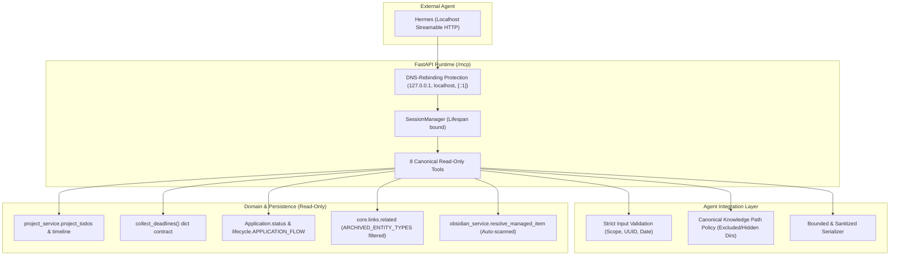

# forkOS × Hermes — H0.1 Correctness & Security Pass Implementation Plan

> **For agentic workers:** REQUIRED SUB-SKILL: Use superpowers:subagent-driven-development to implement this plan task-by-task. Steps use checkbox (`- [ ]`) syntax for tracking.

**Goal:** Implement the H0.1 correctness, security, and domain alignment patch for the forkOS × Hermes Brain Interface, resolving all P0/P1/P2 audit findings while maintaining the exact 8 read-only MCP tools, zero mutation, and loopback-only invariants.

**Architecture:** Strengthen the existing `backend/app/integrations/agent/` layer:
1. Consolidate knowledge path security into a single canonical policy for both `brain_search` and `brain_read`.
2. Enable official MCP SDK localhost DNS-rebinding protection on `/mcp`.
3. Align project and briefing aggregators with canonical domain models (`belongs_to` todos, `collect_deadlines` dictionary contract, `Application` lifecycle for opportunity attention, and `project_service.timeline`).
4. Replace shallow row-count checks with SHA-256 DB row content hashing in immutability verification.
5. Re-use `app.core.links.related()` to strictly exclude legacy note links from active operational context.
6. Enforce strict input validation (Literal scopes, date/UUID parsing) and payload bounding (depth, keys, string length).

**Architecture Diagram:**


**Tech Stack:** Python 3.12+, FastAPI, Starlette, SQLAlchemy 2.0 (Async), `mcp>=1.0,<3.0`, Pydantic v2.

**Spec:** User audit requirements (P0/P1/P2 items 1 through 15).

## Global Constraints
- **Zero Mutation:** Zero mutating tools. PostgreSQL database and Vault filesystem remain 100% immutable.
- **8 Public MCP Tools:** Exactly the 8 approved tools (`forkos_briefing`, `forkos_search`, `forkos_entity_context`, `forkos_project_context`, `forkos_recent_activity`, `brain_status`, `brain_search`, `brain_read`).
- **Single Canonical Transport:** Streamable HTTP mounted at `/mcp`.
- **Localhost DNS-Rebinding Protection Active:** Only localhost origins and hosts (`127.0.0.1:*`, `localhost:*`, `[::1]:*`) permitted.
- **No Broad Silent Exceptions:** "Failure" must not be masked as "empty data".
- **Legacy Notes Frozen:** `note` and `note_folder` remain frozen archive tables and are never exposed as active relations or active search results.

---

### Task 1: Canonical Knowledge Path Policy & `brain_read` Security Hardening (P0)

**Files:**
- Modify: `backend/app/integrations/agent/knowledge.py`
- Modify: `backend/tests/test_agent_knowledge.py`

**Interfaces:**
- Produces: `is_safe_knowledge_path(rel_path: str | Path) -> bool` and `validate_safe_knowledge_path(vault_root: Path, rel_path: str | Path) -> Path`
- Enforces: Exclusion of `.git/**`, `.obsidian/**`, `.forkos-migration/**`, `.trash/**`, `Attachments/**`, `95-ekler`, `90-şablonlar`, `90-sablonlar`, and any dot-prefixed path parts across both `search_vault` and `read_vault_note`.

- [ ] **Step 1: Write failing tests in `test_agent_knowledge.py`**
  Add tests for `brain_read` rejecting:
  - `.forkos-migration/report.md`
  - `.obsidian/workspace.json`
  - `Attachments/image.png`
  - `attachments/note.md`
  - `95-ekler/file.md`
  - `.hidden_folder/secret.md`
  - Path traversal `../../../etc/passwd`
  - Verify normal unmanaged and managed notes still succeed.

- [ ] **Step 2: Run tests to verify failure**
  Run: `pytest backend/tests/test_agent_knowledge.py -k test_safe_knowledge_path -v`
  Expected: FAIL (currently `read_vault_note` permits access to `.obsidian/` etc. within vault).

- [ ] **Step 3: Implement canonical knowledge path policy in `knowledge.py`**
  - Define `EXCLUDED_DIR_NAMES = frozenset({".git", ".obsidian", ".forkos-migration", ".trash", "attachments", "95-ekler", "90-şablonlar", "90-sablonlar"})`
  - Create `is_safe_knowledge_path(rel_path: str | Path) -> bool`:
    - Check each part of the relative path.
    - If any part starts with `.` or lowercased part is in `EXCLUDED_DIR_NAMES`, return `False`.
  - In `read_vault_note()`:
    - Validate target relative path against `is_safe_knowledge_path()`. If unsafe, raise `ValueError("ACCESS_DENIED: Path is in an excluded or hidden directory.")`.
  - In `search_vault()`:
    - Use identical `is_safe_knowledge_path()` logic.

- [ ] **Step 4: Run tests to verify pass**
  Run: `pytest backend/tests/test_agent_knowledge.py -v`
  Expected: PASS

- [ ] **Step 5: Commit**
  `git add backend/app/integrations/agent/knowledge.py backend/tests/test_agent_knowledge.py`
  `git commit -m "fix(agent): unify canonical knowledge path exclusion policy for search and read"`

---

### Task 2: Enable Localhost DNS-Rebinding Protection & MCP Security Tests (P0)

**Files:**
- Modify: `backend/app/integrations/agent/mcp.py`
- Modify: `backend/tests/test_agent_mcp.py`

**Interfaces:**
- Consumes: MCP SDK `streamable_http_app` localhost security default.
- Enforces: Rejection of non-localhost Host / Origin headers (e.g. `Host: evil.com`).

- [ ] **Step 1: Write failing security regression test in `test_agent_mcp.py`**
  - Test client connecting with `Host: evil.com` is rejected (HTTP 403 / 400).
  - Test client connecting with `Host: 127.0.0.1` or `localhost` succeeds.

- [ ] **Step 2: Run test to verify failure**
  Run: `pytest backend/tests/test_agent_mcp.py -v`
  Expected: FAIL (currently protection is disabled).

- [ ] **Step 3: Remove protection-disabled override in `mcp.py`**
  - In `backend/app/integrations/agent/mcp.py`:
    Remove `transport_security=TransportSecuritySettings(enable_dns_rebinding_protection=False)`.
    Call `mcp_server.streamable_http_app(streamable_http_path="/")` with SDK default localhost protection (which binds `allowed_hosts=["127.0.0.1:*", "localhost:*", "[::1]:*"]`).

- [ ] **Step 4: Run test to verify pass**
  Run: `pytest backend/tests/test_agent_mcp.py -v`
  Expected: PASS

- [ ] **Step 5: Commit**
  `git add backend/app/integrations/agent/mcp.py backend/tests/test_agent_mcp.py`
  `git commit -m "fix(agent): enable official mcp localhost dns-rebinding protection"`

---

### Task 3: Canonical Project Todo Direction & Project Timeline Reuse (P1 / P2)

**Files:**
- Modify: `backend/app/integrations/agent/context.py`
- Modify: `backend/tests/test_agent_context.py`

**Interfaces:**
- Consumes: `app.modules.project.service.project_todos(session, project_id)` and `app.modules.project.service.timeline(session, project_id)`
- Enforces: Canonical `Link.from_id = todo.id`, `Link.to_id = project.id`, `Link.relation = "belongs_to"`.

- [ ] **Step 1: Update `test_agent_context.py` fixtures and assertions**
  - Update `test_get_project_context` to insert link with `from_id = todo.id`, `to_id = project.id`, `relation = "belongs_to"`.
  - Assert project context contains the todo.
  - Assert project context `recent_activity` reflects linked todo events and project events from `project_service.timeline`.

- [ ] **Step 2: Run test to verify failure**
  Run: `pytest backend/tests/test_agent_context.py -k test_get_project_context -v`
  Expected: FAIL

- [ ] **Step 3: Update `get_project_context()` in `context.py`**
  - Call `await project_service.project_todos(session, proj_uuid)` to retrieve project todos.
  - Filter for open/active todos: `[t for t in all_todos if t.get("status") != "done"][:20]`.
  - Call `await project_service.timeline(session, proj_uuid, limit=10)` to retrieve comprehensive project events (project events, linked todo events, commit events).
  - Sanitize and bound event payloads.

- [ ] **Step 4: Run test to verify pass**
  Run: `pytest backend/tests/test_agent_context.py -k test_get_project_context -v`
  Expected: PASS

- [ ] **Step 5: Commit**
  `git add backend/app/integrations/agent/context.py backend/tests/test_agent_context.py`
  `git commit -m "fix(agent): use canonical belongs_to project todo relation and timeline service"`

---

### Task 4: Fix Briefing Deadline Contract & Remove Silent Exception Masking (P1)

**Files:**
- Modify: `backend/app/integrations/agent/context.py`
- Modify: `backend/tests/test_agent_context.py`

**Interfaces:**
- Consumes: `app.core.deadlines.collect_deadlines(session, limit=...)` returning `list[dict]` with keys `entity_id`, `type`, `title`, `due_at`, `module`, `sub_kind`, `priority`.
- Enforces: Accurate deadline extraction without AttributeError, and elimination of broad `except Exception: ... = []` blocks.

- [ ] **Step 1: Write test with real deadlines in `test_agent_context.py`**
  - Create a Todo with a `due_at` date.
  - Call `get_briefing_context(session)`.
  - Verify `briefing.deadlines` contains the deadline item with correct fields (`id`, `title`, `due_at`, `type`).

- [ ] **Step 2: Run test to verify failure**
  Run: `pytest backend/tests/test_agent_context.py -k test_get_briefing_context_deadlines -v`
  Expected: FAIL (previously swallowed to `[]`).

- [ ] **Step 3: Fix deadline handling and remove broad exception catchers in `context.py`**
  - In `get_briefing_context()`:
    ```python
    raw_deadlines = await collect_deadlines(session, limit=15)
    deadlines = [
        {
            "id": d["entity_id"],
            "title": d["title"],
            "due_at": d["due_at"].isoformat() if hasattr(d["due_at"], "isoformat") else str(d["due_at"]) if d["due_at"] else None,
            "entity_type": d["type"],
            "module": d.get("module"),
            "priority": d.get("priority"),
        }
        for d in raw_deadlines
    ]
    ```
  - Audit and eliminate broad silent `except Exception:` swallowers across agenda, learning, opportunity, notifications in `get_briefing_context()`. Allow legitimate database errors to surface cleanly as `ToolError`.

- [ ] **Step 4: Run tests to verify pass**
  Run: `pytest backend/tests/test_agent_context.py -v`
  Expected: PASS

- [ ] **Step 5: Commit**
  `git add backend/app/integrations/agent/context.py backend/tests/test_agent_context.py`
  `git commit -m "fix(agent): parse collect_deadlines dict contract and remove silent exception masking"`

---

### Task 5: Opportunity Attention Canonical Lifecycle Integration (P1)

**Files:**
- Modify: `backend/app/integrations/agent/context.py`
- Modify: `backend/tests/test_agent_context.py`

**Interfaces:**
- Consumes: `app.modules.opportunity.models.Application`, `Opportunity`, and `app.modules.opportunity.lifecycle` (`APPLICATION_TERMINAL`, `JOB_KINDS`, `ACTIVE_DISCOVERY_STATUSES`).
- Enforces: Correct derivation of active job applications (non-terminal) and active announcements requiring attention.

- [ ] **Step 1: Write lifecycle-differentiated tests in `test_agent_context.py`**
  - Create:
    - Job Opportunity with `Application(status="applied")` -> MUST appear in `opportunity_attention`.
    - Job Opportunity with `Application(status="interview")` -> MUST appear in `opportunity_attention`.
    - Job Opportunity with `Application(status="rejected")` (terminal) -> MUST NOT appear.
    - Announcement Opportunity with `status="action_required"` -> MUST appear.
    - Announcement Opportunity with `status="completed"` -> MUST NOT appear.

- [ ] **Step 2: Run test to verify failure**
  Run: `pytest backend/tests/test_agent_context.py -k test_opportunity_attention_lifecycle -v`
  Expected: FAIL

- [ ] **Step 3: Implement canonical opportunity attention query in `context.py`**
  - Query non-terminal applications:
    `select(Application, Opportunity, Entity.title).join(Opportunity, ...).join(Entity, ...).where(Application.status.not_in(APPLICATION_TERMINAL))`
  - Query active announcements:
    `select(Opportunity, Entity.title).join(Entity, ...).where(Opportunity.kind.not_in(JOB_KINDS), Opportunity.status.in_({"action_required", "watching", "new"}))`
  - Combine and format attention items.

- [ ] **Step 4: Run test to verify pass**
  Run: `pytest backend/tests/test_agent_context.py -k test_opportunity_attention_lifecycle -v`
  Expected: PASS

- [ ] **Step 5: Commit**
  `git add backend/app/integrations/agent/context.py backend/tests/test_agent_context.py`
  `git commit -m "fix(agent): derive opportunity attention from canonical application and announcement lifecycles"`

---

### Task 6: Filter Legacy Note Links via `core.links.related` & Cold Vault Freshness (P1 / P2)

**Files:**
- Modify: `backend/app/integrations/agent/context.py`
- Modify: `backend/tests/test_agent_context.py`

**Interfaces:**
- Consumes: `app.core.links.related(session, entity_id)`
- Consumes: `app.integrations.obsidian.service.resolve_managed_item(forkos_id)`

- [ ] **Step 1: Write test for legacy note link exclusion and cold vault resolution**
  - Link operational project to a legacy `note` in DB.
  - Call `get_entity_context(session, project_id)`.
  - Assert legacy `note` is NOT in `related_entities`.
  - In a fresh process state without index scan, call `get_project_context(session, project_id)` and verify knowledge pointer resolves correctly.

- [ ] **Step 2: Run test to verify failure**
  Run: `pytest backend/tests/test_agent_context.py -k test_legacy_note_link_and_cold_vault -v`
  Expected: FAIL

- [ ] **Step 3: Update `get_entity_context` and `get_project_context` in `context.py`**
  - Use `await links_svc.related(session, ent_uuid)` in `get_entity_context()`.
  - Replace `vault_index.get_item(str(ent_uuid))` with `resolve_managed_item(ent_uuid)` from `app.integrations.obsidian.service`.

- [ ] **Step 4: Run test to verify pass**
  Run: `pytest backend/tests/test_agent_context.py -v`
  Expected: PASS

- [ ] **Step 5: Commit**
  `git add backend/app/integrations/agent/context.py backend/tests/test_agent_context.py`
  `git commit -m "fix(agent): exclude legacy note links via related() and resolve cold vault items"`

---

### Task 7: Strict Input Validation, Payload Bounding & Accurate Truncation (P2)

**Files:**
- Modify: `backend/app/integrations/agent/models.py`
- Modify: `backend/app/integrations/agent/knowledge.py`
- Modify: `backend/app/integrations/agent/context.py`
- Modify: `backend/app/integrations/agent/tools.py`
- Modify: `backend/tests/test_agent_models.py`
- Modify: `backend/tests/test_agent_tools.py`

**Interfaces:**
- Consumes: Literal `BrainScope`, `sanitize_and_bound_payload()`
- Enforces: Schema-level bounds, rejection of typos in scope/date/UUID, accurate `truncated` flag propagation.

- [ ] **Step 1: Write tests in `test_agent_models.py` and `test_agent_tools.py`**
  - Test invalid scope `scope="unknown"` raises `ToolError`.
  - Test invalid date `day="2026-99-99"` raises `ToolError`.
  - Test invalid since `since="not-a-date"` raises `ToolError`.
  - Test short query `query="a"` raises `ToolError`.
  - Test large/deep event payload is bounded by depth, key count, string length, total bytes.
  - Test `brain_read` passes `truncated=True` when content exceeds limit.

- [ ] **Step 2: Run tests to verify failure**
  Run: `pytest backend/tests/test_agent_models.py backend/tests/test_agent_tools.py -v`
  Expected: FAIL

- [ ] **Step 3: Implement validation, bounding, and truncation**
  - In `models.py`: Implement `sanitize_and_bound_payload(obj, max_depth=4, max_keys=25, max_items=25, max_str_len=500, max_bytes=4096)`.
  - In `knowledge.py`: Enforce allowed `scope` keys, pass `truncated` flag.
  - In `context.py`: Enforce strict date parsing for `day` and strict ISO parsing for `since`. Use `sanitize_and_bound_payload`.
  - In `tools.py`: Connect `truncated` flag from inner data to outer `AgentEnvelope`.

- [ ] **Step 4: Run tests to verify pass**
  Run: `pytest backend/tests/test_agent_models.py backend/tests/test_agent_tools.py -v`
  Expected: PASS

- [ ] **Step 5: Commit**
  `git add backend/app/integrations/agent/ backend/tests/`
  `git commit -m "fix(agent): enforce strict input validation, bounded event payloads, and accurate truncation"`

---

### Task 8: Deterministic DB Row Content Fingerprinting & Immutability Verification (P1)

**Files:**
- Modify: `backend/tests/test_agent_immutability.py`

**Interfaces:**
- Produces: `_capture_db_content_fingerprint(session: AsyncSession) -> str`
- Hashes: Primary keys + mutable fields across Entity, Event, Link, Todo, Project, Milestone, Notification, Opportunity, Application, FlashcardCard, Bookmark, Note, NoteFolder.

- [ ] **Step 1: Write DB content fingerprinting helper and UPDATE sensitivity test**
  - Implement `_capture_db_content_fingerprint()` returning SHA-256 over canonical serialized table rows.
  - Write test proving that if an `UPDATE` occurs on any field (e.g. `todo.priority = 99`), the fingerprint changes.
  - In `test_db_and_vault_immutability_under_all_mcp_tools`, replace count checking with `_capture_db_content_fingerprint()` before and after calling all 8 MCP tools.

- [ ] **Step 2: Run immutability tests to verify pass**
  Run: `pytest backend/tests/test_agent_immutability.py -v`
  Expected: PASS (0 mutations detected, UPDATE sensitivity confirmed).

- [ ] **Step 3: Commit**
  `git add backend/tests/test_agent_immutability.py`
  `git commit -m "test(agent): verify db immutability via deterministic row content hashing"`

---

### Task 9: Documentation Updates & Full H0.1 Verification

**Files:**
- Modify: `docs/hermes/h0-brain-interface.md`
- Modify: `docs/hermes/h0-tool-contract.md`
- Modify: `docs/hermes/h0-setup.md`

- [ ] **Step 1: Update documentation to reflect H0.1 corrections**
  - Update `h0-brain-interface.md`: Document DNS-rebinding protection enabled by default, content-hash immutability proof, unified knowledge path exclusion policy.
  - Update `h0-tool-contract.md`: Document Literal `scope`, strict validation error codes, bounded event payloads, and accurate truncation flags.
  - Update `h0-setup.md`: Update security notes.

- [ ] **Step 2: Run full test suite & linter**
  - `pytest backend/tests/test_agent_*.py -v`
  - `pytest backend/tests/test_obsidian_integration.py backend/tests/test_registry.py -v`
  - `ruff check backend/app/integrations/agent backend/tests`
  - `git diff --check`

- [ ] **Step 3: Commit**
  `git add docs/hermes/`
  `git commit -m "docs(hermes): document h0.1 security, lifecycle, and immutability updates"`
