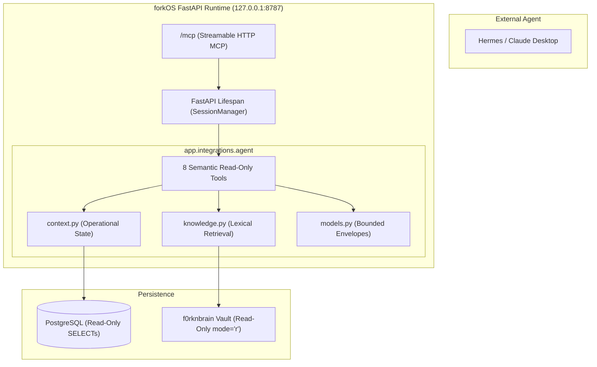

# forkOS × Hermes — H0 Implementation Plan

> **For agentic workers:** REQUIRED SUB-SKILL: Use superpowers:subagent-driven-development to implement this plan task-by-task. Steps use checkbox (`- [ ]`) syntax for tracking.

**Goal:** Build the first agent-facing, read-only brain interface for forkOS + f0rknbrain using the official Python Model Context Protocol (MCP) SDK over Streamable HTTP mounted in FastAPI at `/mcp`.

**Architecture:** A lightweight, non-mutating layer (`backend/app/integrations/agent/`) exposes 8 high-level semantic read-only tools to external agents like Hermes. forkOS operational context is assembled from existing domain services without duplicating business logic, and durable f0rknbrain knowledge is retrieved via a fast, safe direct lexical scanner without vector DBs or background pollers. The server is mounted directly into FastAPI at `/mcp` with session manager lifecycle tied to the host FastAPI lifespan.

**Architecture Diagram:**

**Tech Stack:** Python 3.12+, FastAPI, Starlette, SQLAlchemy 2.0 (Async), `mcp>=1.0,<3.0` (Official Python MCP SDK), Pydantic v2.

**Spec:** [docs/superpowers/specs/2026-09-20-hermes-h0-brain-interface-design.md](../specs/2026-09-20-hermes-h0-brain-interface-design.md)

## Global Constraints
- **Zero Mutation:** Zero mutating tools exposed via MCP. No task creation, task completion, project update, or Vault write.
- **Single Canonical Transport:** Streamable HTTP MCP mounted inside FastAPI at `/mcp`. No stdio companion script, no extra daemon.
- **Local-Only & Bound to Loopback:** All services bound strictly to `127.0.0.1`. No external network calls (no LLM, no embeddings, no GitHub sync).
- **Zero DB and Vault Modification:** All tool executions leave PostgreSQL and Vault files/mtimes byte-identical.
- **Read-Only Annotations & Contract:** Every tool description includes: `"Read-only. Does not modify forkOS or the Vault."` and has `readOnlyHint=True`.
- **Bounded Envelopes:** All lists capped; snippets 300–700 chars; `brain_read` capped at 12,000 / 40,000 chars with explicit `truncated` flag.
- **Phase 3 Boundary Preserved:** Legacy notes archive tables (`note`, `note_folder`) remain frozen and excluded from active search.

---

### Task 1: Bounded Output Models & Response Envelopes

**Files:**
- Create: `backend/app/integrations/agent/models.py`
- Test: `backend/tests/test_agent_models.py`

**Interfaces:**
- Consumes: `pydantic.BaseModel`, `datetime.datetime`
- Produces: `AgentEnvelope`, `BriefingData`, `EntitySearchResult`, `EntityContextData`, `ProjectContextData`, `ActivityEventData`, `BrainStatusData`, `BrainSearchResult`, `BrainReadData`

- [ ] **Step 1: Write unit tests for models and envelopes**
  - Verify `AgentEnvelope` formats timestamps, sets `source` (`"forkos"` or `"f0rknbrain"`), and tracks `truncated`.
  - Verify size validation and default bounds on sub-models.

- [ ] **Step 2: Run test to verify it fails**
  - Run: `./backend/.venv/bin/pytest backend/tests/test_agent_models.py -v`
  - Expected: FAIL with `ModuleNotFoundError`

- [ ] **Step 3: Implement `backend/app/integrations/agent/models.py`**
  - Define Pydantic models for all 8 tool responses.
  - Implement recursive secret scrubber helper for activity event payloads.

- [ ] **Step 4: Run test to verify it passes**
  - Run: `./backend/.venv/bin/pytest backend/tests/test_agent_models.py -v`
  - Expected: PASS

- [ ] **Step 5: Commit**
  - `git add backend/app/integrations/agent/models.py backend/tests/test_agent_models.py`
  - `git commit -m "feat(agent): add bounded pydantic models and response envelopes"`

---

### Task 2: Safe Vault Knowledge Retrieval & Reader

**Files:**
- Create: `backend/app/integrations/agent/knowledge.py`
- Test: `backend/tests/test_agent_knowledge.py`

**Interfaces:**
- Consumes: `backend/app/config.py` (`settings.resolved_obsidian_vault_path`), `backend/app/integrations/obsidian/service.py` (`safe_vault_path`, `VaultIndex`)
- Produces:
  - `get_brain_status() -> BrainStatusData`
  - `search_vault(query: str, scope: str = "all", limit: int = 8) -> list[BrainSearchResult]`
  - `read_vault_note(forkos_id: str | None = None, relative_path: str | None = None, heading: str | None = None) -> BrainReadData`

- [ ] **Step 1: Write tests for knowledge retrieval and reader**
  - Test searching managed notes with frontmatter vs unmanaged human notes.
  - Test ranking: exact title > title token > heading > path > body.
  - Test scope filtering (`"all"`, `"projects"`, `"daily"`, etc.).
  - Test exclusion of system directories (`.git`, `.obsidian`, `.forkos-migration`, `.trash`, attachments).
  - Test path traversal (`../`) and outside-symlink rejection.
  - Test heading extraction and character limit truncation (`truncated=True`).
  - Test file open mode is strictly `mode="r"` (no write, no mtime change).

- [ ] **Step 2: Run test to verify it fails**
  - Run: `./backend/.venv/bin/pytest backend/tests/test_agent_knowledge.py -v`
  - Expected: FAIL with `ModuleNotFoundError`

- [ ] **Step 3: Implement `backend/app/integrations/agent/knowledge.py`**
  - Safe direct lexical scanner with tokenization and multi-tier ranking.
  - Frontmatter parser extracting title, headings, and whitelisted metadata.
  - Bounded snippet extractor with highlight surrounding matches.
  - Section/heading-range extractor.

- [ ] **Step 4: Run test to verify it passes**
  - Run: `./backend/.venv/bin/pytest backend/tests/test_agent_knowledge.py -v`
  - Expected: PASS

- [ ] **Step 5: Commit**
  - `git add backend/app/integrations/agent/knowledge.py backend/tests/test_agent_knowledge.py`
  - `git commit -m "feat(agent): add bounded vault lexical search and note reader"`

---

### Task 3: forkOS Operational State Context Service

**Files:**
- Create: `backend/app/integrations/agent/context.py`
- Test: `backend/tests/test_agent_context.py`

**Interfaces:**
- Consumes: `sqlalchemy.ext.asyncio.AsyncSession`, existing domain services (`TodoService`, `ProjectService`, `EventLog`, `TodayService`, `Registry`)
- Produces:
  - `get_briefing_context(session, day=None) -> BriefingData`
  - `search_operational_context(session, query, entity_types=None, limit=10) -> list[EntitySearchResult]`
  - `get_entity_context(session, entity_id) -> EntityContextData`
  - `get_project_context(session, project_id) -> ProjectContextData`
  - `get_recent_activity_context(session, since=None, entity_type=None, verb=None, limit=30) -> list[ActivityEventData]`

- [ ] **Step 1: Write tests for operational context assembly**
  - Test `get_briefing_context` on empty and populated DB, verifying caps on agenda, todos, deadlines, projects, opportunities.
  - Test `search_operational_context` excludes legacy `note` and `note_folder`.
  - Test `get_entity_context` resolves relationships and deep links.
  - Test `get_project_context` returns milestones, open todos, and Vault note pointer only (no full body).
  - Test `get_recent_activity_context` returns sanitized events without leaking tokens or passwords.
  - Test zero external network calls occur.

- [ ] **Step 2: Run test to verify it fails**
  - Run: `./backend/.venv/bin/pytest backend/tests/test_agent_context.py -v`
  - Expected: FAIL with `ModuleNotFoundError`

- [ ] **Step 3: Implement `backend/app/integrations/agent/context.py`**
  - Query operational entities using existing models and services.
  - Assemble compact, bounded responses.
  - Enforce bounds and truncate flags.

- [ ] **Step 4: Run test to verify it passes**
  - Run: `./backend/.venv/bin/pytest backend/tests/test_agent_context.py -v`
  - Expected: PASS

- [ ] **Step 5: Commit**
  - `git add backend/app/integrations/agent/context.py backend/tests/test_agent_context.py`
  - `git commit -m "feat(agent): add read-only forkos operational context aggregators"`

---

### Task 4: Semantic MCP Tool Definitions & Server Registry

**Files:**
- Create: `backend/app/integrations/agent/tools.py`
- Create: `backend/app/integrations/agent/mcp.py`
- Create: `backend/app/integrations/agent/__init__.py`
- Test: `backend/tests/test_agent_tools.py`

**Interfaces:**
- Consumes: `mcp.server.mcpserver.MCPServer`, `backend/app/integrations/agent/context.py`, `backend/app/integrations/agent/knowledge.py`
- Produces: `mcp_server: MCPServer`, `get_streamable_http_app() -> Starlette`

- [ ] **Step 1: Write tests for MCP tool registration and tool contracts**
  - Verify exact 8 public tool names: `forkos_briefing`, `forkos_search`, `forkos_entity_context`, `forkos_project_context`, `forkos_recent_activity`, `brain_status`, `brain_search`, `brain_read`.
  - Verify every tool description contains `"Read-only. Does not modify forkOS or the Vault."`.
  - Verify tool schemas and input parameters.
  - Verify structured errors (`VAULT_UNAVAILABLE`, `ENTITY_NOT_FOUND`, `PROJECT_NOT_FOUND`, `KNOWLEDGE_NOT_FOUND`, etc.).

- [ ] **Step 2: Run test to verify it fails**
  - Run: `./backend/.venv/bin/pytest backend/tests/test_agent_tools.py -v`
  - Expected: FAIL with `ModuleNotFoundError`

- [ ] **Step 3: Implement `tools.py`, `mcp.py`, and `__init__.py`**
  - Initialize `MCPServer("forkos-brain")`.
  - Register the 8 tools with DB session management (`get_db_session()`).
  - Configure `TransportSecuritySettings(enable_dns_rebinding_protection=False)`.
  - Export `mcp_server` and `get_streamable_http_app()`.

- [ ] **Step 4: Run test to verify it passes**
  - Run: `./backend/.venv/bin/pytest backend/tests/test_agent_tools.py -v`
  - Expected: PASS

- [ ] **Step 5: Commit**
  - `git add backend/app/integrations/agent/ backend/tests/test_agent_tools.py`
  - `git commit -m "feat(agent): define 8 semantic read-only mcp tools on forkos-brain"`

---

### Task 5: Mount MCP in FastAPI Lifespan & `/mcp` Route

**Files:**
- Modify: `backend/app/main.py`
- Modify: `backend/pyproject.toml` (add `mcp>=1.0,<3.0`)
- Test: `backend/tests/test_agent_mcp.py`

**Interfaces:**
- Consumes: `app.integrations.agent.mcp.mcp_server`, `app.integrations.agent.mcp.get_streamable_http_app`
- Produces: FastAPI mounted `/mcp` endpoint with lifespan-managed session manager

- [ ] **Step 1: Write integration tests for MCP HTTP endpoint mounting**
  - Test `/mcp` endpoint responds over HTTP.
  - Test connecting using official `streamable_http_client` and `ClientSession`.
  - Test `session.initialize()`, `session.list_tools()`, and calling each tool (`brain_status`, `forkos_briefing`).
  - Test lifespan startup and shutdown.

- [ ] **Step 2: Run test to verify it fails**
  - Run: `./backend/.venv/bin/pytest backend/tests/test_agent_mcp.py -v`
  - Expected: FAIL

- [ ] **Step 3: Update `backend/pyproject.toml` and `backend/app/main.py`**
  - Add `"mcp>=1.0,<3.0"` to dependencies in `backend/pyproject.toml`.
  - In `backend/app/main.py`, update the lifespan async context manager to run `mcp_server.session_manager.run()`.
  - Mount the Starlette Streamable HTTP app at `/mcp`.

- [ ] **Step 4: Run test to verify it passes**
  - Run: `./backend/.venv/bin/pytest backend/tests/test_agent_mcp.py -v`
  - Expected: PASS

- [ ] **Step 5: Commit**
  - `git add backend/pyproject.toml backend/app/main.py backend/tests/test_agent_mcp.py`
  - `git commit -m "feat(agent): mount mcp streamable http server in fastapi lifespan at /mcp"`

---

### Task 6: Immutability, Security & Regression Suite

**Files:**
- Create: `backend/tests/test_agent_immutability.py`

**Interfaces:**
- Consumes: All 8 MCP tools, test PostgreSQL database, mock/fixture Vault filesystem
- Produces: Proof of zero DB mutation, zero Vault mutation, and security verification

- [ ] **Step 1: Write immutability test suite**
  - Fingerprint DB before calling all 8 tools (entity counts, todos, projects, events, links, opportunities).
  - Fingerprint Vault before calling all knowledge tools (file hashes, directory mtimes).
  - Execute all 8 tools.
  - Re-verify fingerprints: assert 100% byte-identical.
  - Test security constraints: path traversal, symlink escape, hidden file exclusion, credential scrubbing.

- [ ] **Step 2: Run test to verify it passes**
  - Run: `./backend/.venv/bin/pytest backend/tests/test_agent_immutability.py -v`
  - Expected: PASS

- [ ] **Step 3: Commit**
  - `git add backend/tests/test_agent_immutability.py`
  - `git commit -m "test(agent): verify db and vault immutability under mcp tool execution"`

---

### Task 7: Documentation Suite & H0 Verification Report

**Files:**
- Create: `docs/hermes/README.md`
- Create: `docs/hermes/h0-brain-interface.md`
- Create: `docs/hermes/h0-tool-contract.md`
- Create: `docs/hermes/h0-setup.md`
- Create: `docs/hermes/roadmap.md`
- Modify: `README.md`

- [ ] **Step 1: Write `docs/hermes/` documentation suite**
  - Document the mental model, boundaries, and read-only guarantees.
  - Document tool contracts, schemas, and example JSON.
  - Provide Hermes config setup instructions for `http://127.0.0.1:8787/mcp`.
  - Document H-series evolutionary roadmap (H0 to H6).
  - Add pointer in main `README.md`.

- [ ] **Step 2: Run full verification suite**
  - Run `pytest` across all backend tests.
  - Run `ruff check`.
  - Run `git diff --check`.
  - Verify timings for all 8 tools.

- [ ] **Step 3: Commit**
  - `git add docs/hermes/ README.md`
  - `git commit -m "docs(hermes): document h0 brain interface, tool contracts, setup and roadmap"`
