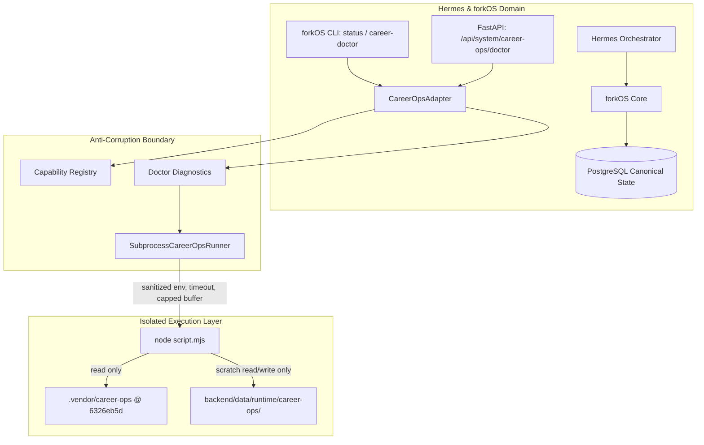

# forkOS × career-ops — C1: Integration Foundation, Version Pinning & Doctor Implementation Plan

> **For agentic workers:** REQUIRED SUB-SKILL: Use superpowers:subagent-driven-development to implement this plan task-by-task. Steps use checkbox (`- [ ]`) syntax for tracking.

**Goal:** Establish `career-ops` as a strictly version-pinned internal capability engine in forkOS with an anti-corruption adapter, isolated runner, capability registry, doctor diagnostics, and zero canonical state mutation.

**Architecture:** A dedicated integration layer at `backend/app/integrations/career_ops/` decouples forkOS from career-ops scripts. An asynchronous runner executes allowlisted Node scripts against a pinned `.vendor/career-ops` checkout using an isolated runtime workspace (`backend/data/runtime/career-ops/`), reporting diagnostic status and capabilities through forkOS CLI and read-only REST endpoints without creating or updating any canonical career database rows.

**Architecture Diagram:**



**Tech Stack:** Python 3.12/3.14, FastAPI, Pydantic v2, Typer, Rich, Node.js (>=22.5), pytest, asyncio.

**Spec:** [`docs/superpowers/specs/2026-09-25-career-ops-c1-design.md`](file:///Users/furkanturkoglu/Desktop/Projeler/forkOS/docs/superpowers/specs/2026-09-25-career-ops-c1-design.md)

## Global Constraints

- Pinned Upstream Repo: `career-ops-hq/career-ops`
- Pinned Package Version: `1.34.0`
- Pinned Commit SHA: `6326eb5d3804e8cb20d28acd5701a4e603a301f9`
- Canonical State Owner: `forkOS PostgreSQL` exclusively
- Zero canonical table writes in C1: `Opportunity`, `Application`, `Interview`, `CareerStory`, `CareerConnection`, `Document`, `Todo`, `Project`, `Learning`, `Obsidian` must remain untouched
- Fail closed: If career-ops is missing, disabled, or invalid, forkOS boots and operates normally
- No arbitrary shell commands: `shell=True` prohibited; allowlist of scripts strictly enforced
- Zero new Hermes product tools in C1: Existing 34 MCP tools retained unchanged

---

### Task 1: Version Pinning, Identity & Provisioning Script

**Files:**
- Create: `backend/app/integrations/career_ops/__init__.py`
- Create: `backend/app/integrations/career_ops/config.py`
- Create: `scripts/setup_career_ops.sh`
- Modify: `Makefile`
- Modify: `.gitignore`
- Test: `backend/tests/test_career_ops_identity.py`

**Interfaces:**
- Produces: `CAREER_OPS_UPSTREAM_REPO`, `CAREER_OPS_PINNED_VERSION`, `CAREER_OPS_PINNED_COMMIT`

- [ ] **Step 1: Write the failing test**

```python
# backend/tests/test_career_ops_identity.py
from app.integrations.career_ops.config import (
    CAREER_OPS_PINNED_COMMIT,
    CAREER_OPS_PINNED_VERSION,
    CAREER_OPS_UPSTREAM_REPO,
)


def test_career_ops_pinned_constants():
    assert CAREER_OPS_UPSTREAM_REPO == "career-ops-hq/career-ops"
    assert CAREER_OPS_PINNED_VERSION == "1.34.0"
    assert CAREER_OPS_PINNED_COMMIT == "6326eb5d3804e8cb20d28acd5701a4e603a301f9"
```

- [ ] **Step 2: Run test to verify it fails**

Run: `pytest backend/tests/test_career_ops_identity.py -v`
Expected: FAIL with ModuleNotFoundError: No module named 'app.integrations.career_ops'

- [ ] **Step 3: Write minimal implementation**

```python
# backend/app/integrations/career_ops/__init__.py
"""career-ops version-pinned capability engine integration boundary."""

from app.integrations.career_ops.config import (
    CAREER_OPS_PINNED_COMMIT,
    CAREER_OPS_PINNED_VERSION,
    CAREER_OPS_UPSTREAM_REPO,
)

__all__ = [
    "CAREER_OPS_PINNED_COMMIT",
    "CAREER_OPS_PINNED_VERSION",
    "CAREER_OPS_UPSTREAM_REPO",
]
```

```python
# backend/app/integrations/career_ops/config.py
"""Canonical constants and version pinning for career-ops integration."""

CAREER_OPS_UPSTREAM_REPO = "career-ops-hq/career-ops"
CAREER_OPS_PINNED_VERSION = "1.34.0"
CAREER_OPS_PINNED_COMMIT = "6326eb5d3804e8cb20d28acd5701a4e603a301f9"
```

Create `scripts/setup_career_ops.sh`:
```bash
#!/usr/bin/env bash
set -euo pipefail

REPO_ROOT="$(cd "$(dirname "${BASH_SOURCE[0]}")/.." && pwd)"
TARGET_DIR="${REPO_ROOT}/.vendor/career-ops"
PINNED_COMMIT="6326eb5d3804e8cb20d28acd5701a4e603a301f9"
PINNED_VERSION="1.34.0"
REPO_URL="https://github.com/career-ops-hq/career-ops.git"

echo "=== Setting up pinned career-ops engine (${PINNED_VERSION} @ ${PINNED_COMMIT:0:7}) ==="

if [ ! -d "${TARGET_DIR}/.git" ]; then
    echo "Cloning career-ops into ${TARGET_DIR}..."
    mkdir -p "$(dirname "${TARGET_DIR}")"
    git clone "${REPO_URL}" "${TARGET_DIR}"
fi

cd "${TARGET_DIR}"
echo "Checking out pinned commit ${PINNED_COMMIT}..."
git fetch origin "${PINNED_COMMIT}" --depth 1
git checkout "${PINNED_COMMIT}"

ACTUAL_COMMIT=$(git rev-parse HEAD)
if [ "${ACTUAL_COMMIT}" != "${PINNED_COMMIT}" ]; then
    echo "ERROR: Commit mismatch! Expected ${PINNED_COMMIT}, got ${ACTUAL_COMMIT}" >&2
    exit 1
fi

echo "Installing minimal Node.js runtime dependencies..."
npm install --ignore-scripts --no-audit

echo "Verifying package.json version..."
ACTUAL_VERSION=$(node -p "require('./package.json').version")
if [ "${ACTUAL_VERSION}" != "${PINNED_VERSION}" ]; then
    echo "ERROR: Version mismatch! Expected ${PINNED_VERSION}, got ${ACTUAL_VERSION}" >&2
    exit 1
fi

echo "=== career-ops setup complete: ${ACTUAL_VERSION} (${ACTUAL_COMMIT}) ==="
```
Make executable: `chmod +x scripts/setup_career_ops.sh`.

Add to `.gitignore`:
```text
.vendor/career-ops
backend/data/runtime/career-ops
```

Add to `Makefile`:
```makefile
career-ops-setup: ; ./scripts/setup_career_ops.sh
```

- [ ] **Step 4: Run test to verify it passes**

Run: `pytest backend/tests/test_career_ops_identity.py -v`
Expected: PASS

- [ ] **Step 5: Commit**

```bash
git add backend/app/integrations/career_ops backend/tests/test_career_ops_identity.py scripts/setup_career_ops.sh Makefile .gitignore
git commit -m "feat(career-ops): add version pinning and setup provisioning"
```

---

### Task 2: Typed Integration Models & Errors

**Files:**
- Create: `backend/app/integrations/career_ops/errors.py`
- Create: `backend/app/integrations/career_ops/models.py`
- Test: `backend/tests/test_career_ops_models.py`

**Interfaces:**
- Produces: `CareerOpsIdentity`, `CareerOpsDoctorResult`, `CareerOpsRuntimeStatus`, `CareerOpsStatusEnum`, `CareerOpsCapabilityStatus`, exception hierarchy (`CareerOpsError`, etc.)

- [ ] **Step 1: Write the failing test**

```python
# backend/tests/test_career_ops_models.py
from app.integrations.career_ops.errors import (
    CareerOpsConfigurationError,
    CareerOpsError,
    CareerOpsSecurityError,
    CareerOpsTimeoutError,
    CareerOpsUnavailableError,
    CareerOpsVersionMismatchError,
)
from app.integrations.career_ops.models import (
    CareerOpsDoctorResult,
    CareerOpsIdentity,
    CareerOpsRuntimeStatus,
    CareerOpsStatusEnum,
)


def test_models_and_errors():
    identity = CareerOpsIdentity(
        repository="career-ops-hq/career-ops",
        version="1.34.0",
        commit="6326eb5d3804e8cb20d28acd5701a4e603a301f9",
    )
    assert identity.version == "1.34.0"

    runtime = CareerOpsRuntimeStatus(
        node_version="26.9.0",
        node_compatible=True,
        installed=True,
    )
    assert runtime.node_compatible is True

    doc = CareerOpsDoctorResult(
        status=CareerOpsStatusEnum.READY,
        expected_identity=identity,
        actual_identity=identity,
        runtime=runtime,
        capabilities_declared=23,
        capabilities_available=0,
        canonical_state_owner="forkOS PostgreSQL",
    )
    assert doc.status == CareerOpsStatusEnum.READY

    assert issubclass(CareerOpsVersionMismatchError, CareerOpsError)
    assert issubclass(CareerOpsUnavailableError, CareerOpsError)
    assert issubclass(CareerOpsSecurityError, CareerOpsError)
    assert issubclass(CareerOpsTimeoutError, CareerOpsError)
    assert issubclass(CareerOpsConfigurationError, CareerOpsError)
```

- [ ] **Step 2: Run test to verify it fails**

Run: `pytest backend/tests/test_career_ops_models.py -v`
Expected: FAIL with ModuleNotFoundError: No module named 'app.integrations.career_ops.errors'

- [ ] **Step 3: Write minimal implementation**

```python
# backend/app/integrations/career_ops/errors.py
"""Typed exceptions for career-ops integration."""


class CareerOpsError(Exception):
    """Base error for career-ops integration."""


class CareerOpsConfigurationError(CareerOpsError):
    """Configuration missing or invalid."""


class CareerOpsUnavailableError(CareerOpsError):
    """Runtime, Node.js binary or checkout is not reachable."""


class CareerOpsVersionMismatchError(CareerOpsError):
    """Actual version or commit differs from expected pin."""


class CareerOpsTimeoutError(CareerOpsError):
    """Operation exceeded time limit."""


class CareerOpsExecutionError(CareerOpsError):
    """Subprocess failed or exited with non-zero code."""


class CareerOpsInvalidOutputError(CareerOpsError):
    """Output was malformed, truncated, or unparseable."""


class CareerOpsSecurityError(CareerOpsError):
    """Security invariant violated (e.g. non-allowlisted script)."""
```

```python
# backend/app/integrations/career_ops/models.py
"""Typed contracts and status models for career-ops integration."""

from enum import Enum
from pydantic import BaseModel, Field


class CareerOpsStatusEnum(str, Enum):
    READY = "ready"
    DISABLED = "disabled"
    UNAVAILABLE = "unavailable"
    VERSION_MISMATCH = "version_mismatch"
    MISCONFIGURED = "misconfigured"
    DEGRADED = "degraded"


class CapabilityStatus(str, Enum):
    SUPPORTED = "supported"
    UNAVAILABLE = "unavailable"
    DISABLED = "disabled"
    UNKNOWN = "unknown"


class CareerOpsIdentity(BaseModel):
    repository: str
    version: str
    commit: str


class CareerOpsRuntimeStatus(BaseModel):
    node_version: str | None = None
    node_compatible: bool = False
    installed: bool = False
    details: str | None = None


class CareerOpsCapability(BaseModel):
    id: str
    domain: str
    name: str
    description: str
    status: CapabilityStatus = CapabilityStatus.UNAVAILABLE


class CareerOpsDoctorResult(BaseModel):
    status: CareerOpsStatusEnum
    expected_identity: CareerOpsIdentity
    actual_identity: CareerOpsIdentity | None = None
    runtime: CareerOpsRuntimeStatus
    capabilities_declared: int = 0
    capabilities_available: int = 0
    canonical_state_owner: str = "forkOS PostgreSQL"
    warnings: list[str] = Field(default_factory=list)
    errors: list[str] = Field(default_factory=list)
```

- [ ] **Step 4: Run test to verify it passes**

Run: `pytest backend/tests/test_career_ops_models.py -v`
Expected: PASS

- [ ] **Step 5: Commit**

```bash
git add backend/app/integrations/career_ops/errors.py backend/app/integrations/career_ops/models.py backend/tests/test_career_ops_models.py
git commit -m "feat(career-ops): define typed error hierarchy and diagnostic models"
```

---

### Task 3: Settings & Configuration Integration

**Files:**
- Modify: `backend/app/config.py`
- Test: `backend/tests/test_career_ops_config.py`

**Interfaces:**
- Produces: `settings.career_ops_enabled`, `settings.resolved_career_ops_root`, `settings.resolved_career_ops_runtime_dir`, `settings.career_ops_timeout_seconds`, etc.

- [ ] **Step 1: Write the failing test**

```python
# backend/tests/test_career_ops_config.py
from app.config import Settings


def test_career_ops_config_defaults():
    cfg = Settings(
        career_ops_enabled=False,
        career_ops_root="",
        career_ops_node_bin="node",
        career_ops_timeout_seconds=30.0,
    )
    assert cfg.career_ops_enabled is False
    assert cfg.career_ops_node_bin == "node"
    assert cfg.career_ops_timeout_seconds == 30.0
    assert cfg.resolved_career_ops_root.name == "career-ops"
    assert "runtime/career-ops" in str(cfg.resolved_career_ops_runtime_dir)
```

- [ ] **Step 2: Run test to verify it fails**

Run: `pytest backend/tests/test_career_ops_config.py -v`
Expected: FAIL with AttributeError: 'Settings' object has no attribute 'career_ops_enabled'

- [ ] **Step 3: Write minimal implementation**

In `backend/app/config.py`, add:
```python
    # career-ops capability engine integration (C1)
    career_ops_enabled: bool = False
    career_ops_root: str = ""
    career_ops_node_bin: str = "node"
    career_ops_timeout_seconds: float = 30.0
    career_ops_max_buffer_bytes: int = 512 * 1024
    career_ops_runtime_dir: str = ""

    @property
    def resolved_career_ops_root(self) -> Path:
        if self.career_ops_root and self.career_ops_root.strip():
            return Path(self.career_ops_root.strip()).expanduser().resolve()
        # Default to repo_root/.vendor/career-ops
        repo_root = Path(__file__).resolve().parent.parent.parent
        return (repo_root / ".vendor" / "career-ops").resolve()

    @property
    def resolved_career_ops_runtime_dir(self) -> Path:
        if self.career_ops_runtime_dir and self.career_ops_runtime_dir.strip():
            return Path(self.career_ops_runtime_dir.strip()).expanduser().resolve()
        repo_root = Path(__file__).resolve().parent.parent.parent
        return (repo_root / "backend" / "data" / "runtime" / "career-ops").resolve()
```

- [ ] **Step 4: Run test to verify it passes**

Run: `pytest backend/tests/test_career_ops_config.py -v`
Expected: PASS

- [ ] **Step 5: Commit**

```bash
git add backend/app/config.py backend/tests/test_career_ops_config.py
git commit -m "feat(career-ops): add typed configuration and path resolvers to Settings"
```

---

### Task 4: Capability Registry

**Files:**
- Create: `backend/app/integrations/career_ops/capabilities.py`
- Test: `backend/tests/test_career_ops_capabilities.py`

**Interfaces:**
- Produces: `get_declared_capabilities()`, `get_capability_status(cap_id, enabled, runtime_ready)`

- [ ] **Step 1: Write the failing test**

```python
# backend/tests/test_career_ops_capabilities.py
from app.integrations.career_ops.capabilities import (
    ALL_CAPABILITIES,
    CapabilityStatus,
    get_capability_status,
    get_declared_capabilities,
)


def test_capability_registry():
    declared = get_declared_capabilities()
    assert len(declared) >= 20
    assert "discovery.scan" in [c.id for c in declared]
    assert "evaluation.deep" in [c.id for c in declared]
    assert "cv.tailor" in [c.id for c in declared]

    # When disabled
    status_disabled = get_capability_status("discovery.scan", enabled=False, runtime_ready=False)
    assert status_disabled == CapabilityStatus.DISABLED

    # When enabled but runtime unavailable
    status_unavail = get_capability_status("discovery.scan", enabled=True, runtime_ready=False)
    assert status_unavail == CapabilityStatus.UNAVAILABLE

    # In C1 domain capabilities are not yet implemented, so even if runtime ready they remain UNAVAILABLE
    status_ready = get_capability_status("discovery.scan", enabled=True, runtime_ready=True)
    assert status_ready == CapabilityStatus.UNAVAILABLE

    # Foundation doctor capability is supported when runtime is ready
    status_doc = get_capability_status("foundation.doctor", enabled=True, runtime_ready=True)
    assert status_doc == CapabilityStatus.SUPPORTED
```

- [ ] **Step 2: Run test to verify it fails**

Run: `pytest backend/tests/test_career_ops_capabilities.py -v`
Expected: FAIL with ModuleNotFoundError: No module named 'app.integrations.career_ops.capabilities'

- [ ] **Step 3: Write minimal implementation**

```python
# backend/app/integrations/career_ops/capabilities.py
"""Semantic capability registry for career-ops integration."""

from app.integrations.career_ops.models import CapabilityStatus, CareerOpsCapability

ALL_CAPABILITIES: tuple[CareerOpsCapability, ...] = (
    CareerOpsCapability(
        id="foundation.doctor",
        domain="foundation",
        name="Doctor & Diagnostic Probe",
        description="Verify engine identity, runtime readiness, and configuration.",
    ),
    CareerOpsCapability(
        id="discovery.scan",
        domain="discovery",
        name="Job Discovery Scan",
        description="Scan ATS APIs and RSS/JSON job portals without authentication.",
    ),
    CareerOpsCapability(
        id="discovery.reverse_ats",
        domain="discovery",
        name="Mass Reverse ATS Sweep",
        description="Discover unindexed openings across target ATS platforms.",
    ),
    CareerOpsCapability(
        id="discovery.liveness",
        domain="discovery",
        name="Posting Liveness Verification",
        description="Zero-token verification that job postings remain open.",
    ),
    CareerOpsCapability(
        id="job.extract",
        domain="job",
        name="Job Description Extraction",
        description="Extract structured posting content via browser / readability.",
    ),
    CareerOpsCapability(
        id="job.repost_analysis",
        domain="job",
        name="Repost Detection",
        description="Detect reposted and duplicate vacancies across boards.",
    ),
    CareerOpsCapability(
        id="job.legitimacy",
        domain="job",
        name="Posting Legitimacy & Risk Signals",
        description="Detect phantom jobs, agency scrapers, and high-risk signals.",
    ),
    CareerOpsCapability(
        id="evaluation.deep",
        domain="evaluation",
        name="Structured A-H Evaluation",
        description="Generate comprehensive multidimensional fit reports.",
    ),
    CareerOpsCapability(
        id="evaluation.requirements",
        domain="evaluation",
        name="Hard Requirement Extraction",
        description="Extract required skills, experience floor, and tech stack.",
    ),
    CareerOpsCapability(
        id="evaluation.compensation",
        domain="evaluation",
        name="Compensation Analysis",
        description="Extract and benchmark salary and equity offerings.",
    ),
    CareerOpsCapability(
        id="evaluation.work_authorization",
        domain="evaluation",
        name="Work Authorization & Visa Fit",
        description="Verify visa sponsorship and geographic eligibility.",
    ),
    CareerOpsCapability(
        id="cv.tailor",
        domain="cv",
        name="Targeted CV Tailoring",
        description="Tailor resume bullets to job requirements while preserving facts.",
    ),
    CareerOpsCapability(
        id="cv.verify_facts",
        domain="cv",
        name="CV Fact Checking",
        description="Ensure generated CV statements strictly match user career truth.",
    ),
    CareerOpsCapability(
        id="cv.render_pdf",
        domain="cv",
        name="PDF Rendering",
        description="Render pixel-perfect ATS-safe PDF documents.",
    ),
    CareerOpsCapability(
        id="cv.render_latex",
        domain="cv",
        name="LaTeX Compilation",
        description="Compile structured LaTeX CV templates into PDF.",
    ),
    CareerOpsCapability(
        id="cv.visual_validate",
        domain="cv",
        name="Visual Validation",
        description="Verify CV visual layout and pagination via Playwright.",
    ),
    CareerOpsCapability(
        id="application.cover_letter",
        domain="application",
        name="Cover Letter Generation",
        description="Generate contextual cover letters matched to company tone.",
    ),
    CareerOpsCapability(
        id="application.answers",
        domain="application",
        name="Application Question Answering",
        description="Synthesize answers for bespoke ATS application forms.",
    ),
    CareerOpsCapability(
        id="application.prefill",
        domain="application",
        name="Form Prefill Payload",
        description="Generate structured autofill payloads for job applications.",
    ),
    CareerOpsCapability(
        id="interview.prepare",
        domain="interview",
        name="Interview Preparation Brief",
        description="Synthesize company research and expected interview questions.",
    ),
    CareerOpsCapability(
        id="interview.practice",
        domain="interview",
        name="Mock Interview Simulation",
        description="Interactive technical and behavioral interview simulation.",
    ),
    CareerOpsCapability(
        id="interview.debrief",
        domain="interview",
        name="Post-Interview Debrief",
        description="Extract lessons, questions asked, and STAR updates after interview.",
    ),
    CareerOpsCapability(
        id="analytics.funnel",
        domain="analytics",
        name="Funnel Velocity Analysis",
        description="Measure conversion and velocity across application stages.",
    ),
    CareerOpsCapability(
        id="analytics.rejection_patterns",
        domain="analytics",
        name="Rejection Pattern Analysis",
        description="Identify systemic failure points in CV or interview loops.",
    ),
    CareerOpsCapability(
        id="analytics.skill_gap",
        domain="analytics",
        name="Skill Gap Analysis",
        description="Highlight missing requirements across target opportunity clusters.",
    ),
    CareerOpsCapability(
        id="analytics.calibration",
        domain="analytics",
        name="Market Calibration",
        description="Calibrate target compensation and seniority against market reality.",
    ),
)


def get_declared_capabilities() -> tuple[CareerOpsCapability, ...]:
    return ALL_CAPABILITIES


def get_capability_status(
    capability_id: str,
    enabled: bool,
    runtime_ready: bool,
) -> CapabilityStatus:
    if not enabled:
        return CapabilityStatus.DISABLED
    if not runtime_ready:
        return CapabilityStatus.UNAVAILABLE
    # In C1, only foundation doctor capability is currently active.
    # C2 introduces discovery, C3 evaluation, C4 application/interview, C5 generation.
    if capability_id == "foundation.doctor":
        return CapabilityStatus.SUPPORTED
    return CapabilityStatus.UNAVAILABLE
```

- [ ] **Step 4: Run test to verify it passes**

Run: `pytest backend/tests/test_career_ops_capabilities.py -v`
Expected: PASS

- [ ] **Step 5: Commit**

```bash
git add backend/app/integrations/career_ops/capabilities.py backend/tests/test_career_ops_capabilities.py
git commit -m "feat(career-ops): implement semantic capability registry"
```

---

### Task 5: Safe Runner Boundary & Workspace Isolation

**Files:**
- Create: `backend/app/integrations/career_ops/runner.py`
- Test: `backend/tests/test_career_ops_runner.py`

**Interfaces:**
- Produces: `CareerOpsRunner` (Protocol), `SubprocessCareerOpsRunner` with `run_script(script_name, args, timeout_seconds)`

- [ ] **Step 1: Write the failing test**

```python
# backend/tests/test_career_ops_runner.py
import pytest
from app.integrations.career_ops.errors import (
    CareerOpsSecurityError,
    CareerOpsTimeoutError,
)
from app.integrations.career_ops.runner import SubprocessCareerOpsRunner


@pytest.mark.asyncio
async def test_runner_security_rejects_unallowlisted(tmp_path):
    runner = SubprocessCareerOpsRunner(
        checkout_dir=tmp_path,
        runtime_dir=tmp_path / "runtime",
        node_bin="node",
    )
    with pytest.raises(CareerOpsSecurityError):
        await runner.run_script("malicious.mjs", [])


@pytest.mark.asyncio
async def test_runner_executes_allowlisted_script(tmp_path):
    # Create fake doctor.mjs in tmp checkout
    script_path = tmp_path / "doctor.mjs"
    script_path.write_text('console.log(JSON.stringify({ok: true}));\n')

    runner = SubprocessCareerOpsRunner(
        checkout_dir=tmp_path,
        runtime_dir=tmp_path / "runtime",
        node_bin="node",
    )
    result = await runner.run_script("doctor.mjs", ["--json"])
    assert result.exit_code == 0
    assert '"ok": true' in result.stdout
```

- [ ] **Step 2: Run test to verify it fails**

Run: `pytest backend/tests/test_career_ops_runner.py -v`
Expected: FAIL with ModuleNotFoundError: No module named 'app.integrations.career_ops.runner'

- [ ] **Step 3: Write minimal implementation**

```python
# backend/app/integrations/career_ops/runner.py
"""Subprocess execution boundary and workspace isolation for career-ops."""

from __future__ import annotations

import asyncio
import os
import shutil
from dataclasses import dataclass
from pathlib import Path
from typing import Protocol

from app.integrations.career_ops.errors import (
    CareerOpsExecutionError,
    CareerOpsInvalidOutputError,
    CareerOpsSecurityError,
    CareerOpsTimeoutError,
    CareerOpsUnavailableError,
)

ALLOWLISTED_SCRIPTS: frozenset[str] = frozenset({
    "doctor.mjs",
})


@dataclass(frozen=True)
class ExecutionResult:
    script_name: str
    exit_code: int
    stdout: str
    stderr: str


class CareerOpsRunner(Protocol):
    async def run_script(
        self,
        script_name: str,
        args: list[str],
        timeout_seconds: float | None = None,
    ) -> ExecutionResult:
        ...


class SubprocessCareerOpsRunner:
    def __init__(
        self,
        checkout_dir: Path,
        runtime_dir: Path,
        node_bin: str = "node",
        default_timeout_seconds: float = 30.0,
        max_buffer_bytes: int = 512 * 1024,
    ) -> None:
        self.checkout_dir = checkout_dir.resolve()
        self.runtime_dir = runtime_dir.resolve()
        self.node_bin = node_bin
        self.default_timeout_seconds = default_timeout_seconds
        self.max_buffer_bytes = max_buffer_bytes

    def _ensure_workspace(self) -> tuple[Path, Path, Path]:
        gen_in = self.runtime_dir / "generated-input"
        temp_out = self.runtime_dir / "temporary-output"
        cache = self.runtime_dir / "cache"
        gen_in.mkdir(parents=True, exist_ok=True)
        temp_out.mkdir(parents=True, exist_ok=True)
        cache.mkdir(parents=True, exist_ok=True)
        return gen_in, temp_out, cache

    def _build_env(self) -> dict[str, str]:
        # Clean environment: keep essential path variables, strip credentials
        safe_keys = {"PATH", "HOME", "USER", "TMPDIR", "LANG", "LC_ALL"}
        clean_env = {k: v for k, v in os.environ.items() if k in safe_keys}

        # Inject isolated workspace overrides
        clean_env["CAREER_OPS_ROOT"] = str(self.runtime_dir)
        clean_env["CAREER_OPS_DATA_DIR"] = str(self.runtime_dir)
        clean_env["CAREER_OPS_TRACKER"] = str(self.runtime_dir / "ephemeral-tracker.md")
        clean_env["NODE_ENV"] = "production"
        return clean_env

    async def run_script(
        self,
        script_name: str,
        args: list[str],
        timeout_seconds: float | None = None,
    ) -> ExecutionResult:
        if script_name not in ALLOWLISTED_SCRIPTS:
            raise CareerOpsSecurityError(f"Script '{script_name}' is not in allowlisted operations.")

        target_script = self.checkout_dir / script_name
        if not target_script.exists():
            raise CareerOpsUnavailableError(f"Script file '{target_script}' does not exist.")

        node_path = shutil.which(self.node_bin)
        if not node_path:
            raise CareerOpsUnavailableError(f"Node executable '{self.node_bin}' not found on PATH.")

        self._ensure_workspace()
        env = self._build_env()
        cmd = [node_path, str(target_script)] + list(args)

        timeout = timeout_seconds if timeout_seconds is not None else self.default_timeout_seconds

        try:
            proc = await asyncio.create_subprocess_exec(
                *cmd,
                stdout=asyncio.subprocess.PIPE,
                stderr=asyncio.subprocess.PIPE,
                cwd=str(self.checkout_dir),
                env=env,
            )

            try:
                stdout_data, stderr_data = await asyncio.wait_for(
                    proc.communicate(),
                    timeout=timeout,
                )
            except TimeoutError as exc:
                try:
                    proc.kill()
                    await proc.wait()
                except Exception:
                    pass
                raise CareerOpsTimeoutError(
                    f"Script '{script_name}' timed out after {timeout} seconds."
                ) from exc

        except OSError as exc:
            raise CareerOpsUnavailableError(f"Failed to spawn node process: {exc}") from exc

        if len(stdout_data) > self.max_buffer_bytes or len(stderr_data) > self.max_buffer_bytes:
            raise CareerOpsInvalidOutputError(
                f"Script '{script_name}' exceeded maximum output buffer ({self.max_buffer_bytes} bytes)."
            )

        stdout_str = stdout_data.decode("utf-8", errors="replace")
        stderr_str = stderr_data.decode("utf-8", errors="replace")

        return ExecutionResult(
            script_name=script_name,
            exit_code=proc.returncode if proc.returncode is not None else -1,
            stdout=stdout_str,
            stderr=stderr_str,
        )
```

- [ ] **Step 4: Run test to verify it passes**

Run: `pytest backend/tests/test_career_ops_runner.py -v`
Expected: PASS

- [ ] **Step 5: Commit**

```bash
git add backend/app/integrations/career_ops/runner.py backend/tests/test_career_ops_runner.py
git commit -m "feat(career-ops): implement safe subprocess runner and workspace isolation"
```

---

### Task 6: Doctor Diagnostic Engine & Adapter

**Files:**
- Create: `backend/app/integrations/career_ops/doctor.py`
- Create: `backend/app/integrations/career_ops/adapter.py`
- Test: `backend/tests/test_career_ops_doctor.py`

**Interfaces:**
- Produces: `CareerOpsDoctor`, `CareerOpsAdapter`, `diagnose()` returning `CareerOpsDoctorResult`

- [ ] **Step 1: Write the failing test**

```python
# backend/tests/test_career_ops_doctor.py
import pytest
from app.integrations.career_ops.adapter import CareerOpsAdapter
from app.integrations.career_ops.models import CareerOpsStatusEnum


@pytest.mark.asyncio
async def test_doctor_disabled_status():
    adapter = CareerOpsAdapter(enabled=False)
    report = await adapter.doctor()
    assert report.status == CareerOpsStatusEnum.DISABLED


@pytest.mark.asyncio
async def test_doctor_missing_checkout_status(tmp_path):
    adapter = CareerOpsAdapter(
        enabled=True,
        checkout_dir=tmp_path / "nonexistent",
        runtime_dir=tmp_path / "runtime",
    )
    report = await adapter.doctor()
    assert report.status == CareerOpsStatusEnum.UNAVAILABLE


@pytest.mark.asyncio
async def test_doctor_version_mismatch(tmp_path):
    pkg_json = tmp_path / "package.json"
    pkg_json.write_text('{"name": "career-ops", "version": "9.9.9"}')
    (tmp_path / "doctor.mjs").write_text('console.log("{}");')
    (tmp_path / "path-resolver.mjs").write_text('export {};')

    adapter = CareerOpsAdapter(
        enabled=True,
        checkout_dir=tmp_path,
        runtime_dir=tmp_path / "runtime",
    )
    report = await adapter.doctor()
    assert report.status == CareerOpsStatusEnum.VERSION_MISMATCH
```

- [ ] **Step 2: Run test to verify it fails**

Run: `pytest backend/tests/test_career_ops_doctor.py -v`
Expected: FAIL with ModuleNotFoundError: No module named 'app.integrations.career_ops.doctor'

- [ ] **Step 3: Write minimal implementation**

```python
# backend/app/integrations/career_ops/doctor.py
"""Comprehensive diagnostic surface for career-ops."""

from __future__ import annotations

import json
import re
import shutil
import subprocess
from pathlib import Path

from app.integrations.career_ops.capabilities import get_declared_capabilities
from app.integrations.career_ops.config import (
    CAREER_OPS_PINNED_COMMIT,
    CAREER_OPS_PINNED_VERSION,
    CAREER_OPS_UPSTREAM_REPO,
)
from app.integrations.career_ops.models import (
    CareerOpsDoctorResult,
    CareerOpsIdentity,
    CareerOpsRuntimeStatus,
    CareerOpsStatusEnum,
)
from app.integrations.career_ops.runner import CareerOpsRunner


class CareerOpsDoctor:
    def __init__(
        self,
        enabled: bool,
        checkout_dir: Path,
        runtime_dir: Path,
        runner: CareerOpsRunner,
        node_bin: str = "node",
    ) -> None:
        self.enabled = enabled
        self.checkout_dir = checkout_dir
        self.runtime_dir = runtime_dir
        self.runner = runner
        self.node_bin = node_bin

    def _expected_identity(self) -> CareerOpsIdentity:
        return CareerOpsIdentity(
            repository=CAREER_OPS_UPSTREAM_REPO,
            version=CAREER_OPS_PINNED_VERSION,
            commit=CAREER_OPS_PINNED_COMMIT,
        )

    def _check_node_runtime(self) -> CareerOpsRuntimeStatus:
        node_path = shutil.which(self.node_bin)
        if not node_path:
            return CareerOpsRuntimeStatus(
                node_version=None,
                node_compatible=False,
                installed=False,
                details=f"Node.js binary '{self.node_bin}' not found on PATH.",
            )

        try:
            out = subprocess.check_output([node_path, "--version"], text=True, timeout=5).strip()
            # Expect v26.x or v22.x
            m = re.match(r"^v(\d+)\.(\d+)\.", out)
            if not m:
                return CareerOpsRuntimeStatus(
                    node_version=out,
                    node_compatible=False,
                    installed=True,
                    details=f"Unrecognized Node.js version format: {out}",
                )
            major, minor = int(m.group(1)), int(m.group(2))
            compatible = major >= 18
            return CareerOpsRuntimeStatus(
                node_version=out.lstrip("v"),
                node_compatible=compatible,
                installed=True,
                details="Node runtime OK" if compatible else "Node >= 18 required",
            )
        except Exception as exc:
            return CareerOpsRuntimeStatus(
                node_version=None,
                node_compatible=False,
                installed=True,
                details=f"Failed to check Node version: {exc}",
            )

    async def run_diagnostics(self) -> CareerOpsDoctorResult:
        expected = self._expected_identity()
        runtime = self._check_node_runtime()
        declared = get_declared_capabilities()

        if not self.enabled:
            return CareerOpsDoctorResult(
                status=CareerOpsStatusEnum.DISABLED,
                expected_identity=expected,
                actual_identity=None,
                runtime=runtime,
                capabilities_declared=len(declared),
                capabilities_available=0,
                warnings=["career-ops capability engine is disabled in configuration."],
            )

        if not runtime.installed or not runtime.node_compatible:
            return CareerOpsDoctorResult(
                status=CareerOpsStatusEnum.UNAVAILABLE,
                expected_identity=expected,
                actual_identity=None,
                runtime=runtime,
                capabilities_declared=len(declared),
                capabilities_available=0,
                errors=[runtime.details or "Node runtime incompatible or missing"],
            )

        if not self.checkout_dir.exists() or not (self.checkout_dir / "package.json").exists():
            return CareerOpsDoctorResult(
                status=CareerOpsStatusEnum.UNAVAILABLE,
                expected_identity=expected,
                actual_identity=None,
                runtime=runtime,
                capabilities_declared=len(declared),
                capabilities_available=0,
                errors=[f"career-ops checkout missing at {self.checkout_dir}"],
            )

        # Inspect package.json version
        actual_version = ""
        try:
            pkg_data = json.loads((self.checkout_dir / "package.json").read_text("utf-8"))
            actual_version = pkg_data.get("version", "")
        except Exception as exc:
            return CareerOpsDoctorResult(
                status=CareerOpsStatusEnum.MISCONFIGURED,
                expected_identity=expected,
                actual_identity=None,
                runtime=runtime,
                capabilities_declared=len(declared),
                capabilities_available=0,
                errors=[f"Failed to read package.json: {exc}"],
            )

        # Inspect actual commit
        actual_commit = ""
        git_dir = self.checkout_dir / ".git"
        if git_dir.exists():
            try:
                actual_commit = subprocess.check_output(
                    ["git", "rev-parse", "HEAD"],
                    cwd=str(self.checkout_dir),
                    text=True,
                    timeout=5,
                ).strip()
            except Exception:
                actual_commit = "unknown"

        actual_identity = CareerOpsIdentity(
            repository=CAREER_OPS_UPSTREAM_REPO,
            version=actual_version,
            commit=actual_commit,
        )

        if actual_version != expected.version or (
            actual_commit and actual_commit != "unknown" and actual_commit != expected.commit
        ):
            return CareerOpsDoctorResult(
                status=CareerOpsStatusEnum.VERSION_MISMATCH,
                expected_identity=expected,
                actual_identity=actual_identity,
                runtime=runtime,
                capabilities_declared=len(declared),
                capabilities_available=0,
                errors=[
                    f"Version/commit mismatch! Expected {expected.version}@{expected.commit[:7]}, "
                    f"got {actual_version}@{actual_commit[:7]}"
                ],
            )

        # Verify core files
        core_files = ["doctor.mjs", "path-resolver.mjs"]
        missing_files = [f for f in core_files if not (self.checkout_dir / f).exists()]
        if missing_files:
            return CareerOpsDoctorResult(
                status=CareerOpsStatusEnum.MISCONFIGURED,
                expected_identity=expected,
                actual_identity=actual_identity,
                runtime=runtime,
                capabilities_declared=len(declared),
                capabilities_available=0,
                errors=[f"Required core files missing: {', '.join(missing_files)}"],
            )

        # Execute upstream doctor in isolated workspace
        warnings: list[str] = []
        try:
            exec_res = await self.runner.run_script(
                "doctor.mjs",
                ["--target", str(self.runtime_dir), "--json"],
                timeout_seconds=15.0,
            )
            if exec_res.exit_code != 0:
                warnings.append(f"doctor.mjs exited with code {exec_res.exit_code}")
            else:
                try:
                    payload = json.loads(exec_res.stdout)
                    upstream_warnings = payload.get("warnings", [])
                    if isinstance(upstream_warnings, list):
                        warnings.extend([str(w) for w in upstream_warnings])
                except Exception:
                    warnings.append("doctor.mjs stdout was not JSON parseable")
        except Exception as exc:
            return CareerOpsDoctorResult(
                status=CareerOpsStatusEnum.DEGRADED,
                expected_identity=expected,
                actual_identity=actual_identity,
                runtime=runtime,
                capabilities_declared=len(declared),
                capabilities_available=1,
                warnings=[f"Engine doctor probe failed: {exc}"],
            )

        return CareerOpsDoctorResult(
            status=CareerOpsStatusEnum.READY,
            expected_identity=expected,
            actual_identity=actual_identity,
            runtime=runtime,
            capabilities_declared=len(declared),
            capabilities_available=1,  # foundation.doctor active
            warnings=warnings,
        )
```

```python
# backend/app/integrations/career_ops/adapter.py
"""Central Anti-Corruption Adapter for career-ops."""

from __future__ import annotations

from pathlib import Path

from app.config import settings
from app.integrations.career_ops.capabilities import (
    get_capability_status,
    get_declared_capabilities,
)
from app.integrations.career_ops.doctor import CareerOpsDoctor
from app.integrations.career_ops.models import (
    CareerOpsCapability,
    CareerOpsDoctorResult,
    CareerOpsStatusEnum,
)
from app.integrations.career_ops.runner import CareerOpsRunner, SubprocessCareerOpsRunner


class CareerOpsAdapter:
    def __init__(
        self,
        enabled: bool | None = None,
        checkout_dir: Path | None = None,
        runtime_dir: Path | None = None,
        node_bin: str | None = None,
        runner: CareerOpsRunner | None = None,
    ) -> None:
        self.enabled = enabled if enabled is not None else settings.career_ops_enabled
        self.checkout_dir = (
            checkout_dir.resolve()
            if checkout_dir is not None
            else settings.resolved_career_ops_root
        )
        self.runtime_dir = (
            runtime_dir.resolve()
            if runtime_dir is not None
            else settings.resolved_career_ops_runtime_dir
        )
        self.node_bin = node_bin if node_bin is not None else settings.career_ops_node_bin

        if runner is not None:
            self.runner = runner
        else:
            self.runner = SubprocessCareerOpsRunner(
                checkout_dir=self.checkout_dir,
                runtime_dir=self.runtime_dir,
                node_bin=self.node_bin,
                default_timeout_seconds=settings.career_ops_timeout_seconds,
                max_buffer_bytes=settings.career_ops_max_buffer_bytes,
            )

        self._doctor = CareerOpsDoctor(
            enabled=self.enabled,
            checkout_dir=self.checkout_dir,
            runtime_dir=self.runtime_dir,
            runner=self.runner,
            node_bin=self.node_bin,
        )

    async def doctor(self) -> CareerOpsDoctorResult:
        return await self._doctor.run_diagnostics()

    async def capabilities(self) -> list[CareerOpsCapability]:
        doc = await self.doctor()
        ready = doc.status == CareerOpsStatusEnum.READY
        return [
            CareerOpsCapability(
                id=c.id,
                domain=c.domain,
                name=c.name,
                description=c.description,
                status=get_capability_status(c.id, enabled=self.enabled, runtime_ready=ready),
            )
            for c in get_declared_capabilities()
        ]
```

- [ ] **Step 4: Run test to verify it passes**

Run: `pytest backend/tests/test_career_ops_doctor.py -v`
Expected: PASS

- [ ] **Step 5: Commit**

```bash
git add backend/app/integrations/career_ops/doctor.py backend/app/integrations/career_ops/adapter.py backend/tests/test_career_ops_doctor.py
git commit -m "feat(career-ops): implement doctor diagnostic engine and central adapter"
```

---

### Task 7: Diagnostics Integration (CLI & API Endpoint)

**Files:**
- Modify: `backend/app/cli.py` (add `career-doctor` and include in `status`)
- Modify: `backend/app/modules/system/router.py` (add `GET /api/system/career-ops/doctor`)
- Test: `backend/tests/test_career_ops_diagnostics.py`

**Interfaces:**
- Produces: CLI `python -m app.cli career-doctor`, CLI `status` career engine line, API `GET /api/system/career-ops/doctor`

- [ ] **Step 1: Write the failing test**

```python
# backend/tests/test_career_ops_diagnostics.py
import pytest
from httpx import ASGITransport, AsyncClient
from app.main import app


@pytest.mark.asyncio
async def test_api_career_ops_doctor_endpoint():
    async with AsyncClient(transport=ASGITransport(app=app), base_url="http://test") as client:
        resp = await client.get("/api/system/career-ops/doctor")
        assert resp.status_code == 200
        body = resp.json()
        assert "status" in body
        assert body["canonical_state_owner"] == "forkOS PostgreSQL"
        assert body["expected_identity"]["version"] == "1.34.0"
```

- [ ] **Step 2: Run test to verify it fails**

Run: `pytest backend/tests/test_career_ops_diagnostics.py -v`
Expected: FAIL with 404 Not Found

- [ ] **Step 3: Write minimal implementation**

In `backend/app/modules/system/router.py`, add:
```python
from app.integrations.career_ops.adapter import CareerOpsAdapter
from app.integrations.career_ops.models import CareerOpsDoctorResult


@router.get("/system/career-ops/doctor", response_model=CareerOpsDoctorResult)
async def career_ops_doctor() -> CareerOpsDoctorResult:
    """career-ops yetenek motoru tanı ve durum raporu (salt okunur)."""
    adapter = CareerOpsAdapter()
    return await adapter.doctor()
```

In `backend/app/cli.py`, add command `career-doctor` and update `status`:
```python
@app.command("career-doctor")
def career_doctor() -> None:
    """career-ops yetenek motoru tanı ve durum kontrolü."""
    from app.integrations.career_ops.adapter import CareerOpsAdapter
    import asyncio

    adapter = CareerOpsAdapter()
    result = asyncio.run(adapter.doctor())

    color = "green" if result.status == "ready" else "yellow" if result.status == "disabled" else "red"
    console.print(f"[{color}]career-ops durumu: {result.status.upper()}[/{color}]")
    console.print(f"Beklenen: {result.expected_identity.version} ({result.expected_identity.commit[:7]})")
    if result.actual_identity:
        console.print(f"Mevcut:   {result.actual_identity.version} ({result.actual_identity.commit[:7]})")
    console.print(f"Kanonik Durum Sahibi: [bold]{result.canonical_state_owner}[/bold]")
    console.print(f"Yetenekler: {result.capabilities_available}/{result.capabilities_declared} kullanılabilir")

    if result.warnings:
        console.print("[yellow]Uyarılar:[/yellow]")
        for w in result.warnings:
            console.print(f"  • {w}")
    if result.errors:
        console.print("[red]Hatalar:[/red]")
        for e in result.errors:
            console.print(f"  • {e}")
```

And in `status()` command in `backend/app/cli.py`, append the career engine line:
```python
    try:
        from app.integrations.career_ops.adapter import CareerOpsAdapter
        import asyncio
        cap_doc = asyncio.run(CareerOpsAdapter().doctor())
        c_color = "green" if cap_doc.status == "ready" else "dim" if cap_doc.status == "disabled" else "yellow"
        console.print(f"[{c_color}]Career Engine: career-ops {cap_doc.status}[/{c_color}]")
    except Exception:
        pass
```

- [ ] **Step 4: Run test to verify it passes**

Run: `pytest backend/tests/test_career_ops_diagnostics.py -v`
Expected: PASS

- [ ] **Step 5: Commit**

```bash
git add backend/app/modules/system/router.py backend/app/cli.py backend/tests/test_career_ops_diagnostics.py
git commit -m "feat(career-ops): expose doctor diagnostic via REST API and CLI"
```

---

### Task 8: Canonical State Invariant & Security Proof

**Files:**
- Create: `backend/tests/test_career_ops_safety.py`

**Interfaces:**
- Verifies that calling adapter doctor, runner, or diagnostics causes zero database writes or file changes to canonical state.

- [ ] **Step 1: Write the test**

```python
# backend/tests/test_career_ops_safety.py
import pytest
from app.integrations.career_ops.adapter import CareerOpsAdapter
from app.integrations.career_ops.capabilities import get_declared_capabilities
from app.integrations.career_ops.runner import SubprocessCareerOpsRunner
from app.integrations.career_ops.errors import CareerOpsSecurityError
from app.db import SessionLocal
from sqlalchemy import select, func
from app.modules.opportunity.models import (
    Opportunity,
    Application,
    Interview,
    CareerStory,
    CareerConnection,
)


@pytest.mark.asyncio
async def test_zero_canonical_mutation(tmp_path):
    async with SessionLocal() as session:
        counts_before = {
            "opportunity": await session.scalar(select(func.count(Opportunity.id))),
            "application": await session.scalar(select(func.count(Application.opportunity_id))),
            "interview": await session.scalar(select(func.count(Interview.id))),
            "story": await session.scalar(select(func.count(CareerStory.id))),
            "connection": await session.scalar(select(func.count(CareerConnection.id))),
        }

    adapter = CareerOpsAdapter(
        enabled=True,
        checkout_dir=tmp_path,
        runtime_dir=tmp_path / "runtime",
    )
    _ = await adapter.doctor()
    _ = await adapter.capabilities()

    async with SessionLocal() as session:
        counts_after = {
            "opportunity": await session.scalar(select(func.count(Opportunity.id))),
            "application": await session.scalar(select(func.count(Application.opportunity_id))),
            "interview": await session.scalar(select(func.count(Interview.id))),
            "story": await session.scalar(select(func.count(CareerStory.id))),
            "connection": await session.scalar(select(func.count(CareerConnection.id))),
        }

    assert counts_before == counts_after


def test_runner_security_rejections():
    runner = SubprocessCareerOpsRunner(
        checkout_dir=Path("/tmp"),
        runtime_dir=Path("/tmp/runtime"),
    )
    with pytest.raises(CareerOpsSecurityError):
        import asyncio
        asyncio.run(runner.run_script("scan.mjs", []))
```

- [ ] **Step 2: Run test to verify it passes**

Run: `pytest backend/tests/test_career_ops_safety.py -v`
Expected: PASS

- [ ] **Step 3: Commit**

```bash
git add backend/tests/test_career_ops_safety.py
git commit -m "test(career-ops): verify zero canonical state mutation invariant and security limits"
```

---

### Task 9: Real Pinned Runtime Provisioning & Live Smoke Validation

**Files:**
- Execute: `scripts/setup_career_ops.sh`
- Provision: `.vendor/career-ops` at `6326eb5d3804e8cb20d28acd5701a4e603a301f9`
- Test: `backend/tests/test_career_ops_live_smoke.py`

- [ ] **Step 1: Run provisioning script**

Run: `./scripts/setup_career_ops.sh`
Expected: Clones/checks out commit `6326eb5d3804e8cb20d28acd5701a4e603a301f9`, runs `npm install --ignore-scripts`, verifies version `1.34.0`.

- [ ] **Step 2: Write live smoke test**

```python
# backend/tests/test_career_ops_live_smoke.py
import pytest
from pathlib import Path
from app.integrations.career_ops.adapter import CareerOpsAdapter
from app.integrations.career_ops.models import CareerOpsStatusEnum


@pytest.mark.asyncio
async def test_live_pinned_career_ops_runtime():
    repo_root = Path(__file__).resolve().parent.parent.parent
    vendor_dir = repo_root / ".vendor" / "career-ops"

    if not vendor_dir.exists():
        pytest.skip(".vendor/career-ops not provisioned; run 'make career-ops-setup'")

    adapter = CareerOpsAdapter(
        enabled=True,
        checkout_dir=vendor_dir,
    )
    result = await adapter.doctor()
    assert result.status == CareerOpsStatusEnum.READY
    assert result.expected_identity.version == "1.34.0"
    assert result.actual_identity.version == "1.34.0"
    assert result.actual_identity.commit == "6326eb5d3804e8cb20d28acd5701a4e603a301f9"
    assert result.canonical_state_owner == "forkOS PostgreSQL"
```

- [ ] **Step 3: Run live smoke test**

Run: `pytest backend/tests/test_career_ops_live_smoke.py -v`
Expected: PASS

- [ ] **Step 4: Commit**

```bash
git add backend/tests/test_career_ops_live_smoke.py
git commit -m "test(career-ops): add live smoke test verifying real pinned runtime"
```

---

### Task 10: Documentation & Upgrade Runbook

**Files:**
- Create: `docs/integrations/career-ops.md`

- [ ] **Step 1: Write integration document**

Document:
- Purpose & boundary: `career-ops = capability engine`, `forkOS PostgreSQL = canonical career state`, `Hermes = orchestrator`, `Obsidian = durable human knowledge`.
- Pinned version & commit details (`1.34.0` @ `6326eb5d3804e8cb20d28acd5701a4e603a301f9`).
- Installation/runtime strategy rationale (Approach 1: Pinned Managed Checkout + Subprocess Runner Boundary).
- Configuration options.
- Capability registry & deferred capabilities for C2–C5.
- Doctor diagnostics & CLI commands.
- Security constraints & workspace isolation.
- Explicit non-goals.
- Upgrade procedure.

- [ ] **Step 2: Commit**

```bash
git add docs/integrations/career-ops.md
git commit -m "docs(career-ops): document C1 integration foundation and upgrade runbook"
```

---

### Task 11: Regression Suite & Verification Check

- [ ] **Step 1: Run complete backend test suite**

Run: `pytest backend/tests -v`
Expected: All tests pass.

- [ ] **Step 2: Run CLI doctor check**

Run: `backend/.venv/bin/python -m app.cli career-doctor`
Expected: Clean output with READY status when enabled and verified.

- [ ] **Step 3: Git diff and hygiene check**

Run: `git diff --check`
Run: `git status --short`
Ensure no untracked artifacts or test garbage remained.
