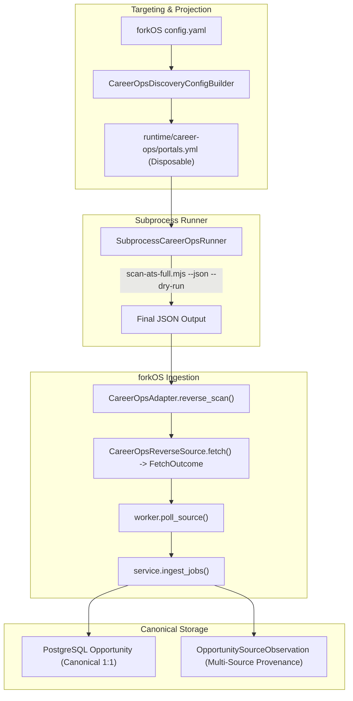

# Career-Ops C2: Discovery & Provider Fusion Implementation Plan

> **For agentic workers:** REQUIRED SUB-SKILL: Use superpowers:subagent-driven-development to implement this plan task-by-task. Steps use checkbox (`- [ ]`) syntax for tracking.

**Goal:** Integrate career-ops reverse-ATS discovery into forkOS as unified, slow-optin source adapters feeding canonical Opportunity ingestion without duplicate tracking or false closures.

**Architecture:** Project forkOS targeting preferences into disposable `portals.yml`; execute `scan-ats-full.mjs` via `CareerOpsAdapter` with `--json --dry-run`; map discovered offers into forkOS `RawItem`s through `CareerOpsReverseSource`; ingest via existing `ingest_jobs()` to maintain canonical deduplication, multi-source `OpportunitySourceObservation` tracking, and exempt career-ops sources from missing-sweep closures.

**Architecture Diagram:**

**Tech Stack:** Python 3.14, FastAPI, SQLAlchemy 2.0 (asyncpg), Pydantic v2, Node.js (v22+), Pytest.

**Spec:** [docs/superpowers/specs/2026-09-25-career-ops-c2-discovery-design.md](../specs/2026-09-25-career-ops-c2-discovery-design.md)

## Global Constraints
- Sole canonical database: forkOS PostgreSQL (`Opportunity`, `OpportunitySourceObservation`).
- career-ops tracker files (`pipeline.md`, `applications.md`, `scan-history.tsv`) are noncanonical and ignored (`--dry-run` is mandatory).
- Only `scan-ats-full.mjs` is added to runner allowlist; `scan.mjs` and arbitrary scripts remain blocked.
- Reverse ATS directory sweep sources must be classified as `SourceClass.SLOW_OPTIN`.
- `_sweep_missing()` must NEVER be run for `careerops:*` sources (No-False-Closure invariant).
- Zero LLM tokens in C2 discovery.

---

### Task 1: Targeting Projection (`CareerOpsDiscoveryConfigBuilder`)

**Files:**
- Create: `backend/app/integrations/career_ops/targeting.py`
- Test: `backend/tests/test_career_ops_targeting.py`

**Interfaces:**
- Produces: `CareerOpsDiscoveryConfigBuilder.build_portals_yaml(config_path: Path | None = None) -> str`
- Produces: `CareerOpsDiscoveryConfigBuilder.project_to_runtime(runtime_dir: Path, config_path: Path | None = None) -> Path`

- [ ] **Step 1: Write the failing test for targeting projection**
- [ ] **Step 2: Run test to verify failure**
- [ ] **Step 3: Implement `CareerOpsDiscoveryConfigBuilder`**
- [ ] **Step 4: Run test to verify it passes**
- [ ] **Step 5: Verify fail-closed behavior on empty positive keywords**

---

### Task 2: Runner Allowlist & Streaming Configuration for Discovery

**Files:**
- Modify: `backend/app/integrations/career_ops/runner.py`
- Modify: `backend/app/config.py`
- Modify: `.env.example`
- Test: `backend/tests/test_career_ops_runner.py`

**Interfaces:**
- `ALLOWED_SCRIPTS = frozenset({"doctor.mjs", "scan-ats-full.mjs"})`
- `Settings.CAREER_OPS_DISCOVERY_TIMEOUT_SECONDS: float = 300.0`
- `Settings.CAREER_OPS_DISCOVERY_MAX_BUFFER_BYTES: int = 4194304` (4MB)

- [ ] **Step 1: Write the test verifying `scan-ats-full.mjs` is allowed and unallowlisted remain blocked**
- [ ] **Step 2: Update `ALLOWED_SCRIPTS` and settings**
- [ ] **Step 3: Run runner tests to verify passing**

---

### Task 3: Discovery Typed Models & Adapter API

**Files:**
- Modify: `backend/app/integrations/career_ops/models.py`
- Modify: `backend/app/integrations/career_ops/adapter.py`
- Test: `backend/tests/test_career_ops_discovery_adapter.py`

**Interfaces:**
- `CareerOpsDiscoveredJob`: `company: str`, `title: str`, `url: str`, `location: str | None`, `posted_at: datetime | None`, `date_status: str`, `source: str`, `upstream_metadata: dict`
- `CareerOpsDiscoveryResult`: `provider: str`, `companies_available: int`, `companies_scanned: int`, `cap_hit: bool`, `stopped_by_outage: bool`, `dataset_status: Any`, `unreachable_boards: int`, `is_partial: bool`, `partial_detail: str`, `offers: list[CareerOpsDiscoveredJob]`
- `CareerOpsAdapter.reverse_scan(provider: str, since_days: int = 7, limit: int | None = 200, include_undated: bool = False) -> CareerOpsDiscoveryResult`

- [ ] **Step 1: Write unit tests with mock JSON fixtures for valid, partial, and degraded scans**
- [ ] **Step 2: Define models in `models.py`**
- [ ] **Step 3: Implement `reverse_scan` in `adapter.py` with argument bounds (provider in {greenhouse, lever, ashby, workday, icims, bamboohr}, 1 <= since_days <= 90, 1 <= limit <= 10000)**
- [ ] **Step 4: Run tests to verify passing**

---

### Task 4: Source Adapters (`CareerOpsReverseSource`)

**Files:**
- Create: `backend/app/sources/career_ops_sources.py`
- Modify: `backend/app/sources/catalog.py`
- Test: `backend/tests/test_career_ops_sources.py`

**Interfaces:**
- `CareerOpsReverseSource`: `id = f"careerops:{provider}"`, `source_class = SourceClass.SLOW_OPTIN.value`, `async def fetch() -> FetchOutcome`
- `get_career_ops_sources() -> list[CareerOpsReverseSource]`

- [ ] **Step 1: Write test for source adapter creation and fetch outcome mapping**
- [ ] **Step 2: Implement `CareerOpsReverseSource` mapping `CareerOpsDiscoveredJob` to `RawItem` without hallucinated fields**
- [ ] **Step 3: Register careerops sources in source catalog**
- [ ] **Step 4: Verify test passes**

---

### Task 5: No-False-Closure Invariant in Worker

**Files:**
- Modify: `backend/app/modules/opportunity/worker.py`
- Test: `backend/tests/test_career_ops_worker_safety.py`

**Interfaces:**
- Worker must check `not source.id.startswith("careerops:")` before calling `_sweep_missing()`

- [ ] **Step 1: Write test verifying that absent jobs from `careerops:*` source run do not trigger missing/closure sweep**
- [ ] **Step 2: Guard `_sweep_missing()` in `worker.py`**
- [ ] **Step 3: Run test to prove no-false-closure invariant**

---

### Task 6: Multi-Source Canonical Merge & Idempotency Integration Test

**Files:**
- Create: `backend/tests/test_career_ops_discovery_integration.py`

**Scenarios:**
- Case A: Seed job via forkjob -> ingest identical canonical URL via `careerops:greenhouse` -> Opportunity count = 1, observations count >= 2.
- Case B: Same careerops scan ingested twice -> idempotent.
- Case C: Same posting discovered by `careerops:greenhouse` and `careerops:lever` -> 1 Opportunity, 2 observations.
- Case D: Deleting runtime directory leaves PostgreSQL Opportunities intact.

- [ ] **Step 1: Write the integration tests against test PostgreSQL**
- [ ] **Step 2: Execute integration tests and verify PASS**

---

### Task 7: Capability Registry Activation & Diagnostic Inventory

**Files:**
- Modify: `backend/app/integrations/career_ops/capabilities.py`
- Test: `backend/tests/test_career_ops_capabilities.py`

**Interfaces:**
- `discovery.reverse_ats` -> `SUPPORTED`
- `discovery.scan` -> `UNAVAILABLE` (documented)
- `get_provider_capability_inventory() -> dict`

- [ ] **Step 1: Update capability registry**
- [ ] **Step 2: Implement provider capability inventory**
- [ ] **Step 3: Run capability tests**

---

### Task 8: Live Smoke Test with Pinned Engine

**Files:**
- Create: `backend/tests/test_career_ops_discovery_live.py`

- [ ] **Step 1: Write live smoke test calling `adapter.reverse_scan("greenhouse", since_days=3, limit=2)`**
- [ ] **Step 2: Verify live JSON parsing and clean execution with `.vendor/career-ops`**

---

### Task 9: Documentation, Verification, Commit & Push

**Files:**
- Modify: `docs/integrations/career-ops.md`

- [ ] **Step 1: Update documentation with C2 architecture and provider inventory**
- [ ] **Step 2: Run full regression test suite**
- [ ] **Step 3: Commit and push to `origin/main`**
