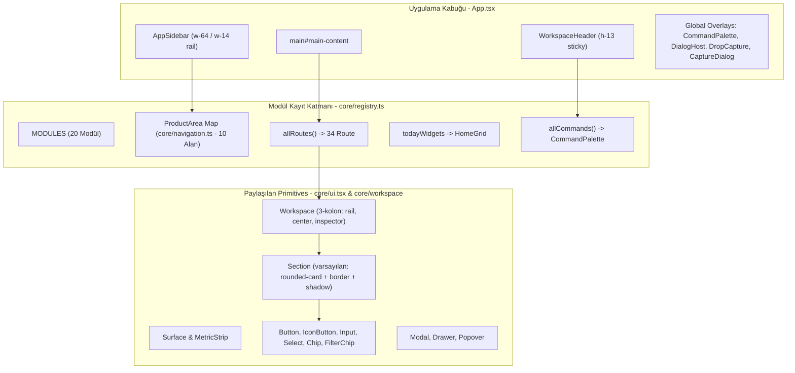

# forkOS — U0 Full UI/UX Inventory & Native-Readiness Audit

> **Status:** AUDIT COMPLETED  
> **Phase:** U0 (Observe → Map → Classify → Report)  
> **Next Phase:** U1 — Design Foundation v2  
> **Investigation Date:** 2026-09-22  
> **Methodology:** Static Code Audit (`CODE-CONFIRMED`), Build & Test Verifications (`CODE-CONFIRMED`), Architecture Inferences (`INFERRED`). Live Chromium visual testing was bypassed as headless Chrome was not in standard path (`npx playwright install chrome` required for live browser).

---

## 1. Executive Summary

forkOS tek kullanıcılı, yerel çalışan (local-only) ve gizlilik odaklı bir kişisel işletim sistemidir. Mimari ve altyapı olarak olağanüstü disiplinli bir temel üzerine oturmaktadır:
- **160 test dosyası ve 1.154 birim/entegrasyon testi %100 oranında geçmektedir.**
- Tasarım sistemi token kuralları (`designSystem.test.ts`) statik guardrail ile korunmakta; JSX içinde rastgele hex, keyfi pixel boyutları (`text-[Npx]`), ham `<input>` etiketleri ve palet dışı Tailwind sınıfları tamamen engellenmektedir.
- Modül ekosistemi gevşek bağlı (loosely coupled) `ModuleSpec` kayıt sistemiyle çalışmakta; rotalar, widget'lar ve komutlar merkezi dosyalara müdahale etmeden registry üzerinden türemektedir.
- Ana giriş chunk'ı 461 KB ile 500 KB bütçesinin altındadır.

**Buna rağmen forkOS neden bugün modern, sakin ve Linear/macOS kalitesinde bir "product-grade" ürün gibi hissettirmiyor?**

1. **"Kutu İçinde Kutu" (Box-in-Box) Sendromu ve Aşırı Kenarlık Yükü:**  
   forkOS'un en büyük görsel borcu geometrisindedir. Arayüzde **1.193 adet `border*`**, **452 adet `rounded*`** ve **369 adet `bg-surface*`** kullanımı mevcuttur. `<Workspace>` bileşeni kenarlık, köşe yuvarlatma ve gölge ile bir kart oluştururken; içine giren `<Section>` bileşenleri varsayılan olarak `!flat` (düz değil) gelmekte ve her biri kendi kenarlığı, başlık ayracı, köşe yarıçapı ve gölgesi olan ikinci bir kart üretmektedir. Bu kutuların içine giren girdi alanları, formlar ve satır listeleriyle birlikte arayüz 3-4 katmanlı bir "çerçeve tarlası"na dönüşmektedir.
2. **"Yapı Hissedilmeli, Çizilmemeli" İlkesinin İhlali:**  
   Linear ve macOS yerel arayüzlerinde görsel hiyerarşi kenarlıklarla değil; yüzey kontrastı (%1-2 ton farkı), negatif boşluk (whitespace), hizalama ve tipografik ağırlıkla kurulur. forkOS ise hemen her semantik alanı 1px `border-subtle` veya `border-strong` ile hapsetmektedir.
3. **Aşırı Küçük Büyük-Harf (Uppercase Micro-Label) Yoğunluğu:**  
   `label-caps` (`text-[10px] uppercase tracking-[0.16em]`) sınıfı arayüzde 38'den fazla yerde; bölüm başlıklarında, kart üstlerinde, filtrelerde ve butonlarda kullanılmaktadır. Bu durum arayüze sakin bir işletim sistemi havası değil, telemetri/uçuş paneli veya aşırı mühendislik kokan bir dashboard havası vermektedir.
4. **Denetçi (Inspector) Yerine Engelleyici Çekmece/Modal (Drawer/Modal Scrim) Kullanımı:**  
   Özellikle Fırsatlar (Kariyer) ekranında bir ilana tıklandığında, ekranın sağından açılan `<Drawer>` tüm arayüzün üstüne karartıcı perde (`--overlay-scrim`) sermektedir. Kullanıcı solundaki listeyle etkileşimi kaybeder, klavye akışı kesilir ve hızlı triyaj/tarama imkansızlaşır. Aynı şekilde Okuma Modu, Hızlı Yakalama ve Görev Düzenleme ekranları da tam sayfa veya modal perdelerle çalışmaktadır.
5. **Günün Ekranı (Today) Odak Çelişkisi:**  
   Today ekranı "Şu an ne yapmalıyım?" sorusuna yanıt veren sakin bir yürütme ekranı olmak yerine; 44px'lik saat, 4 günlük hava durumu tahmini, nem oranı ve 3 kolonlu yoğun veri akışıyla bir "sistemde hangi datalar var?" dashboard'una dönüşmüştür.

---

## 2. Current UI Architecture



### 2.1 Router ve Durum Katmanı
- **HashRouter (`src/app/router.ts`):** Sıfır bağımlılıklı, hafif, named `:param` destekli özel hash router (`useHashRoute`, `findRouteMatch`, `navigate`). URL hash değişimi `window.addEventListener("hashchange")` ile dinlenir. Tarayıcı geçmişi ve deep-link'ler kusursuz çalışır.
- **Sunucu Önbelleği (React Query):** `@tanstack/react-query` v5. Bütün mutasyonlar `core/invalidation.ts::invalidateAfter()` fonksiyonu üzerinden tetiklenir; dağınık `queryClient.invalidateQueries()` çağrıları engellenmiştir.
- **Çevrimdışı / PWA:** Vite PWA eklentisi ve Workbox ile GET sorguları için `NetworkFirst` (3 saniye tavan) stratejisi uygulanır. Ağ koptuğunda UI okuma moduna geçer ve uyarı bandı açılır.

---

## 3. Existing Strengths — KEEP

Bu bölüm, U1–U6 fazlarında kesinlikle korunması, bozulmaması gereken yüksek mühendislik kararlarını belgeler:

1. **Statik Tasarım Sistemi Guardrail'i (`core/designSystem.test.ts`):**  
   Vitest üzerinde koşan statik AST/regex tarayıcısı, `src/` altındaki kodlarda ham renk (`#hex`, `rgb`, `bg-blue-500`), keyfi tipografi (`text-[11px]`) ve ham form girdileri (`<input>`) yazılmasını engeller. Bu test U1 sonrasında da genişletilerek korunmalıdır.
2. **Merkezi Modül Kayıt Mimarisi (`core/registry.ts` & `core/navigation.ts`):**  
   Modüller doğrudan `App.tsx` içine import edilip harici rotalarla bağlanmaz. `registerModule()` ve `PRODUCT_AREAS` haritası temiz bir tersine kontrol (IoC) sunar.
3. **Sıfır Bağımlılıklı Hafif Sanallaştırıcı (`src/lib/useVirtual.ts`):**  
   Harici virtualization kütüphanelerine ihtiyaç duymadan 76 satırda yazılmış `useVirtualizer` hook'u. `RssPage` üzerinde kanıtlanmıştır ve diğer büyük listelere (Kariyer, Yer İmleri) yayılmaya hazırdır.
4. **Klavye Ergonomisi ve Odak Yönetimi Primitives (`core/ui.tsx`):**  
   `useDialogFocus` hook'u; modal ve çekmecelerde odağı tuzağa düşürür (trap focus), `Escape` ile kapatır ve açılış odağını tetikleyiciye iade eder. `:focus-visible` global CSS kuralı erişilebilir klavye kullanımını garanti eder.
5. **Giriş Chunk Bütçe Bekçisi (`scripts/check-bundle.mjs`):**  
   Uygulama giriş boyutunun 500 KB altında kalmasını zorunlu kılar (şu an 461 KB). Sayfa bazlı `React.lazy` yüklemesi sağlıklı çalışmaktadır.
6. **Süper-Hızlı Klavye Kısayolları (Vim/Superhuman):**  
   RSS okuma akışında `j/k/u/s/J`, Gelen Kutusu triyajında `1..6 / a/r/t/n/l/p / d`, Kart tekrarında `1..4` ve komut paletinde `Cmd+K` klavye etkileşimleri mükemmel düşünülmüştür.

---

## 4. Global Design Problems

### 4.1 Box-in-Box (Kutu İçinde Kutu) Sendromu
Arayüzde kart içine kart yerleştirme alışkanlığı en yüksek görsel borcu üretmektedir.

```text
[Viewport]
  └── PageFrame (max-w-[1600px] px-4 py-5)
      └── Workspace (rounded-card border border-subtle bg-surface shadow-card)
          ├── Aside Rail (border-r border-subtle bg-surface-sunken)
          │   └── WorkspaceRailGroup
          │       └── Button (rounded-control)
          └── Section Body (min-h-0 flex-col)
              ├── WorkspacePaneHeader (border-b border-subtle bg-surface)
              └── WorkspaceScrollArea
                  └── Section (rounded-card border border-subtle bg-surface shadow-card) [!]
                      ├── SectionHeader (border-b border-subtle) [!]
                      └── Field / Input (rounded-control border border-subtle bg-surface) [!]
```
Yukarıdaki hiyerarşide **4 seviye üst üste kenarlık, 3 seviye gölge ve 4 farklı zemin tonu** binmektedir. Bu durum kullanıcının dikkatini içeriğe değil, kutuların sınır çizgilerine yöneltmektedir.

### 4.2 Krom ve Kenarlık İstatistiği (`CODE-CONFIRMED`)
Yapılan tam kod taramasında elde edilen sayılar:
- `border*` sınıfı kullanımı: **1.193**
- `rounded*` sınıfı kullanımı: **452**
- `bg-surface*` sınıfı kullanımı: **369**
- `divide*` sınıfı kullanımı: **72**
- `shadow*` sınıfı kullanımı: **55**

En çok kenarlık yayan dosya açık ara **`core/ui.tsx` (139 kullanım)** ve `Workspace.tsx`'tir. Yani sorun ekran yazarlarından değil, **ortak bileşenlerin varsayılan olarak kutu ve kenarlık dayatmasından** kaynaklanmaktadır.

### 4.3 Tipografi Hiyerarşisi ve `label-caps` Yorgunluğu
- `label-caps` (`10px uppercase tracking-[0.16em]`): 38 kullanım.
- Normal metin (`body` 13.5px / 20px) ile başlıklar (`heading` 15px / 20px semibold) arasındaki görsel kontrast çok düşüktür (yalnızca 1.5px fark).
- `micro` (10px) metinler özellikle koyu temada kontrast kaybetmekte ve okunabilirlik sınırının altına inmektedir.
- Kod içinde kaldırıldığı belirtilen serif font paketi (`@fontsource-variable/newsreader`), `main.tsx` içinde hala import edilmekte ve dist klasörüne **106 KB'lık kullanılmayan font dosyası** basmaktadır.

### 4.4 Renk ve Zemin Çeşitliliği
CSS değişkenleri (`index.css`):
- `--canvas`, `--sidebar`, `--surface`, `--surface-sunken`, `--surface-hover`, `--surface-raised`, `--surface-selected` olmak üzere 7 farklı gri yüzey seviyesi vardır.
- Ayrıca `--heat-0..4` (5 seviye), `--feed-*` (4 marka), `--chart-1..8` (8 kategori), `--kind-*` (9 medya türü), `--src-*` (17 kaynak rengi) ile birlikte palette **50'den fazla renk tanımı** yaşamaktadır. Bu durum sakinliği öldürmektedir.

---

## 5. Design System Inventory

Aşağıdaki tablo repo içerisindeki tüm paylaşılan görsel ve kontrol bileşenlerinin envanteridir:

| Primitive | Dosya / Kaynak | Kullanıldığı Yerler | Mevcut Görsel Rol | Sorun / Borç | U1 Tavsiyesi |
|---|---|---|---|---|---|
| `Workspace` | `core/workspace/Workspace.tsx` | 14 ana ekran | 3 kolonlu çalışma alanı çerçevesi | Varsayılan olarak `rounded-card`, `border`, `shadow-card` taşıyor. İç bölmeler kutulanıyor. | **SIMPLIFY** (Kenarlıksız, düz zeminli, esnek pane sistemine dönüştürülmeli) |
| `WorkspacePaneHeader` | `core/workspace/Workspace.tsx` | Tüm Workspace sayfaları | Bölme üst başlığı, filtre alanı | Altındaki `border-b` çizgisi her sayfada yatay bölünme yaratıyor. | **SIMPLIFY** (Linear tarzı ince toolbar/başlık formatına indirgenmeli) |
| `Section` | `core/ui.tsx` | 35+ bileşen | İçerik gruplama kutusu | Varsayılanı `!flat`: Her yere otomatik `rounded-card border bg-surface shadow-card` basıyor. | **REDESIGN** (Varsayılanı `flat` olmalı, kutu istisna haline getirilmeli) |
| `Surface` | `core/ui.tsx` | Form ve paneller | Yükseltilmiş kutu | `Section` ile neredeyse aynı görsel stili üretiyor (`rounded-card border bg-surface`). | **CONSOLIDATE / REMOVE** (`Section` ile birleştirilmeli) |
| `MetricStrip` | `core/ui.tsx` | TodayHero, MediaStats | İstatistik kutuları şeridi | `divide-x` ve `border` ile ızgara kutuları çiziyor. | **SIMPLIFY** (Çizgisiz, yalnızca tipografik rakam ve etiket dizilimi) |
| `RowList` | `core/ui.tsx` | Liste görünümleri | `divide-y` ayrıcı listesi | Her satır arasına sert çizgi çekiyor; satır hover durumu zayıf. | **SIMPLIFY** (Hover ile beliren sakin satır etkileşimi, çizgisiz) |
| `SectionHeader` | `core/ui.tsx` | Form & liste üstü | `label-caps` + `h-px bg-subtle` çizgisi | Tam genişlikte 1px çizgi çekerek görsel gürültü ekliyor. | **SIMPLIFY** (Çizgisiz, boşlukla ayrılan sakin başlık) |
| `Button` | `core/ui.tsx` | Tüm sistem (200+) | Birincil, ikincil eylemler | `control` (34px) ve `sm` (28px). Buton stilleri tutarlı fakat görsel ağırlığı yüksek. | **KEEP** (Stiller U1 tokenlarına göre sadeleştirilecek) |
| `IconButton` | `core/ui.tsx` | Tüm sistem (100+) | İkonik butonlar (kapat, sil vb.) | Hover zeminleri sert; boyutları 32px kare. | **KEEP** (Piksel yerine sakin hover durumları) |
| `Input` / `Select` | `core/ui.tsx` | Tüm formlar | Tek satır metin ve seçim | 34px yükseklik, `border-subtle`, odak ringi mor/mavi accent. Gayet erişilebilir. | **KEEP** (Token uyumu korunacak) |
| `Field` | `core/ui.tsx` | Formlar | Etiket + input sarmalayıcısı | Etiket metinleri bazen küçük kalıyor (`text-meta`). | **KEEP** |
| `Chip` / `FilterChip` | `core/ui.tsx` | Filtreler, durum rozetleri | Durum rozetleri, seçilebilir etiketler | Renkli zemin varyantları çok fazla (`ok`, `warn`, `danger`, `accent`, `identity`). | **SIMPLIFY** (Tonlar sakinleştirilmeli, metin kontrastı artırılmalı) |
| `Modal` | `core/ui.tsx` | 24 modal penceresi | Ortalanmış diyalog | `fixed inset-0 z-modal` karartıcı perde ile çalışıyor. Çok sık kullanılıyor. | **SIMPLIFY** (Kritik olmayanlar Inspector veya Inline alana taşınmalı) |
| `Drawer` | `core/ui.tsx` | `OpportunityDetail.tsx` | Sağdan kayan detay çekmecesi | Karartıcı perde arkadaki listeyi donduruyor. Tek kullanıcısı var. | **REDESIGN** (Kalıcı veya yan yana açılan Inspector'a dönüştürülmeli) |
| `Popover` | `core/ui.tsx` | 12 açılır menü | Dropdown, durum menüleri | Anchor konumu DOM koordinatına göre hesaplanıyor. | **KEEP** (Erişilebilir ve hafif) |
| `Empty` | `core/ui.tsx` | Tüm boş durumlar | Boş liste ve hata gösterimi | Gayet temiz, metin ve opsiyonel eylem butonu alıyor. | **KEEP** |
| `SkeletonRows` | `core/ui.tsx` | Yükleme durumları | Yükleme iskeleti | `animate-pulse` ile standart çizgiler çiziyor. | **KEEP** |
| `Kbd` | `core/ui.tsx` | Kısayol göstergeleri | Klavye tuşu kutucuğu | `rounded border bg-surface-sunken`. Sade ve amacına uygun. | **KEEP** |

---

## 6. Shell Audit

### 6.1 Kenar Çubuğu (`AppSidebar.tsx`)
- **Genişlik:** Geniş modda `248px` (`w-sidebar`), daraltılmış modda `56px` (`rail`).
- **Grup ve Hiyerarşi:** Kök alanlar (`home`, `plan`, `projects`, `career`, `learning`, `library`, `finance`, `activity`, `review`) ve sistem alanı (`system`).
- **Derinlik Yapısı:**
  - Kök alan (`depth: 0`, 36px satır, 16px ikon, text-body).
  - Modül satırı (`depth: 1`, 32px satır, 24px sol girinti, text-meta).
  - Alt rota (`depth: 2`, 28px satır, 40px sol girinti, text-meta).
- **Sorunlar:**
  - Sabitlenmiş görünümler (`pinnedViews`) ve alt alanlar açıldığında sidebar dikeyde çok uzamakta.
  - Sidebar daraltıldığında (56px) alt menülerin tooltip veya flyout menüsü yoktur; kullanıcı yalnızca kök ikonları görür, neye tıkladığını kestiremez.
  - "Tümünü daralt / Tümünü genişlet" butonu gereksiz bir krom satırı kaplamaktadır.
- **macOS Eşleşmesi:** Doğrudan `NSSplitViewItem` / SwiftUI `Sidebar` modeline uyar (`NATIVE-FRIENDLY`).

### 6.2 Üst Başlık ve Toolbar (`WorkspaceHeader.tsx`)
- **Yapı:** `sticky top-0 z-header h-workspace-header (52px)` border-b ile ayrılmış şerit.
- **İçerik:**
  1. Mobil hamburger menü butonu (md altında)
  2. Sidebar genişletme butonu (daraltılmışsa)
  3. Modül ikonu + Sayfa başlığı
  4. Durum LED'i (`StatusLed`)
  5. Kaynakları Yenile butonu (`RefreshCw` + animasyon)
  6. Yenileme Kapsamı popover butonu (`ChevronDown`)
  7. Genel Arama / Komut Paleti tetikleyicisi (`Ctrl K` kutusu)
  8. Aktif Odak (Pomodoro) göstergesi
  9. Bildirim Paneli (`NotificationPanel`)
  10. Tema değiştirme butonu (Güneş/Ay)
- **Sorun:** Header'ın sağ tarafında tam **7 adet bağımsız aksiyon butonu** yan yana dizilidir! Sayfa yerel eylemleriyle küresel eylemler yarışmaktadır.
- **macOS Eşleşmesi:** macOS yerel Pencere Araç Çubuğu (`NSToolbar`) karşılığıdır (`NATIVE-FRIENDLY`).

---

## 7. Full Screen Inventory (30 Sayfa / Rota)

Aşağıdaki tablo forkOS içerisindeki tüm ekranları eksiksiz listeler (`CODE-CONFIRMED`):

| # | Ekran Adı | Rota | Modül | Düzen Tipi | Ana Bileşenler | Veri Yoğunluğu | Native Portability | Öneri |
|---|---|---|---|---|---|---|---|---|
| 1 | **Today (Home)** | `/` | `today` | 3-Kolon Izgara | `TodayHero`, `PendingDecisions`, `TodayAgendaWidget`, `DeadlinesWidget`, `CareerWidget`, `FeedStreamWidget`, `HomeHeatmap` | Yüksek | **PORTABLE** | **REDESIGN** |
| 2 | **Görevler** | `/todos` | `todo` | Workspace (Rail + Liste + Inspector) | `TodoRow`, `TodoComposer`, `WorkspaceRail`, `RelatedPanel` | Orta | **NATIVE-FRIENDLY** | **SIMPLIFY** |
| 3 | **Haftalık Plan** | `/planner` | `todo` | Çoklu Kolon Pano | Günlük kolonlar, sürükle-bırak kartlar, görev kutusu | Yüksek | **PORTABLE** | **SIMPLIFY** |
| 4 | **Rutinler** | `/habits` | `todo` | Workspace (Filtreli Liste) | `TodoRow`, periyodik tekrar sayaçları | Orta | **PORTABLE** | **MERGE** (`/todos` içi sekme) |
| 5 | **Takvim** | `/calendar` | `calendar` | Workspace (Ay/Hafta Izgarası) | Ay/Hafta grid, etkinlik kartı, mini takvim | Yüksek | **NATIVE-FRIENDLY** | **SIMPLIFY** |
| 6 | **Odak (Pomodoro)** | `/pomodoro` | `pomodoro` | Merkez Sayaç + Izgara | Dairesel sayaç, seans geçmişi, bahçe görseli, etiketler | Düşük | **PORTABLE** | **SIMPLIFY** |
| 7 | **Projeler** | `/projects` | `projects` | Workspace (Rail + Yığılmış Bölümler) | Proje listesi, `GithubPanel`, `Milestones`, `ProjectTodos`, `ProjectActivityTimeline`, `ProjectKnowledgeNote` | Yüksek | **NATIVE-FRIENDLY** | **REDESIGN** (3-Kolona dönüştürülmeli) |
| 8 | **Kariyer (Fırsatlar)** | `/opportunities` | `opportunity` | Workspace (Sekmeler + Filtre + Infinite List) | Sekme barı, filtre popover'ları, `OpportunityCard`, `OpportunityKanban`, `OpportunityDetail` (`Drawer`) | Çok Yüksek | **NATIVE-FRIENDLY** | **REDESIGN** (List-Inspector modeli) |
| 9 | **Öğrenme** | `/learning` | `learning` | Workspace (Ağaç + Kartlar) | `TopicTree`, `ResourceList`, `CoursesView`, `ReviewPanel` | Yüksek | **PORTABLE** | **SIMPLIFY** |
| 10 | **Çalışma Ağacı** | `/study` | `learning` | Gizli Yönlendirme | `/learning` ile aynı sayfaya gider | - | **PORTABLE** | **MERGE** (Gereksiz rota kaldırılabilir) |
| 11 | **Kartlar (SRS)** | `/flashcard` | `flashcard` | Liste / Kart Oynatıcı | Deste listesi, `ReviewSession`, kart çevirme animasyonu | Orta | **PORTABLE** | **KEEP** |
| 12 | **Yer İmleri** | `/bookmarks` | `bookmarks` | Workspace (Rail + Grid/List + Inspector) | Koleksiyon rayı, etiket filtreleri, `BookmarkCard`, `BookmarkReaderModal` | Yüksek | **NATIVE-FRIENDLY** | **SIMPLIFY** |
| 13 | **RSS Okuyucu** | `/rss` | `rss` | Workspace (3 Bölmeli Okuyucu) | Feed listesi, sanallaştırılmış yazı listesi, makale okuma paneli | Çok Yüksek | **NATIVE-FRIENDLY** | **KEEP** (En iyi çalışan düzen) |
| 14 | **Okuma Akışı** | `/feed` | `rss` | Tekil Akış Listesi | Birleşik besleme akışı (RSS, Reddit, HN, GitHub) | Yüksek | **PORTABLE** | **MERGE** (`/rss` içine görünüm olarak) |
| 15 | **Medya Kütüphanesi** | `/media` | `media` | Workspace (Medya Rail + Poster Grid) | Tür listesi, durum filtreleri, poster kartları, arama diyaloğu | Yüksek | **NATIVE-FRIENDLY** | **SIMPLIFY** |
| 16 | **Medya Detayı** | `/media/:id` | `media` | Tam Sayfa Detay | Medya afişi, bölüm/birim listesi, ilerleme kaydı, incelemeler | Yüksek | **NATIVE-FRIENDLY** | **SIMPLIFY** (Inspector alternatifi) |
| 17 | **Medya Koleksiyonları**| `/media/collections`| `media` | Kart Izgarası | Özel koleksiyon kartları, oluşturma butonu | Orta | **PORTABLE** | **SIMPLIFY** |
| 18 | **Koleksiyon Detayı** | `/media/collections/:id`| `media` | Liste | Koleksiyona ait medya kayıtları | Orta | **PORTABLE** | **SIMPLIFY** |
| 19 | **Gelecek Medya** | `/media/upcoming` | `media` | Zaman Çizelgesi | Çıkış tarihi yaklaşan medya kayıtları | Orta | **PORTABLE** | **SIMPLIFY** |
| 20 | **Medya İstatistikleri** | `/media/stats` | `media` | İstatistik Paneli | Yıllık özetler, kategori grafikleri | Düşük | **PORTABLE** | **SIMPLIFY** |
| 21 | **Medya Çöpü** | `/media/trash` | `media` | Silinmiş Kayıtlar | Geri yükleme/kalıcı silme satırları | Düşük | **PORTABLE** | **SIMPLIFY** |
| 22 | **Bilgi (Obsidian Vault)**| `/notes` | `knowledge` | Durum Paneli | Vault köprüsü durumu, günlük not açma, Obsidian arama URI | Düşük | **PORTABLE** | **SIMPLIFY** |
| 23 | **Belgeler (Drive)** | `/documents` | `documents` | Workspace (Rail + Liste + Önizleme) | Drive belge listesi, kategori filtreleri, önizleme alanı | Orta | **NATIVE-FRIENDLY** | **SIMPLIFY** (Kariyer bağlamında) |
| 24 | **Finans** | `/finance` | `finance` | Workspace (Tabbed View) | Gelir/gider akışı, abonelikler listesi, aylık özet | Yüksek | **PORTABLE** | **SIMPLIFY** |
| 25 | **Etkinlik & Ritim** | `/activity` | `activity` | Isı Haritası + Trend | Yıllık GitHub tarzı ısı haritası, seri sayaçları, trend çizelgeleri | Yüksek | **PORTABLE** | **KEEP** |
| 26 | **Gün Detayı** | `/day` | `activity` | Kronolojik Akış | Belirli bir günün tüm append-only olay kütüğü | Orta | **PORTABLE** | **SIMPLIFY** |
| 27 | **Isı Haritası (Eski)** | `/activity/heatmap` | `activity` | Tam Sayfa Harita | `/activity` içinde zaten var; eski rota | Düşük | **PORTABLE** | **REMOVE** |
| 28 | **Haftalık Değerlendirme**| `/review/weekly` | `review` | Adım Adım Form | Tamamlananlar özeti, metrikler, açık uçlu değerlendirme soruları | Düşük | **PORTABLE** | **SIMPLIFY** |
| 29 | **Günlük Değerlendirme** | `/review/daily` | `review` | Kısa Form | Gün sonu puanlama ve notlar | Düşük | **PORTABLE** | **SIMPLIFY** |
| 30 | **Gelen Kutusu (Triyaj)** | `/inbox` | `inbox` | Kanban / Kart Kuyruğu | İşlenmemiş yer imleri ve notlar, sürükle-bırak taşıma hedefleri | Orta | **PORTABLE** | **SIMPLIFY** |
| 31 | **Ayarlar** | `/settings` | `settings` | Sekmeli Ayarlar | Modül aç/kapa, tema, entegrasyonlar, yedekleme | Orta | **NATIVE-FRIENDLY** | **SIMPLIFY** (macOS Settings formatı) |
| 32 | **Sağlık** | `/health` | `health` | Servis Durumu | DB, API, Disk, Bellek metrikleri ve loglar | Düşük | **PORTABLE** | **SIMPLIFY** |
| 33 | **Kaynaklar** | `/sources` | `sources` | Kaynak Çalışma Alanı | Scraper ve besleme koşu geçmişi, manuel tetikleme, loglar | Yüksek | **PORTABLE** | **SIMPLIFY** |
| 34 | **İstatistik Yönlendirme**| `/statistics` | `activity` | Redirect Rota | `/activity` sayfasına yönlendirir | - | - | **REMOVE** |

---

## 8. Deep Audits (Pilot Ekranlar)

### 8.1 Pilot 1: Today Screen Deep Audit
```text
SCREEN: Today (Home)
Purpose: Günlük komuta merkezi ve yürütme yüzeyi.
Primary user goal: "Bugün ne yapmalıyım, sıradaki işim ne, bekleyen bir karar var mı?"
Primary action: Sıradaki görevi tamamlamak veya odak seansını başlatmak.
Secondary actions: Okuma akışından makale açmak, takvim saatlerini görmek, son tarihleri incelemek.
Data density: Aşırı yüksek ve dengesiz.
Layout: Üstte TodayHero -> Bekleyen Kararlar bandı -> 3 Kolonlu HomeGrid.
Main primitives: TodayHero, Section, RowList, Chip, Button, Metric.
Cards/surfaces: Her widget (Agenda, Feed, Heatmap, Career, Deadlines) kendi Section kutusunda.
Tables/lists: AgendaLine listeleri, Feed listesi.
Inspector/modal use: Yok (tıklamalar ilgili modüllere yönlendirir).
Keyboard support: Zayıf (yalnizca genel Ctrl+K; widget'lar arasi klavye gezintisi yok).
Loading state: İskelet satırları (`SkeletonRows`).
Empty state: "Panel boş" genel uyarısı.
Error state: Banner uyarısı ("Kaynak durumu alınamadı").
Responsive behavior: lg altında 3 kolondan tek kolona düşer (DOM sırası korunur).
Visual noise: YÜKSEK. Saat + hava + metrikler + 5 farklı widget aynı anda parlıyor.
Performance concern: Hava durumu, saat sayacı ve akış sorgularının aynı anda render edilmesi.
Native portability: PORTABLE. macOS'ta "Today" view veya ana pencere split alanı.
Recommendation: REDESIGN (U3).
```

#### Today Dikkat Hiyerarşisi Teşhisi:
1. **Kullanıcı nerede olduğunu hemen anlıyor mu?** Evet, tarih ve saat çok belirgin.
2. **Şu anda en önemli şey belli mi?** **HAYIR.** 44px'lik saat, 30px'lik hava durumu ve sağdaki 4 metrik kutusu dikkatin %30'unu çalıyor. Orta kolondaki Reddit/HN okuma akışı, sol kolondaki görev listesiyle görsel olarak eşit ağırlıkta yarışıyor.
3. **Primary action belli mi?** Hayır; ekranda 10'dan fazla tıklanabilir aksiyon eşit kontrastta.
4. **Sonuç:** Today şu anda bir "ne yapmalıyım?" yürütme aracı değil, bir "bilgi panosu" (data dashboard). Linear/Sunsama modelinde saatin ve havanın küçültülüp, odak eyleminin en tepeye alınması şarttır.

---

### 8.2 Pilot 2: Projects Screen Deep Audit
```text
SCREEN: Projects
Purpose: Projelerin aşamalarını, görevlerini ve GitHub bağlantılarını yönetmek.
Primary user goal: Seçili projenin ilerlemesini görmek, sıradaki kilometre taşını ve issue'ları tamamlamak.
Primary action: Projeye bağlı görev eklemek veya kilometre taşı durumunu güncellemek.
Secondary actions: GitHub issue'su içe aktarmak, bağlantılı notu Obsidian'da açmak, projeyi silmek.
Data density: Yüksek.
Layout: 2 Bölmeli Workspace (Sol Rail: Proje listesi; Sağ Alan: Tek sütunda yığılmış 9 bölüm).
Main primitives: Workspace, WorkspacePaneHeader, Section, Field, Input, Select, MilestoneTimeline.
Cards/surfaces: 9 ADET KUTU ÜST ÜSTE YIĞILMIŞ DURUMDA:
  1. Proje bilgisi (Section kutusu)
  2. GithubPanel (Section kutusu)
  3. Milestones (Section kutusu)
  4. MilestoneTimeline (Section kutusu)
  5. ProjectTodos (Section kutusu)
  6. ProjectKnowledgeNote (Section kutusu)
  7. ProjectActivityTimeline (Section kutusu)
  8. ProjectJournalBridge (Section kutusu)
  9. RelatedPanel (Section kutusu)
Tables/lists: Görev listesi, kilometre taşları listesi.
Inspector/modal use: Modal yok, Inspector kullanılmıyor (her şey ortadaki scroll alanına basılmış).
Keyboard support: Yalnızca form alanları.
Loading state: SkeletonRows.
Empty state: "Henüz proje yok" Empty bileşeni.
Error state: Toast uyarısı.
Responsive behavior: lg altında sol ray tepeye çıkar (border-b), mobilde aşırı uzun kaydırma oluşur.
Visual noise: ÇOK YÜKSEK. 9 adet kenarlıklı kart alt alta sonsuz bir kuyu oluşturuyor.
Performance concern: 9 bölümün her birinin ayrı alt sorgular atması.
Native portability: NATIVE-FRIENDLY. Doğrudan macOS 3-kolon split view modeline oturur.
Recommendation: REDESIGN (U3).
```

#### Projects List → Workspace → Inspector Modeli İncelemesi:
Sorulan soru:
> *Projects doğal olarak list → workspace → inspector modeline dönüşebilir mi?*

**KESİNLİKLE EVET.** Şu anki 9 katmanlı dikey karmaşa tam olarak bu 3 sütunlu modele uymaktadır:
- **Sol Sütun (List Rail):** Proje listesi (aktif/beklemede/bitti durum noktaları, son aktivite zamanı, arama).
- **Orta Sütun (Primary Workspace):** Aktif iş alanı — Kilometre taşları (Milestones) + Proje Görevleri (Todos) + GitHub Issue/PR takibi.
- **Sağ Sütun (Inspector):** Proje Detayları & Bağlamı — Proje durumu ve repo bağlantısı, Obsidian Vault Bilgi Notu, Aktivite Zaman Çizelgesi, Günlük Köprüsü ve İlişkili Kayıtlar (`RelatedPanel`).

Bu dönüşüm yapıldığında sayfadaki 9 kutu dikey yığılmasından kurtulunur ve Linear kalitesinde ferah bir çalışma alanı doğar.

---

### 8.3 Pilot 3: Opportunities Screen Deep Audit
```text
SCREEN: Opportunities (Kariyer)
Purpose: İş fırsatlarını, resmi duyuruları ve iş başvurusu boru hattını (pipeline) yönetmek.
Primary user goal: Yeni fırsatları incelemek, puanına göre filtrelemek ve başvuru aşamalarını ilerletmek.
Primary action: İlan kartını incelemek, durumu değiştirmek (değerlendir, başvuruldu vb.).
Secondary actions: Süzgeçleri değiştirmek, görünüm (liste/grid/kanban) değiştirmek, CV/belge bağlamak.
Data density: Sistemin en yüksek veri yoğunluklu ekranı (Sayfa başı 60 kayıt, sonsuz kaydırma).
Layout: Workspace (Top Tabs -> Filter Bar -> Infinite Collection -> Modal Drawer).
Main primitives: Workspace, Tabs, OpportunityCard, OpportunityKanban, ScoreRangeControl, Drawer.
Cards/surfaces: Her ilan bir kart; kart içinde kaynak çipi, puan çipi, eşleşen etiketler, aksiyon butonları.
Tables/lists: Liste görünümü, kart ızgarası ve Kanban panosu.
Inspector/modal use: İlan tıklandığında ekranın sağına gelen engelleyici Drawer (arkayı karartır).
Keyboard support: Kanban ve liste üzerinde klavye gezintisi yok.
Loading state: Spinner ve fetchNextPage yükleme butonu.
Empty state: Filtreye göre dinamik Empty ekranı.
Error state: "Fırsatlar yüklenemedi" Empty + Yeniden dene butonu.
Responsive behavior: Mobilde filtreler popover'a girer; kanban yatay kayar.
Visual noise: AŞIRI YÜKSEK. Her kartta 5-6 farklı renkli çip, puan rozetleri ve aksiyon butonları yarışıyor.
Performance concern: 172.5 KB chunk boyutu (en büyük rota). Sanallaştırma (virtualization) yok; 200+ kart DOM'a basıldığında tarayıcı şişiyor.
Native portability: NATIVE-FRIENDLY (Tablo + Inspector modeli).
Recommendation: REDESIGN (U3).
```

#### Opportunities DOM ve Etkileşim Riskleri:
1. **Sanallaştırma Eksikliği:** 60'ar 60'ar sonsuz kaydırma ile yüklenen kartlar DOM'dan silinmemektedir. 150-200 kart yüklendiğinde DOM düğüm sayısı 5.000'i aşmaktadır.
2. **Çekmece (Drawer) Engelleyiciliği:** İlan tıklandığında açılan `<Drawer>` penceresi arka plana `bg-[color:var(--overlay-scrim)]` atarak kullanıcıyı listeden koparmaktadır. Kullanıcı arka arkaya 5 ilanı incelemek istese 5 kez çekmece açıp kapamak zorundadır.
3. **İki Katmanlı Sekme Karmaşası:** Sayfanın en üstünde 5 ana sekme (`jobs`, `applications`, `announcements`, `career`, `sources`), onun hemen altında ise görünüm değiştirici (`rows`, `grid`, `kanban`) bulunmaktadır.

---

## 9. Interaction & Command Audit

### 9.1 Komut Mimarisi (`CommandPalette.tsx` & `cmdk`)
- **Tetikleyici:** Global `Ctrl+K` / `Cmd+K` veya Header arama kutusu.
- **Kapsam:** Komutlar registry'deki `allCommands()` fonksiyonundan ve harici linklerden gelir.
- **Arama:** `/api/search` uç noktasına bağlanarak anlık varlık araması yapar (`useGlobalSearch`).
- **Girdi Alanı (`ask`):** Bazı komutlar parametre ister (örn: `todo.quick`, `knowledge.search`). Bu komutlar seçildiğinde palet girdi moduna geçer (`asking` durumu) ve form gibi çalışır.
- **Taşınabilirlik Puanı:** **NATIVE-FRIENDLY.** Raycast / macOS menü komutları mantığına birebir uyar.

### 9.2 Action Architecture (Eylem Modeli Analizi)
Şu anki kodda butonlar doğrudan React state'ine veya mutation callback'lerine bağlıdır:
```text
UI Button Click ──> patch.mutate({ status: "active" })
```
Gelecekteki taşınabilir model:
```text
Semantic Action / Command
├── id: "opportunity.archive"
├── label: "Arşivle"
├── shortcut: "E"
├── canExecute: (selection) => boolean
└── execute: (selection) => Promise<void>
```
Bugün `InboxFocusTriageModal` ve `RssPage` bu modele çok yakındır (klavye tuşu ile buton aynı mutation'ı çağırır). Ancak formlar ve detay sayfaları doğrudan inline state değiştirmektedir.

---

## 10. Modal / Inspector Audit

Tüm geçici yüzeylerin sınıflandırılması:

| Bileşen | Tip | Şu Anki Kullanım | Gelecek Kararı | Gerekçe |
|---|---|---|---|---|
| `OpportunityDetail` | `Drawer` (Scrim) | İlan ve duyuru detayı | **SHOULD BECOME INSPECTOR** | İlan listesini kapatmadan sağ sütunda yan yana incelenmeli. |
| `BookmarkReaderModal`| `Modal` (Tam ekran)| Okuma modu ve vurgulama | **SHOULD BECOME WORKSPACE** | Okuma modu bir pop-up değil, odaklanmış bir okuma çalışma alanı olmalıdır. |
| `InboxFocusTriageModal`| `Modal` | Tek tek gelen kutusu triyajı | **SHOULD REMAIN DIALOG** | Odaklanmış klavye triyajı için modal doğru geçici formattır. |
| `CaptureDialog` | `Modal` (Özel form)| Hızlı görev/not/link yakalama | **SHOULD REMAIN DIALOG** | Raycast "Quick Capture" formatı; modal kalmalı. |
| `DialogHost` | `AlertDialog` | Silme, onaylama diyalogları | **SHOULD REMAIN DIALOG** | Sistem onay pencereleri için modal zorunludur. |
| `HighlightDialog` | `Modal` | Medya alıntısı ekleme | **SHOULD BECOME INSPECTOR** | Detay sayfasında form alanı olarak açılmalı. |
| `JobhunterSettings` | `Modal` | YAML ayar düzenleyici | **SHOULD BECOME WORKSPACE** | Ayarlar sekmesinde tam sayfa form olmalı. |
| `EditCardDialog` | `Modal` | Flaşkart düzenleme | **SHOULD BECOME INSPECTOR** | Deste ekranında sağ panelde düzenlenebilir. |

---

## 11. Performance Audit

### 11.1 Pozitif Bulgular (KEEP)
- **Vite Kod Bölme:** 30 sayfa bileşeni `React.lazy` ile bölünmüştür; ilk yüklemede yalnızca Home ve kabuk iner.
- **Giriş Boyutu:** `index.js` boyutu 461 KB (sıkıştırılmış gzip: 139 KB).
- **React Query Önbelleği:** `staleTime` ve `refetchInterval` değerleri bilinçli ayarlanmıştır; döngüsel istek atılmaz.

### 11.2 Performans Borçları (U6 Adayları)
1. **`OpportunityPage` Chunk Boyutu:** Tek bir rota dosyası ve alt bileşenleri **172.5 KB** büyüklüğündedir. Bu dosya modüler parçalara bölünmelidir.
2. **Kariyer Ekranında DOM Şişmesi:** Sonsuz kaydırma ile yüklenen 100+ ilan kartı sanallaştırılmadığı için DOM düğüm sayısı 5.000'i aşmaktadır.
3. **Kullanılmayan Font Yükü:** `@fontsource-variable/newsreader` paketi dist içine 106 KB'lık woff2 font dosyaları basmaktadır (kullanılmıyor).

---

## 12. Accessibility & Responsive Audit

### 12.1 Erişilebilirlik (A11y)
- **Odak Yönetimi:** `:focus-visible` outline'ı belirgindir (`2px solid var(--accent)`).
- **ARIA Desteği:** Diyaloglarda `role="dialog"`, `aria-modal="true"`, `aria-label` etiketleri tamdır.
- **Klavye Erişimi:** Bütün form kontrolleri Tab tuşuyla gezilebilir.
- **Eksiklik:** Bazı ikon butonlarının (`IconButton`) `title` niteliği varken görünür metin etiketi yoktur; ekran okuyucular için `aria-label` daha sıkı uygulanmalıdır.

### 12.2 Duyarlılık (Responsive)
- Masaüstü varsayımı kuvvetlidir. Geniş monitörlerde (1440px+) sayfalar rahat nefes alırken; dar dizüstü ekranlarında (1024px - 1280px) 3 kolonlu ızgaralar sıkışmaktadır.
- Minimum kullanışlı pencere genişliği ~768px'tir. Bunun altında sidebar gizlenir ve hamburger menüye düşer.
- Sabit yükseklik varsayımı: `calc(100dvh - 5.75rem)` formülü pencere dikeyde küçüldüğünde içerik taşmalarına yol açabilmektedir.

---

## 13. Native macOS Readiness

| Web Modeli (Bugün) | macOS Yerel Karşılığı | Durum | Zorluk Derecesi |
|---|---|---|---|
| `AppSidebar` (w-64 / w-14) | `NavigationSplitView` Sidebar | **NATIVE-FRIENDLY** | Düşük |
| `Workspace` Rail + Content | `NavigationSplitView` Content | **NATIVE-FRIENDLY** | Düşük |
| `Workspace` Inspector | `NavigationSplitView` Inspector | **NATIVE-FRIENDLY** | Düşük |
| `WorkspaceHeader` | `.toolbar` / `NSToolbar` | **NATIVE-FRIENDLY** | Düşük |
| `CommandPalette` (`cmdk`) | Native Spotlight / Quick Panel | **NATIVE-FRIENDLY** | Orta |
| `DialogHost` (`confirmDialog`)| `NSAlert` | **NATIVE-FRIENDLY** | Düşük |
| `Modal` / `Drawer` | `.sheet` / Inspector | **PORTABLE** | Orta |
| Hash Router (`#/todos`) | App Navigation Router / Window Routing | **WEB-SPECIFIC DEBT**| Yeniden yazılmalı |
| ServiceWorker / Workbox PWA | Local SQLite / Core Data / Rust Runtime | **WEB-SPECIFIC DEBT**| Backend taşınması |
| Hover ile beliren butonlar | Context Menu / Toolbar Commands | **WEB-SPECIFIC DEBT**| Tasarım borcu |

---

## 14. Native Migration Risk Register

```text
RISK 1: URL Hash Routing Bağımlılığı
Pattern: location.hash tabanlı yönlendirme ve parametre çözümleme
Current implementation: src/app/router.ts, useHashRoute, findRouteMatch
Why web-specific: Masaüstü yerel uygulamalarda hash URL kavramı yoktur; görünüm hiyerarşisi State ve NavigationPath ile yönetilir.
Product-level concept: Belirli bir ekrana ve alt kayda doğrudan odaklanma (Deep Linking).
Future native equivalent: NavigationStack(path: $navPath) veya scene-based window management.
Urgency: P2 (Yeniden yazım sırasında ele alınır).

RISK 2: Engelleyici Çekmece (Overlay Drawer) Deseni
Pattern: İlan detaylarının tüm ekranı karartan sağ çekmecede açılması.
Current implementation: src/modules/opportunity/OpportunityDetail.tsx, core/ui.tsx Drawer
Why web-specific: Web'de z-index ve fixed div ile kolayca perde çekilir; ancak Mac kullanıcıları yan yana iki panele bakmaya alışkındır.
Product-level concept: Liste kaydının ayrıntı denetçisi (Inspector).
Future native equivalent: NavigationSplitView detail / inspector alanı.
Urgency: P1 (U2/U3 aşamasında web tarafında da Inspector'a çevrilmeli).

RISK 3: Hover Bağımlı Eylemler
Pattern: Yalnızca fare satırın üzerine geldiğinde beliren aksiyon ikonları.
Current implementation: TodoRow.tsx, Milestones.tsx, NotificationPanel.tsx
Why web-specific: Masaüstünde fare hover desteklense de keşfedilebilirlik düşüktür; menü çubuğu veya ikincil tıklama tercih edilir.
Product-level concept: Satır bazlı bağlamsal komutlar.
Future native equivalent: Context Menu (.contextMenu), swipe actions veya klavye kısayolu.
Urgency: P2 (U1/U2 tasarımında görünür veya menüye bağlı hale getirilmeli).
```

---

## 15. KEEP / SIMPLIFY / REDESIGN / REMOVE Matrix

### 15.1 KEEP (Kesinlikle Korunacaklar)
1. **Design System Guardrail (`core/designSystem.test.ts`):** Token disiplini korunacak.
2. **Modül Registry Sistemi (`core/registry.ts`):** Eklenti mimarisi bozulmayacak.
3. **Komut Paleti Altyapısı (`core/CommandPalette.tsx`):** `cmdk` entegrasyonu korunacak.
4. **Hafif Sanallaştırıcı (`src/lib/useVirtual.ts`):** Korunup yaygınlaştırılacak.
5. **Klavye Kısayolları:** RSS ve Triyaj sayfalarındaki Superhuman tuş ergonomisi korunacak.
6. **React Query İptal Sözleşmesi (`invalidateAfter`):** Değiştirilmeyecek.

### 15.2 SIMPLIFY (Sadeleştirilecekler)
1. **`WorkspaceHeader` Toolbarı:** Sağdaki 7 buton tek bir sakin kontrol grubuna indirgenecek.
2. **`Workspace` Geometrisi:** Dış kart kenarlıkları, derin gölgeler kaldırılacak; düz zemin ve temiz negatif boşluk gelecek.
3. **`Section` Bileşeni:** Varsayılan kutulama davranışı kaldırılacak.
4. **Filtre Barları:** Kariyer ve Yer İmleri sayfalarındaki karmaşık çip/popover yığınları sadeleştirilecek.
5. **Açık Renk Paleti:** 50'den fazla renk tokenı konsolide edilecek.

### 15.3 REDESIGN (Yeniden Tasarlanacaklar)
1. **Today Ekranı (U3 Pilotu):** Veri panosundan odaklı yürütme ekranına.
2. **Projeler Ekranı (U3 Pilotu):** 9 bölümlü dikey yığılmadan 3-kolonlu List-Workspace-Inspector modeline.
3. **Fırsatlar Ekranı (U3 Pilotu):** Sonsuz kaydırmalı karartıcı çekmeceden sanallaştırılmış liste + inspector modeline.

### 15.4 REMOVE / RETIRE (Emekliye Ayrılacaklar - U6)
1. **`@fontsource-variable/newsreader`:** Kullanılmayan 106 KB'lık font paketi kaldırılacak.
2. **`/activity/heatmap` ve `/statistics` Rotaları:** Ana ekrana yedirilmiş eski ölü rotalar temizlenecek.
3. **`Surface` Bileşeni:** `Section` ile mükerrer olan bu primitif birleştirilip silinecek.

---

## 16. U1 Inputs (Design Foundation v2)

U1 fazının doğrudan tüketmesi gereken teknik girdiler:
1. **Border Temizliği:** Token sisteminde `border-subtle` rengi görünürlüğü azaltılmalı (%5-8 opaklık seviyesine çekilmeli); varsayılan kenarlık kullanımı kısıtlanmalı.
2. **Yüzey Kontrastı (Surface Hierarchy):** Canvas (`#ffffff` / `#111113`) ile Surface (`#ffffff` / `#18181b`) arasındaki ayrım kenarlıkla değil, hafif zemin kontrastıyla (`#f7f7f8` / `#171719`) sağlanmalı.
3. **Tipografi Ölçeği:**
   - `label-caps` kullanımına sıkı sınır getirilmeli.
   - Başlık (`heading` 15px) ile gövde (`body` 13.5px) arasındaki ağırlık ve hiyerarşi belirginleştirilmeli.
4. **Radius Daraltması:** `control` (6px) ve `card` (8px) yerine Linear tarzı daha sakin 4px/6px ölçeği değerlendirilmeli.

---

## 17. U2 Inputs (Shell v2)

U2 fazının doğrudan tüketmesi gereken teknik girdiler:
1. **Kenar Çubuğu (Sidebar):**
   - Genişlik ve dolgu oranları sakinleştirilmeli.
   - 56px ray modundayken alt satırlara erişim için açılır (flyout) panel düşünülmeli.
2. **Başlık Çubuğu (Header):**
   - 7 adet bağımsız buton elenmeli; durum LED'i, yenileme ve arama tek bir kompakt araç çubuğuna bağlanmalı.
   - Sayfa başlığı sol üstte yerel macOS toolbar başlığı gibi konumlandırılmalı.
3. **Evrensel 3-Kolon Desteği:**
   - `Workspace` bileşeni yerel macOS `NavigationSplitView` geometrisine uyarlanmalı (Sol: Liste, Orta: Çalışma Alanı, Sağ: Denetçi).

---

## 18. U3 Inputs (Pilot Screens)

U3 fazında yeniden tasarlanacak üç pilot ekranın ihtiyaç listesi:
1. **Today:**
   - Dev saat ve hava durumu bloğu kompakt tek bir üst satıra çekilmeli.
   - Sol kolonda "Bugünün Planı", sağ kolonda "Sıradaki ve Bekleyen Kararlar" öne çıkmalı.
   - Okuma akışı ve emek haritası ikincil katmana veya isteğe bağlı görünüme kaydırılmalı.
2. **Projects:**
   - List → Workspace → Inspector bölünmesi uygulanmalı.
   - Ortada yalnızca Milestones + Todos yer almalı.
   - Sağ denetçide GitHub bağlantısı, Vault notu ve etkinlik kütüğü gösterilmeli.
3. **Opportunities:**
   - Drawer perdesi iptal edilip sağ Inspector sütununa taşınmalı.
   - `useVirtualizer` entegre edilerek DOM yükü hafifletilmeli.

---

## 19. U4 Inputs (Dogfood & UX Validation)

Dogfood sürecinde izlenecek sürtünme noktaları:
- **Tıklama Sayısı (Click Depth):** Bir görevi tamamlamak veya ilanı incelemek için gereken tıklama sayısı.
- **Klavye Benimsenmesi:** Komut paleti ve kısayolların fareye kıyasla kullanım oranı.
- **Görsel Yorgunluk (Visual Fatigue):** 1.193 kenarlık kaldırıldıktan sonra göz tarama hızındaki rahatlama.
- **Algılanan Hız:** Modal perdeler kalkıp yan panel denetçisine geçildiğinde ekranlar arası geçiş seriliği.

---

## 20. U5 Inputs (Full UI Migration)

Kalan 27 ekranın modüler göç dalgaları:
- **Dalga 1 (Hafif Listeler):** `bookmarks`, `todo`, `inbox` (Workspace ve Inspector adaptasyonu).
- **Dalga 2 (Medya & İçerik):** `media`, `rss`, `learning` (Kütüphane ve okuyucu yüzeyleri).
- **Dalga 3 (Yardımcı Araçlar):** `calendar`, `pomodoro`, `finance`, `activity` (Form ve sayaçlar).
- **Dalga 4 (Sistem):** `settings`, `health`, `sources` (macOS Settings penceresi formatı).

---

## 21. U6 Inputs (Performance & Cruft Sweep)

U6 fazı için temizlik backlog'u:
1. `@fontsource-variable/newsreader` bağımlılığını sil (106 KB font tasarrufu).
2. `scripts/check-dead-exports.mjs` tarafından raporlanan 3 ölü export'u temizle (`AgentContinuityStatus`, `AgentEpisodeStatus`, `AgentLifecycleStatus`).
3. Eski yönlendirme rotalarını (`/statistics`, `/activity/heatmap`) temizle.
4. `core/ui.tsx` içindeki kullanılmayan veya mükerrer varyantları ayıkla (`Surface`, `MetricStrip`).

---

## 22. Prioritized Findings

### Top 10 Structural Findings (P0 - Yapısal Borçlar)
1. **Kutu İçinde Kutu Geometrisi:** `Workspace` ve `Section` varsayılan olarak kart oluşturup kenarlık dayatıyor.
2. **Engelleyici Çekmece (Drawer):** Kariyer detay ekranı listeyi karartıcı perde ile donduruyor; Inspector sütunu kullanılmıyor.
3. **Yığılmış Proje Sayfası:** Projects ekranında 9 ayrı modül alt alta tek sütunda yığılmış; 3-kolon potansiyeli harcanıyor.
4. **Today Odak Çarpıklığı:** Today ekranı bir planlama/yürütme aracı değil, pasif veri panosu gibi davranıyor.
5. **Başlık Çubuğu Eylem Şişkinliği:** Header sağında 7 farklı küresel buton kalabalık yaratıyor.
6. **Sanallaştırma Eksikliği:** Kariyer ve Yer İmleri gibi yüzlerce kayıtlık listelerde DOM şişmesi yaşanıyor.
7. **Çift Yönlü Sekmeleme:** Kariyer sayfasında 5 ana sekmenin altında bir de 3'lü görünüm seçici bulunuyor.
8. **Mükerrer Primitives:** `Section`, `Surface` ve `WorkspacePaneHeader` benzer stilleri kopyalıyor.
9. **Kullanılmayan Font Paketi:** 106 KB'lık Newsreader fontu gereksiz bundle yükü üretiyor.
10. **Daraltılmış Sidebar Körlüğü:** 56px modunda alt menülerin uçan menüsü (flyout) bulunmuyor.

### Top 10 Visual Findings (P1 - Görsel Borçlar)
1. **1.193 Kenarlık:** Arayüzde aşırı 1px çizgi kalabalığı var.
2. **`label-caps` Enflasyonu:** 38 yerde 10px büyük harf kullanılması telemetri panosu hissi veriyor.
3. **Düşük Başlık/Gövde Kontrastı:** 15px başlık ile 13.5px gövde metni arasında yeterli görsel ayrım yok.
4. **Gölge Katmanlaşması:** Kart ve bindirme gölgeleri kenarlıklarla çakışarak kirli bir görüntü oluşturuyor.
5. **Aşırı Renk Skalası:** 50'den fazla semantik/marka rengi Today ekranında görsel gürültü yaratıyor.
6. **Sert Hover Durumları:** Buton ve satır hover geçişleri Linear yumuşaklığında değil.
7. **Bölüm Ayracı Çizgileri:** `SectionHeader` içindeki 1px tam genişlikli çizgiler arayüzü dilimliyor.
8. **Hava Durumu ve Saat İri Cüssesi:** Hero alanında 44px saat ve hava tahmini orantısız yer kaplıyor.
9. **Koyu Tema Zemin Seviyeleri:** `--surface` ile `--surface-sunken` arasındaki kontrast dar monitörde kayboluyor.
10. **Rozet/Çip Kalabalığı:** Bir ilan kartı üzerinde aynı anda 5 farklı tonda çip bulunabiliyor.

### Top 10 UX Findings (P1 - Etkileşim Borçları)
1. **İlan İncelemede Liste Kopukluğu:** Her detay açılışında arka planın kilitlenmesi hızlı taramayı engelliyor.
2. **Today'de Öncelik Belirsizliği:** Kullanıcı ekrana baktığında ilk nereye tıklayacağını kestiremiyor.
3. **Hover-Only Aksiyonlar:** Görev tamamlama ve silme ikonları yalnızca fareyle üzerine gelince beliriyor.
4. **Projede Sonsuz Kaydırma:** Bir projenin detayında en alttaki ilişkili kayıtlara ulaşmak için 8 ekran kaydırmak gerekiyor.
5. **Global Yakalama Kısayol Karmaşası:** `C` tuşu doğrudan flaşkart açıyor; genel yakalama için `openCapture` açık tuşa sahip değil.
6. **Kayıt Seçiminde Toplu Eylem:** Yer imlerinde toplu işlem barı alttan gelerek çalışma alanını sıkıştırıyor.
7. **Mobil Kaydırma Yorgunluğu:** 3 kolon tek kolona düştüğünde Today sayfası mobilde aşırı uzuyor.
8. **Bildirim Paneli Sıkışıklığı:** Popover içindeki bildirim listesi dar alanda zor okunuyor.
9. **Yenileme Durumu Belirsizliği:** Kaynak çekimi başladığında birden fazla yerde dönen ikonlar dikkat dağıtıyor.
10. **Arama - Komut Ayrımı:** Kullanıcı başlık çubuğundaki kutunun arama mı yoksa komut mu olduğunu deneyimlemeden anlayamıyor.

### Top Native-Readiness Risks
1. **Tarayıcı Hash Router Bağımlılığı:** Mac yerel sürümünde rota yerine state navigation mimarisine geçilmeli.
2. **Modal Scrim Bağımlılığı:** Drawer pencereleri Mac'te doğal olmayan yabancı web alışkanlığıdır.
3. **PWA / Workbox Önbelleği:** Yerel mimaride Rust tabanlı kalıcı SQLite motoruna dönüştürülmeli.
4. **Bağlamsal Menü Eksikliği:** Web sağ tıkı zayıf; macOS'ta sağ tık (`NSMenu`) birincil eylem keşif aracıdır.

---

## 23. Final Verdict

### S1: forkOS neden bugün modern/product-grade hissettirmiyor?
forkOS'un kod kalitesi, testleri ve mantıksal mimarisi birinci sınıftır. Ancak görsel dili **"yapıyı çizerek gösterme"** refleksiyle kurulmuştur. Neredeyse her veri öğesi 1px kenarlık, köşe yuvarlatması, gölge ve başlık çizgisi içeren bir kutu içine hapsedilmiştir. Bu durum modern Linear/Apple sakinliği yerine, 2020 dönemi dashboard şablonlarını andıran görsel bir gürültü ve kutu yorgunluğu üretmektedir.

### S2: Bunun ne kadarı shell kaynaklı?
**Yaklaşık %25'i.** Kenar çubuğu genel olarak sağlıklıdır; ancak başlık çubuğundaki 7 farklı butonun yarattığı kalabalık ve daraltılmış moddaki flyout eksikliği kabuk konforunu düşürmektedir.

### S3: Ne kadarı primitives kaynaklı?
**Yaklaşık %50'si (ASIL KAYNAK).** `Workspace`, `Section`, `Surface` ve `SectionHeader` bileşenlerinin varsayılan olarak kenarlık, kutu, gölge ve ayraç çizgisi dayatması, geliştiricilerin en basit ekranda bile farkında olmadan 3-4 katmanlı kutular üretmesine yol açmaktadır.

### S4: Ne kadarı ekran-specific?
**Yaklaşık %20'si.** Özellikle Today ekranındaki dev saat/hava durumu bloğu, Projeler ekranındaki 9 katmanlı dikey yığılma ve Fırsatlar ekranındaki engelleyici Drawer çekmecesi doğrudan ekran kurgusu hatalarıdır.

### S5: Ne kadarı sadece polish?
**Yaklaşık %5'i.** Tipografi ölçeğinin 1-2 piksel ayarlanması ve `label-caps` sıklığının azaltılması basit bir cila işidir; ancak yukarıdaki yapısal sorunlar cila ile çözülemez, mimari sadeleştirme gerektirir.

### S6: Hangi mevcut şeylere kesinlikle dokunmamalıyız?
- `core/designSystem.test.ts` token guardrail'ine dokunulmamalı.
- `registerModule()` ve `core/navigation.ts` modül mimarisi korunmalı.
- React Query + `invalidateAfter()` veri tazeleme sözleşmesi bozulmamalı.
- RSS, Triyaj ve Flaşkart ekranlarındaki klavye kısayol ergonomisi korunmalı.
- Sıfır bağımlılıklı `useVirtualizer` ve `check-bundle.mjs` bekçileri korunmalı.

### S7: Linear-first dönüşüm için en yüksek leverage değişiklikler hangileri?
1. **`<Section>` ve `<Workspace>` bileşenlerinden varsayılan kenarlık ve gölgelerin sökülmesi:** Sadece bu değişiklik arayüzdeki 1.193 kenarlığın en az 600'ünü bir gecede yok eder ve yapı birdenbire ferahlar.
2. **List → Workspace → Inspector modelinin standartlaştırılması:** Projeler ve Fırsatlar ekranlarında detayların çekmeceden çıkarılıp kalıcı sağ sütuna (denetçi) alınması.
3. **Today ekranının bilgi panosundan "günün yürütme odağı" haline getirilmesi.**

### S8: Future native macOS rewrite açısından bugün hangi tasarım kararları doğru/yanlış?
- **Doğru kararlar:** 3 sütunlu split view omurgası, `cmdk` komut paleti altyapısı, klavye kısayolu önceliği, local-first veri modeli.
- **Yanlış kararlar:** Ekranı karartan engelleyici Drawer perdeleri, hover'a gizlenmiş birincil aksiyonlar, sonsuz kaydırmada sanallaştırmasız DOM büyümesi.

---

> **U0 Faz Sonu Bildirimi:**  
> Bu rapor ile U0 aşaması (Envanter ve İnceleme) eksiksiz tamamlanmıştır. Repo üzerinde hiçbir ürün UI kodu değiştirilmemiş; tüm bulgular somut kod referansları ve istatistiklerle kayıt altına alınmıştır.  
> Bir sonraki aşama olan **U1 — Design Foundation v2** için zemin hazırdır.
